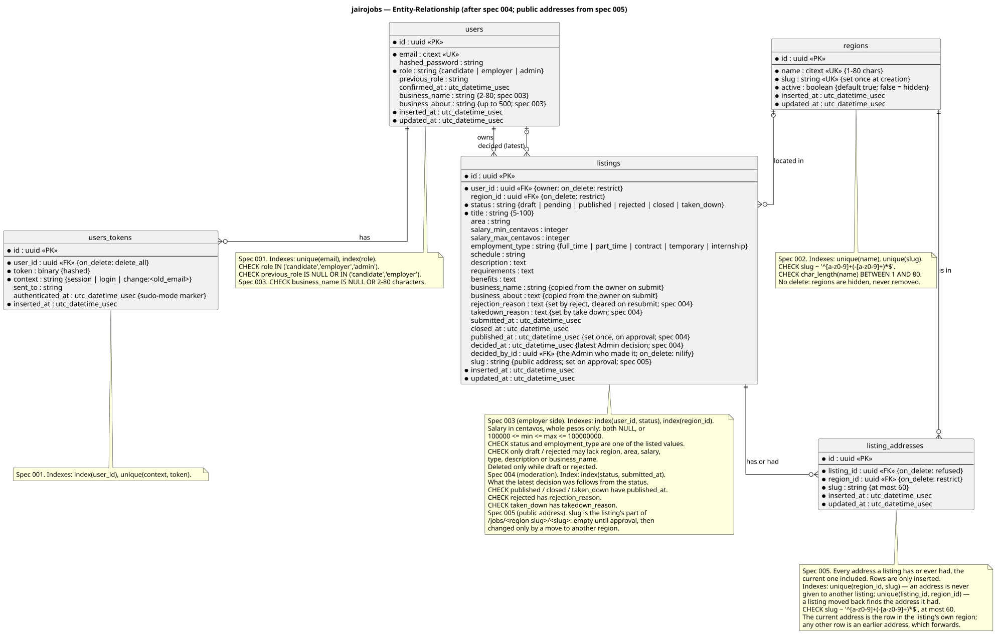

# Data Model

**Last updated:** 2026-11-26 (public addresses: `listings.slug` and `listing_addresses`, spec 005)

Living document. Update the ERD and table list when a spec adds or changes schemas.
The authoritative source is `priv/repo/migrations/` + the `Ecto.Schema` modules;
this page is the readable summary.

## Conventions

- Primary keys: UUID v7 (`:binary_id`), app-generated; all FKs `:binary_id` (ADR-0004)
- Public listing URLs are `/jobs/<region slug>/<listing slug>`: the region's slug plus a listing slug that is unique within the region. The UUID stays the primary key and appears only in private addresses (constitution §4.8, ADR-0004)
- Regions: unique slug set once at creation; hidden via `active = false`, never deleted
- Timestamps: `inserted_at` / `updated_at` (`utc_datetime_usec`)
- Soft deletes: not used unless a spec requires it
- Money: integer centavos in the database, whole pesos in code via `Jairojobs.Pesos` (constitution §4.5)
- Naming: snake_case, plural table names, singular schema modules

## ERD

*Source: `diagrams/src/erd-jairojobs.puml`. Status: matches the migrations through spec 005's first (public addresses).*

## Tables

| Table | Schema module | Context | Introduced by spec | Status |
|---|---|---|---|---|
| `users` | `Jairojobs.Accounts.User` | Accounts | 001 | Implemented |
| `users_tokens` | `Jairojobs.Accounts.UserToken` | Accounts | 001 | Implemented |
| `regions` | `Jairojobs.Regions.Region` | Regions | 002 | Implemented |
| `listings` | `Jairojobs.Listings.Listing` | Listings | 003, 004, 005 | Implemented (employer side 003, moderation 004, public slug 005) |
| `listing_addresses` | `Jairojobs.Listings.ListingAddress` | Listings | 005 | Implemented |

Spec 003 also added `business_name` and `business_about` to `users`.

Spec 004 added four columns to `listings` for the latest Admin decision: `published_at`
(set once, on approval; the "posted" date for spec 005), `decided_at`, `decided_by_id` and
`takedown_reason`. What the decision was is not stored; it follows from the status.

Spec 005 added `slug` to `listings` and the table `listing_addresses`. A listing gets its
slug when it is approved; with its region's slug that is its public address. Every address
a listing has or ever had is a row in `listing_addresses`, the current one included, and
rows are only inserted. So an address is never given to another listing
(`unique(region_id, slug)`), and a listing moved back to a region finds the address it had
there (`unique(listing_id, region_id)`). A listing with an address is never deleted.

Planned, not yet designed: `profiles` + CV files (006),
`applications` (007), `subscriptions` (011).
