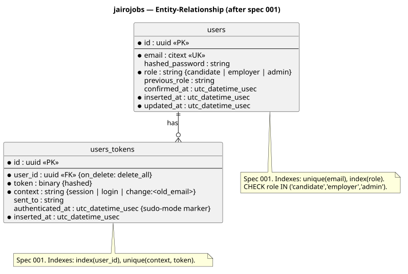

# Data Model

**Last updated:** 2026-10-30 (users / users_tokens planned by spec 001)

Living document. Update the ERD and table list when a spec adds or changes schemas.
The authoritative source is `priv/repo/migrations/` + the `Ecto.Schema` modules;
this page is the readable summary.

## Conventions

- Primary keys: UUID v7 (`:binary_id`), app-generated; all FKs `:binary_id` (ADR-0004)
- Public listing URLs: UUID + unique slug
- Timestamps: `inserted_at` / `updated_at` (`utc_datetime_usec`)
- Soft deletes: not used unless a spec requires it
- Naming: snake_case, plural table names, singular schema modules

## ERD

*Source: `diagrams/src/erd.puml`. Status: reflects spec 001's plan (not yet migrated).*

## Tables

| Table | Schema module | Context | Introduced by spec | Status |
|---|---|---|---|---|
| `users` | `Jairojobs.Accounts.User` | Accounts | 001 | Planned |
| `users_tokens` | `Jairojobs.Accounts.UserToken` | Accounts | 001 | Planned |

Planned, not yet designed: `regions` (002), `listings` (003), `profiles` + CV files (006),
`applications` (007), `subscriptions` (011).
