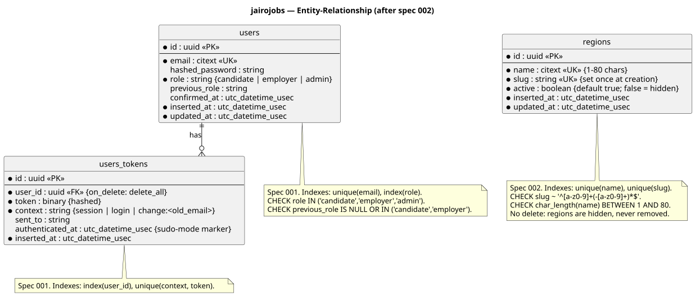

# Data Model

**Last updated:** 2026-11-11 (listings and business details implemented by spec 003)

Living document. Update the ERD and table list when a spec adds or changes schemas.
The authoritative source is `priv/repo/migrations/` + the `Ecto.Schema` modules;
this page is the readable summary.

## Conventions

- Primary keys: UUID v7 (`:binary_id`), app-generated; all FKs `:binary_id` (ADR-0004)
- Public listing URLs: UUID + unique slug
- Regions: unique slug set once at creation; hidden via `active = false`, never deleted
- Timestamps: `inserted_at` / `updated_at` (`utc_datetime_usec`)
- Soft deletes: not used unless a spec requires it
- Money: integer centavos in the database, whole pesos in code via `Jairojobs.Pesos` (constitution §4.5)
- Naming: snake_case, plural table names, singular schema modules

## ERD

*Source: `diagrams/src/erd-jairojobs.puml`. Status: matches the migrations through spec 003.*

## Tables

| Table | Schema module | Context | Introduced by spec | Status |
|---|---|---|---|---|
| `users` | `Jairojobs.Accounts.User` | Accounts | 001 | Implemented |
| `users_tokens` | `Jairojobs.Accounts.UserToken` | Accounts | 001 | Implemented |
| `regions` | `Jairojobs.Regions.Region` | Regions | 002 | Implemented |
| `listings` | `Jairojobs.Listings.Listing` | Listings | 003 | Implemented (employer side; moderation columns in 004, public slug in 005) |

Spec 003 also added `business_name` and `business_about` to `users`.

Planned, not yet designed: `profiles` + CV files (006),
`applications` (007), `subscriptions` (011).
