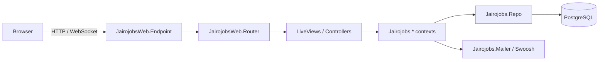

# Architecture Overview

**Last updated:** 2026-10-29 (bootstrap — no domain contexts yet)

Living document. Update when a spec adds or changes a context, boundary, or integration.

## Shape

Single Phoenix 1.8 application (`jairojobs`), server-rendered with LiveView, backed by
PostgreSQL, deployed as an Elixir release on Fly.io.

## Layers

| Layer | Namespace | Rule |
|---|---|---|
| Web | `JairojobsWeb.*` | Routing, LiveViews, controllers, components, layouts. No business logic, no direct `Repo` calls. |
| Domain | `Jairojobs.*` | Phoenix contexts: public API for each bounded area. Owns schemas, changesets, queries. |
| Infra | `Jairojobs.Repo`, `Jairojobs.Mailer` | Adapters to Postgres and email. |

## Contexts

<!-- One row per context as specs land. -->

| Context | Responsibility | Introduced by spec |
|---|---|---|
| _none yet_ | | |

## Cross-cutting

- **Auth:** _TBD_ (likely `mix phx.gen.auth` → `Jairojobs.Accounts` + scopes)
- **Background jobs:** _TBD_
- **Email:** Swoosh; local adapter in dev (`/dev/mailbox`)
- **Observability:** Phoenix LiveDashboard at `/dev/dashboard` (dev only)

## Request flow (typical LiveView page)

1. Router matches a `live` route inside a `live_session` (applies auth hooks).
2. `mount/3` loads data via a context function scoped to the current user.
3. Events → `handle_event/3` → context function → `{:noreply, socket}` with updated assigns.
4. PubSub broadcasts (if any) → `handle_info/2` → re-render.

## Deployment

See [ADR-0003](../decisions/0003-fly-io-deployment.md). `Dockerfile` + `fly.toml` to be
generated by `fly launch`.
