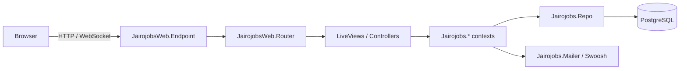
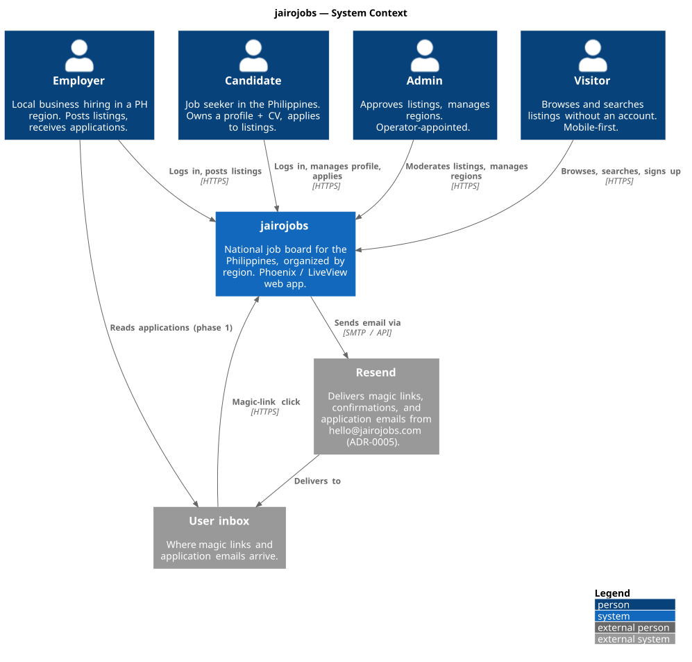
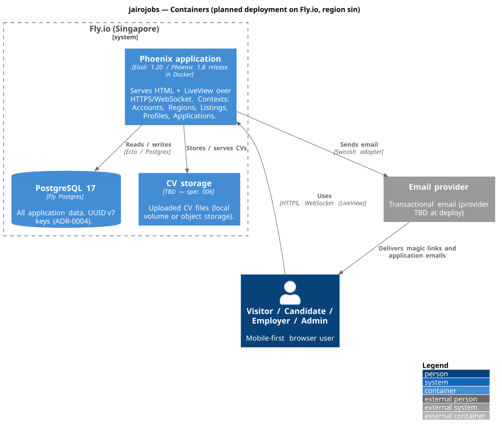
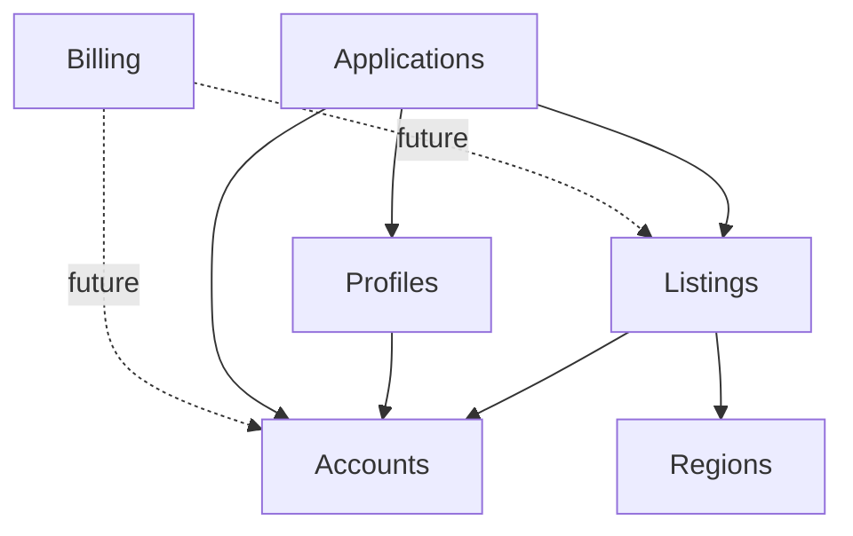

# Architecture Overview

**Last updated:** 2026-10-30 (C4 context + container views added; contexts planned, none implemented)

Living document. Update when a spec adds or changes a context, boundary, or integration.
Richer diagrams live in `diagrams/src/*.puml` (rendered to `diagrams/out/*.svg`; see `docs/README.md`).

## Shape

Single Phoenix 1.8 application (`jairojobs`), server-rendered with LiveView, backed by
PostgreSQL, deployed as an Elixir release on Fly.io.

## C4 views

**Level 1 — System context**

**Level 2 — Containers** (planned deployment; CV storage and email provider still TBD)

*Sources: `diagrams/src/c4-context-system.puml`, `diagrams/src/c4-container-system.puml`.*

## Layers

| Layer | Namespace | Rule |
|---|---|---|
| Web | `JairojobsWeb.*` | Routing, LiveViews, controllers, components, layouts. No business logic, no direct `Repo` calls. |
| Domain | `Jairojobs.*` | Phoenix contexts: public API for each bounded area. Owns schemas, changesets, queries. |
| Infra | `Jairojobs.Repo`, `Jairojobs.Mailer` | Adapters to Postgres and email. |

## Contexts

Names come from the glossary in [spec 000](../specs/000-product-overview/spec.md).
Status becomes *Implemented* when the introducing spec is Done.

| Context | Responsibility | Introduced by spec | Status |
|---|---|---|---|
| `Jairojobs.Accounts` | Users, authentication (password + magic link), roles (candidate / employer / admin), `Scope` | 001 | Planned |
| `Jairojobs.Regions` | Admin-managed list of PH regions/cities | 002 | Planned |
| `Jairojobs.Listings` | Employer job listings, lifecycle (draft → pending → published → closed), approval, slugs, salary range | 003, 004, 005 | Planned |
| `Jairojobs.Profiles` | Candidate profile + CV upload | 006 | Planned |
| `Jairojobs.Applications` | Candidate applies to listing; email delivery (phase 1), on-platform tracking (phase 2) | 007, 009 | Planned |
| `Jairojobs.Billing` | Employer subscriptions, free-tier limits | 011 | Future |
| `Jairojobs.Gigs` (name TBD) | Freelance gig marketplace | 012 | Future |

### Context dependencies

Arrows mean "depends on / references". Keep this acyclic.

## Cross-cutting

- **Auth:** `mix phx.gen.auth` (`Jairojobs.Accounts`) with the `Scope` pattern; email + password
  **and** magic link; roles `candidate` / `employer` / `admin`. Admin created via privileged
  mechanism only. Details in spec 001.
- **Authorization:** every context function touching private data takes the current `Scope`
  first (constitution §4.3).
- **Background jobs:** none. Evaluate Oban via ADR when a spec needs it (constitution §5).
- **Email:** Swoosh; local adapter in dev (`/dev/mailbox`). Production adapter TBD at deploy time.
- **File storage (CVs):** TBD in spec 006 (local disk vs object storage).
- **Observability:** Phoenix LiveDashboard at `/dev/dashboard` (dev only).

## Request flow (typical LiveView page)

1. Router matches a `live` route inside a `live_session` (applies auth hooks).
2. `mount/3` loads data via a context function scoped to the current user.
3. Events → `handle_event/3` → context function → `{:noreply, socket}` with updated assigns.
4. PubSub broadcasts (if any) → `handle_info/2` → re-render.

## Deployment

See [ADR-0003](../decisions/0003-fly-io-deployment.md). `Dockerfile` + `fly.toml` to be
generated by `fly launch`.
