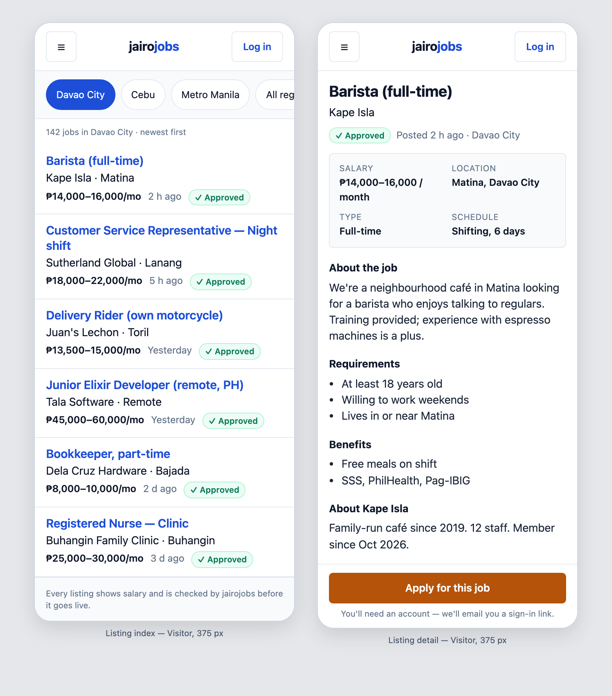

# Design Guide

**Status:** Accepted
**Last updated:** 2026-11-16 (seven internal contradictions resolved with the owner; see Changelog)
**Brief:** "A clean, trustworthy, modern craigslist.org."

The single reference for how jairojobs looks and feels. Agents and humans build every screen
from this document; no per-screen visual design. Layout is sketched per screen with Salt
wireframes (README diagram rule 6); visuals come from here.

Reference render (375 px, listing index + detail):



*Source: `design/mock-listing-375.html` (static HTML, same tokens). Open in a browser to inspect.*

## 1. Principles

1. **Text is the interface.** Listings are a list, not cards. No stock photos, no hero
   banners, no carousels. Content first, chrome last.
2. **Fast and light.** System font stack, no web fonts, minimal JS, no third-party embeds.
   A listing page must be readable on a mid-range Android over 4G in under 2 s.
3. **Nothing hidden.** Salary, region, posted date, employer name, and moderation status are
   always visible. No dark patterns, no fake urgency, no "salary negotiable."
4. **One accent colour, used once per screen** — for the primary action only (Apply, Post a
   job, Approve). Everything else is neutral or the primary blue, except colours that carry
   meaning: the status pills and messages (green, amber, red) and destructive buttons (red).
   Those are states and warnings, not competing calls to action.
5. **Craigslist density, thumb-friendly.** Compact rows (≈ 6 listings per phone screen) but
   every interactive element is at least 44 px tall: buttons, fields, rows and standalone
   links alike. The one exception is a link inside a sentence, which stays the height of
   its text.
6. **Plain language.** Microcopy says what will happen ("We'll email you a sign-in link"),
   never jargon ("Authenticate").
7. **Mobile first, desktop inherits.** Design and test at 375 px; wider screens get more
   margin, not more features. Max content width 720 px.

## 2. Tokens

| Token | Value | Tailwind | Use |
|---|---|---|---|
| Page background | `#ffffff` | `bg-base-100` | pages |
| Section background | `#f8fafc` | `bg-base-200` / slate-50 | filters bar, fact boxes, footers |
| Border | `#e2e8f0` | `border-base-300` / slate-200 | row dividers, inputs, boxes (facts box, status box) |
| Text | `#0f172a` | `text-base-content` / slate-900 | body |
| Muted text | `#64748b` | slate-500 | meta, hints, timestamps |
| **Primary** | `#1d4ed8` | `text-primary` / blue-700 | listing titles, links, selected chips, secondary buttons |
| **Accent (CTA)** | `#b45309` | `btn-accent` / amber-700 | the one primary action per screen |
| Success | `#047857` | emerald-700 | "✓ Approved" badge, "Live" pill |
| Warning | `#b45309` | amber-700 | pending states |
| Error | `#dc2626` | red-600 | validation, destructive |
| Info | `#2563eb` | blue-600 | confirmation messages (flash) |
| Font | system stack | default `font-sans` | everything; no web fonts |
| Base size | 16 px | `text-base` | body |
| Listing title | 17 px / 600 | `text-[17px] font-semibold` | index rows |
| Page title | 22 px / 700 | `text-[22px] font-bold` | detail pages |
| Section heading | 15 px / 700 | `text-[15px] font-bold` | headings inside a listing |
| Meta | 14 px | `text-sm` | salary, date, region |
| Fine print | 12 px | `text-xs` | hints, footers |
| Radius | 6 px | `rounded-md` | buttons, inputs, boxes |
| Pill radius | 999 px | `rounded-full` | chips, badges |
| Row padding | 12 px × 16 px | `py-3 px-4` | list rows |
| Tap target | ≥ 44 px | `min-h-11`; fields and buttons get it from the theme (§3) | every interactive element: buttons, fields, rows, standalone links. Not a link inside a sentence |
| Content width | 720 px | `max-w-[720px] mx-auto` | all pages |
| Theme | light only | — | dark deferred |
| Icons | Heroicons outline 20 px | `<.icon name="hero-…" class="size-5"/>` | stock only |

## 3. daisyUI theme

The tokens are encoded as the single daisyUI theme in `assets/css/app.css`. Replace the
generated `light` and `dark` theme blocks with this one (dark removed; `prefersdark: false`).

```css
@plugin "daisyui/packages/bundle/daisyui-theme" {
  name: "jairojobs";
  default: true;
  prefersdark: false;
  color-scheme: "light";
  --color-base-100: oklch(100% 0 0);            /* white */
  --color-base-200: oklch(98.4% 0.003 247.9);   /* slate-50  #f8fafc */
  --color-base-300: oklch(92.9% 0.013 255.5);   /* slate-200 #e2e8f0 */
  --color-base-content: oklch(20.8% 0.042 265.8); /* slate-900 #0f172a */
  --color-primary: oklch(48.8% 0.243 264.4);    /* blue-700  #1d4ed8 */
  --color-primary-content: oklch(100% 0 0);
  --color-secondary: oklch(55.4% 0.046 257.4);  /* slate-500 #64748b */
  --color-secondary-content: oklch(100% 0 0);
  --color-accent: oklch(55.5% 0.163 49.0);      /* amber-700 #b45309 */
  --color-accent-content: oklch(100% 0 0);
  --color-neutral: oklch(37.2% 0.044 257.3);    /* slate-700 */
  --color-neutral-content: oklch(100% 0 0);
  --color-info: oklch(54.6% 0.245 262.9);       /* blue-600 #2563eb */
  --color-info-content: oklch(100% 0 0);
  --color-success: oklch(50.8% 0.118 165.6);    /* emerald-700 #047857 */
  --color-success-content: oklch(100% 0 0);
  --color-warning: oklch(55.5% 0.163 49.0);     /* amber-700 */
  --color-warning-content: oklch(100% 0 0);
  --color-error: oklch(57.7% 0.245 27.3);       /* red-600 #dc2626 */
  --color-error-content: oklch(100% 0 0);
  --radius-selector: 0.375rem;
  --radius-field: 0.375rem;
  --radius-box: 0.375rem;
  --size-selector: 0.25rem;
  --size-field: 0.275rem;   /* × 10 = 2.75rem = 44 px: fields and buttons (principle 5) */
  --border: 1px;
  --depth: 0;
  --noise: 0;
}
```

`--size-field: 0.275rem` makes every field and button 44 px tall by default (daisyUI
multiplies it by ten), so principle 5 holds without adding a height to each component.
`--depth: 0` and `--noise: 0` keep surfaces flat (no fake 3D). Use `btn-accent` for the CTA,
`btn-primary` for secondary actions, `btn-ghost` with border for tertiary (e.g. "Log in").

## 4. Patterns

### Listing row (index)
Title (primary, 17 px semibold) → employer · area (16 px; plus the region when the list
mixes regions) → salary (bold) · relative date ·
"✓ Approved" badge (14 px meta line). Whole row is the link. 12 px vertical padding, 1 px
divider. No thumbnails.

### Listing detail
Title → employer → trust line (badge · posted · region) → **facts box** (2-col grid on
base-200: salary, location, type, schedule) → sections with 15 px bold headings → sticky
bottom CTA with one line of plain-language hint beneath it.

### Trust signals (always)
- Salary range in PHP on every row and detail page.
- "✓ Approved" badge on published listings (admin moderation).
- Posted date (relative under 7 days, absolute after) on every row, and the region: on
  every row, or once as the list's heading when the whole list is one region.
- Employer name always shown; no anonymous postings.
- Footer line on public lists: "Every listing shows salary and is checked by jairojobs before
  it goes live."

### Forms
Stock `<.input>` / `<.form>` from `core_components.ex`. Labels above fields, one column,
full-width on mobile, `type="email"` + `autocomplete` where relevant, inline errors in
`text-error`. Submit button is `btn-accent` only if it is the screen's primary action.

### Navigation
Per `specs/001-accounts-authentication/diagrams/wireframe-nav`: header with ☰, wordmark,
and one contextual button; drawer below `md`, inline links at `md+`.

### Status labels
A status is always written out in words inside a pill (`badge badge-sm rounded-full`); colour
only reinforces it (§6). One component renders them all:
`JairojobsWeb.ListingComponents.status_badge/1`. Do not invent new labels or colours per screen.

| Listing status | Label the owner sees | Pill |
|---|---|---|
| Draft | Draft | `badge-ghost` (neutral) |
| Pending approval | Waiting for approval | `badge-warning` (amber) |
| Published | Live | `badge-success` (emerald) |
| Rejected | Needs changes | `badge-error` (red) |
| Closed | Closed | `badge-ghost` (neutral) |
| Taken down | Taken down | `badge-ghost` (neutral) |

A hidden Region uses the same neutral pill with the word "hidden". The amber pill is a state,
not an action, so it does not count against "one accent CTA per screen" (principle 4).

On a page about one item (e.g. a listing's owner view) the pill sits in a **status box** at the
top — `bg-base-200`, bordered, 12 px padding: the pill, a short phrase ("— only you can see
this"), one plain sentence on what happens next, then only the actions that status allows.

### Empty / loading / error states
Plain sentences, no illustrations. Loading uses skeleton rows of the same height as listing
rows (no spinners for lists).

### Wordmark
`jairo` in text colour + `jobs` in primary, 18 px bold, `tracking-tight`. Placeholder until a
real logo exists; keep it text so it stays crisp and fast.

## 5. Do / Don't

| Do | Don't |
|---|---|
| Lists of rows with dividers | Card grids with shadows |
| One amber CTA per screen | Multiple competing coloured buttons |
| System fonts | Google Fonts / web fonts |
| Show the salary | "Competitive" / "Negotiable" / hidden salary |
| Relative dates ("2 h ago") | Raw timestamps |
| Short sentences in microcopy | Marketing adjectives |
| Heroicons outline | Emoji as icons, custom icon sets |
| Slate neutrals + blue + amber | Gradients, purple, brand-colour backgrounds |
| `--depth: 0` flat surfaces | Drop shadows, glassmorphism |
| Skeleton rows while loading | Spinners over empty space |

## 6. Accessibility

- Contrast ≥ 4.5:1 for text. Every colour token passes on white, both as text on a white
  page and as a background under white text (checked 2026-11-16; the lowest is muted text
  at 4.76).
- Focus rings visible (daisyUI default `focus-visible` outline in primary).
- Every interactive element reachable by keyboard; drawer traps focus while open.
- `aria-label` on icon-only buttons (☰ = "Open menu").
- Respect `prefers-reduced-motion`; transitions ≤ 150 ms and non-essential.

## 7. Relationship to other documents

- ADR-0001 — stock CoreComponents + daisyUI (this guide is the theme for them).
- Constitution §2.4 (mobile-first), §4.9 (components), §5 (no UI library).
- `AGENTS.md` — the generated line "manually write your own tailwind-based components instead
  of using daisyUI" is overridden by ADR-0001 and this guide: use daisyUI classes from the
  `jairojobs` theme and the stock `core_components.ex`.

## Changelog

Entries before 2026-11-16 are in the commit history.

| Date | Change |
|---|---|
| 2026-11-16 | Seven contradictions inside this guide resolved, each chosen by the owner. (1) Tap targets: principle 5 is the rule, every interactive element is at least 44 px, except a link inside a sentence; the tokens row says the same. (2) The theme's `--size-field` is `0.275rem`, so fields and buttons are 44 px by default (was `0.25rem`, 40 px). (3) Contrast: accent and warning are amber-700, success emerald-700, info blue-600 (were amber-600, emerald-600, blue-500, which failed 4.5:1 under white text); Info added to the tokens table. (4) Region is visible for every row, on the row or as the list's heading. (5) Principle 4 names status and destructive colours as exceptions. (6) "cards" → "boxes" in the Border row. (7) A 15 px section-heading token added; fine print is 12 px. Reference mock redrawn to match |
