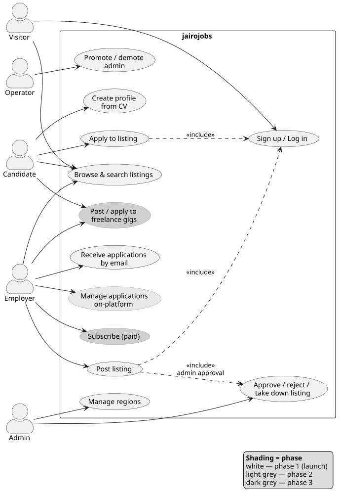

# 000 — Product Overview

**Status:** Approved
**Created:** 2026-10-29
**Approved:** 2026-10-29

The root spec. Every feature spec refers back to the personas and glossary defined here.

## Vision

**jairojobs** is a national job board for the Philippines, organized by region/city
(e.g. Davao City, Cebu, Metro Manila), connecting Philippine employers with local candidates.
Employers post openings; candidates discover and apply to them. A freelance gig marketplace
is planned as a later extension. It is a mobile-first web app, English
only, and relevant to the Philippine market (local locations, salaries in PHP, local
employment norms).

It starts as a free, community-scale board — simple, fast on phones, seeded with a few regions
— built with the structure to grow into a sustainable business through paid employer
subscriptions once the community is established.

### Key product constraints

| Constraint | Decision |
|---|---|
| Geography | Nationwide Philippines, organized by region/city. Initial seeded regions: Davao City, Cebu, Metro Manila; Admin can add any PH city. |
| Platform | Mobile-first responsive web app (no native apps) |
| Language | English only (no i18n for now) |
| Currency | PHP |
| Business model | Free for everyone at launch; paid **employer subscription** later. Candidates always free. |

## Target users / personas

### Visitor

Anyone browsing the site without an account, almost always on a phone. Wants to quickly see
what jobs are open in their city and share listings with friends/family. No login wall for
browsing or searching. Becomes a **Candidate** the moment they want to apply.

### Candidate

A job seeker living in one of the supported regions. Needs an account to apply. Creates a
**profile** on the platform, seeded from an uploaded CV file (PDF/DOC), so they don't have to
retype their history for every application. Applies to listings with one tap once the profile
exists. Frustrations today: national boards full of irrelevant or out-of-region jobs, clunky
mobile experiences, re-entering the same details on every site.

### Employer

A local business or individual hiring in a supported region. Typically **one person** (owner,
manager, or HR staff) — multi-user company accounts are not needed initially. Creates an
account, submits job listings for approval, and **receives applications by email** at first.
Later phase: manage applications on-platform (view, shortlist, reject, message). Future paying
customer via subscription. Frustrations today: expensive or noisy national boards, applications
from outside the region, no simple local option.

### Admin

The operator (initially the owner). **Approves every listing before it goes live**, can edit or
take down listings, manages employer accounts and the list of supported regions, and sees
basic usage stats. Needs tooling that keeps moderation fast enough to not become the bottleneck
as volume grows.

### Persona → access summary

*Source: `docs/architecture/diagrams/src/use-cases.puml`. Shading marks phase; dashed arrows are `<<include>>` dependencies (e.g. posting a listing includes admin approval).*

| Capability | Visitor | Candidate | Employer | Admin |
|---|---|---|---|---|
| Browse / search listings | ✅ | ✅ | ✅ | ✅ |
| Apply to a listing | ❌ | ✅ | ❌ | ❌ |
| Create profile from CV | ❌ | ✅ | ❌ | ❌ |
| Post a listing (pending approval) | ❌ | ❌ | ✅ | ✅ |
| Receive applications by email (phase 1) | ❌ | ❌ | ✅ | ❌ |
| Manage applications on-platform (later) | ❌ | ❌ | ✅ | ❌ |
| Approve / edit / take down listings | ❌ | ❌ | ❌ | ✅ |
| Manage regions & employer accounts | ❌ | ❌ | ❌ | ✅ |

## Problem statement

Job seekers and employers in Philippine cities outside the national spotlight rely on large
national boards (JobStreet, Indeed, LinkedIn), Facebook groups, or word of mouth. National
boards bury local jobs under thousands of irrelevant listings and are expensive or noisy for
small employers; Facebook groups are unstructured, unsearchable, and quickly go stale. There is
no simple, trustworthy, mobile-friendly place to find or post a job *in your own city*.

### Account model

One account = one role (Candidate **or** Employer), chosen at signup. Admin is a separate,
operator-assigned role. Revisit if dual-role accounts become a real need.

## Glossary (domain language)

Use these terms consistently in specs, code (contexts, schemas, modules), and UI copy.
UI may say "jobs" to visitors ("Browse jobs"); the domain object is always a **Listing**.

| Term | Definition | Code |
|---|---|---|
| **Region** | A supported geographic area (e.g. Davao City, Cebu, Metro Manila). Every Listing belongs to exactly one. Admin-managed. | `Jairojobs.Regions` |
| **Listing** | A single open position posted by an Employer. **Must include a salary range (PHP).** Lifecycle: *Draft → Pending approval → Published → Closed/Expired*; Admin may *Reject* or *Take down*. | `Jairojobs.Listings` |
| **Employer** | An account that posts Listings; also the business identity shown on the Listing. One person per account initially. | `Jairojobs.Accounts` (role) |
| **Candidate** | An account that applies to Listings; owns exactly one Profile. | `Jairojobs.Accounts` (role) |
| **Profile** | A Candidate's structured résumé on the platform (contact, summary, experience, education, skills), seeded from an uploaded CV. | `Jairojobs.Profiles` |
| **CV** | The uploaded file (PDF/DOC) a Candidate provides; source for the Profile and attached to Applications. | `Jairojobs.Profiles` |
| **Application** | A Candidate applying to a Listing. Phase 1: emailed to the Employer. Later: tracked on-platform with status *Submitted → Viewed → Shortlisted → Rejected / Hired*. | `Jairojobs.Applications` |
| **Admin** | Operator role: approves Listings, manages Regions and Employer accounts. | `Jairojobs.Accounts` (role) |
| **Approval** | Admin action moving a Listing from *Pending approval* to *Published*. | `Jairojobs.Listings` |
| **Salary range** | Required min–max monthly salary in PHP on every Listing. Transparency is a product differentiator. | `Jairojobs.Listings` |
| **Subscription** | (Future) paid Employer plan unlocking posting beyond the free tier. | `Jairojobs.Billing` (future) |

## Feature map

Phase 1 (001–007) is the minimum launchable product. Each row becomes `docs/specs/NNN-…/` when work starts.

| # | Feature | Phase | Status | Spec |
|---|---|---|---|---|
| 001 | **Accounts & authentication** — signup/login; role chosen at signup (Candidate / Employer); **admin user creation** via a privileged mechanism (mix task / release command / seed — never public signup); admin can promote/demote users | 1 | Spec approved; planning | [001](../001-accounts-authentication/spec.md) |
| 002 | **Regions** — admin-managed list; seed Davao City, Cebu, Metro Manila | 1 | Not started | |
| 003 | **Listings — employer posting** — create/edit listing with required salary range (PHP), submit for approval, close | 1 | Not started | |
| 004 | **Listings — admin moderation** — approval queue, approve / reject / take down, edit | 1 | Not started | |
| 005 | **Public browse & search** — visitor-facing index by region, search/filter, listing detail page, shareable URLs, SEO basics, mobile-first | 1 | Not started | |
| 006 | **Candidate profile & CV upload** — upload CV file, manually fill structured profile (auto-extraction from CV is a later enhancement) | 1 | Not started | |
| 007 | **Applications (email phase)** — apply with profile + CV; employer receives email; candidate sees own application history | 1 | Not started | |
| 008 | **Admin dashboard & stats** — counts of listings, applications, signups per region | 2 | Not started | |
| 009 | **Applications on-platform** — employer views / shortlists / rejects; candidate sees status | 2 | Not started | |
| 010 | **Notifications** — email alerts: new jobs in region (candidates), new applications (employers) | 2 | Not started | |
| 011 | **Employer subscriptions / billing** — paid tiers, posting limits | 3 | Not started | |
| 012 | **Freelance gig marketplace** — short-term gigs posted by clients, applied to by freelancers; scope, payments, and relationship to Listings to be defined in its spec | 3 | Not started | |
| — | CV auto-parsing into profile | Later | Idea | |
| — | Employer company page, saved jobs, report-a-listing | Later | Idea | |

## Non-goals (product level)

- Not an international board; listings must be for work in the Philippines
- No native mobile apps (responsive web only)
- No multi-language / Filipino localisation for now
- No multi-user employer/company accounts initially
- No recruiter/agency marketplace
- No AI matching or CV auto-parsing in phase 1
- Not a social network — no feeds, follows, or messaging beyond the application flow

## Success criteria

Initial, community-scale targets; revise as data comes in.

- Launch with ≥ 3 regions seeded and ≥ 20 approved listings
- Median admin approval time < 24 h
- ≥ 50 candidate accounts and ≥ 10 employer accounts in first 3 months
- ≥ 1 confirmed hire via the platform
- Core pages load < 2 s on a mid-range phone over 4G

## Product decisions (resolved)

| Topic | Decision |
|---|---|
| Authentication | Both email + password **and** magic link (detail in spec 001) |
| Listing expiry | Employer-closed only; no automatic expiry |
| Free tier | Limits apply from day one so a later subscription is meaningful (exact limits in spec 003 / 011) |
| Fly.io region | Singapore (`sin`) |
| Primary keys | UUID v7 everywhere + slugs for public listing URLs (ADR-0004) |

## Open questions

- Free tier exact limits (e.g. N active listings per employer)
- Freelance gig marketplace (012): own context vs. a Listing type; whether payments are in scope
