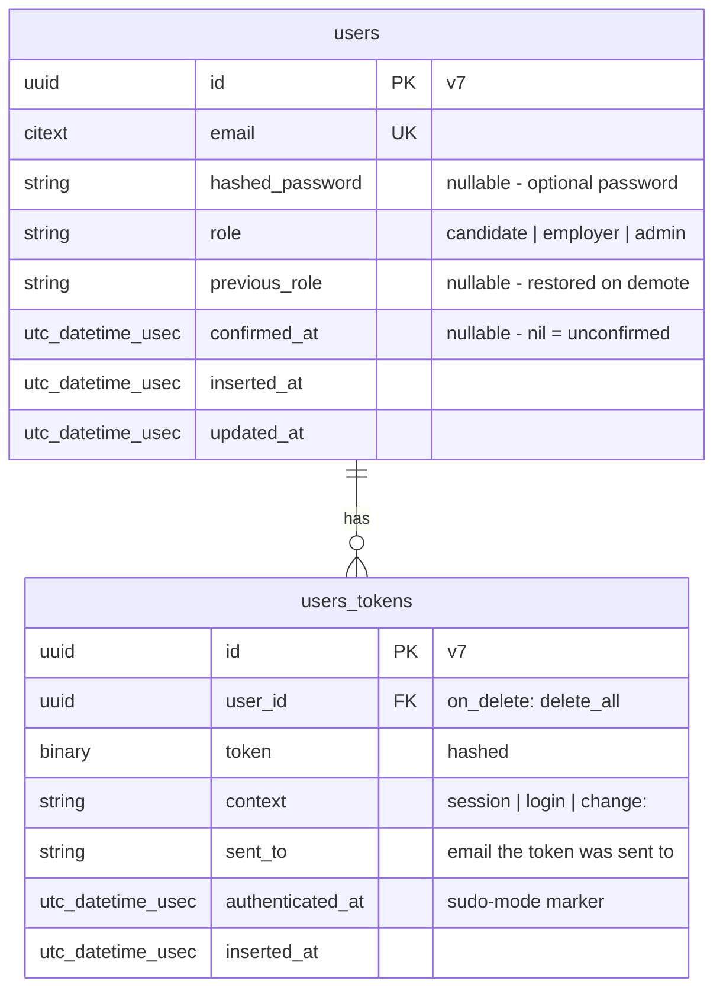
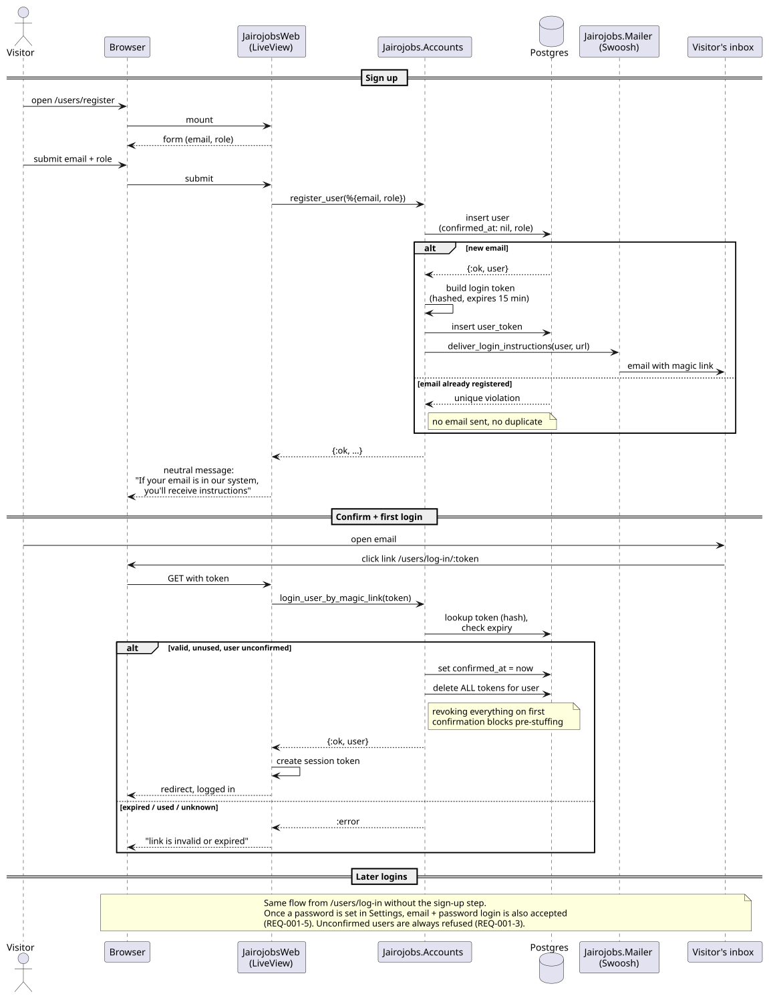
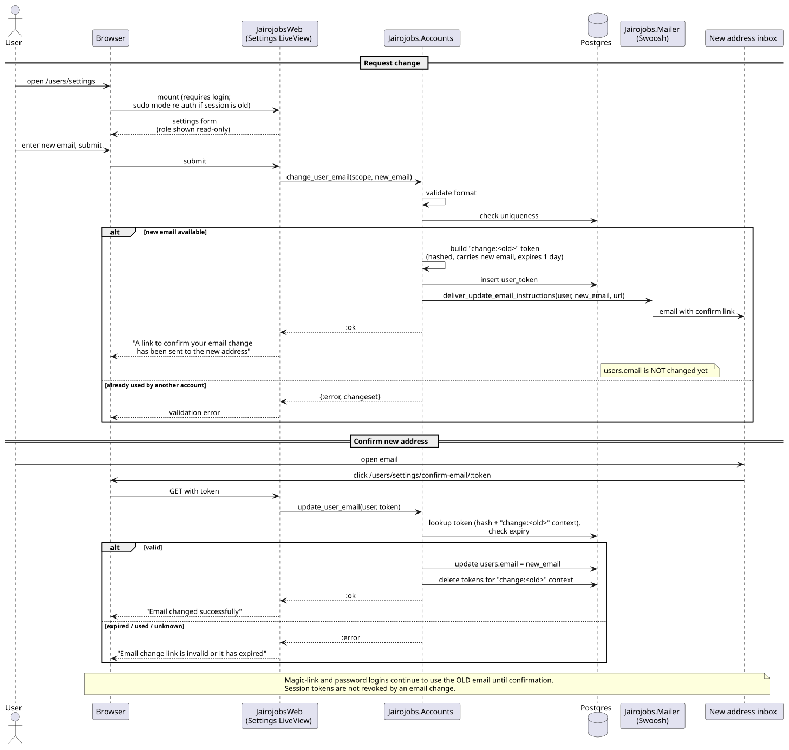

# 001 — Accounts & Authentication — Plan

**Status:** Draft
**Spec:** [spec.md](./spec.md) (Approved 2026-10-30)
**Created:** 2026-10-30

## Approach

Use Phoenix 1.8's `mix phx.gen.auth` as the foundation — it already implements the exact
flow the spec asks for (email-only sign-up, magic-link confirmation + login, optional
password, email change via confirmation, sudo mode, token revocation on first confirm). We
then add the three things it doesn't have: a **role** column with sign-up selection, the
**promote/demote** context functions + mix task, and **role-aware navigation**. We keep the
generated code as-is wherever possible so future Phoenix upgrades stay cheap.

Main trade-off: the generator produces a lot of code we didn't write. We accept that because
it is the community-reviewed reference implementation, and the security notes in
`mix help phx.gen.auth` (pre-stuffing attack, token revocation) are exactly the risks we'd
otherwise have to reason about ourselves.

## Prerequisites (before running the generator)

These must land first because the generator reads them and the migration is hard to change later.

1. **UUID v7 everywhere (ADR-0004)** in `config/config.exs`:
   ```elixir
   config :jairojobs, :generators, binary_id: true, timestamp_type: :utc_datetime_usec
   config :jairojobs, Jairojobs.Repo,
     migration_primary_key: [type: :binary_id],
     migration_foreign_key: [type: :binary_id],
     migration_timestamps: [type: :utc_datetime_usec]
   ```
   and a shared schema base so every schema gets v7 keys:
   ```elixir
   # lib/jairojobs/schema.ex
   defmodule Jairojobs.Schema do
     defmacro __using__(_) do
       quote do
         use Ecto.Schema
         @primary_key {:id, Ecto.UUID, autogenerate: [version: 7]}
         @foreign_key_type Ecto.UUID
         @timestamps_opts [type: :utc_datetime_usec]
       end
     end
   end
   ```
   Generated schemas will be switched from `use Ecto.Schema` to `use Jairojobs.Schema`.
   (Ecto 3.14 supports `version: 7` natively — no extra dependency.)
2. **CI workflow** (constitution §3.9–10) — `.github/workflows/ci.yml` running `mix precommit`
   with a Postgres service, `paths-ignore` for `docs/**`, `scratchpad/**`, `**/*.md`.

## Generator invocation

```bash
mix phx.gen.auth Accounts User users --live
```
(`--binary-id` is implied by the generator config above.) Default hashing lib **bcrypt**
is kept — argon2 is stronger but needs a bigger Fly machine; revisit via ADR if ever needed.

Generated (verified by dry run on this project):

| Area | Files |
|---|---|
| Context | `lib/jairojobs/accounts.ex`, `accounts/user.ex`, `accounts/user_token.ex`, `accounts/user_notifier.ex`, `accounts/scope.ex` |
| Web | `lib/jairojobs_web/user_auth.ex` (plugs + `on_mount` hooks), `controllers/user_session_controller.ex`, `live/user_live/{registration,login,confirmation,settings}.ex` |
| Migration | `priv/repo/migrations/*_create_users_auth_tables.exs` (`users`, `users_tokens`, `citext` extension) |
| Tests | context tests, LiveView tests per page, `user_auth_test.exs`, `accounts_fixtures.ex` |
| Injected | router scopes + `live_session`s, `root.html.heex` nav, `conn_case.ex` helpers, `config/test.exs` (bcrypt rounds), `mix.exs` (`bcrypt_elixir`), `AGENTS.md` auth guidelines |

## Contexts & modules

| Module | New / Changed | Responsibility |
|---|---|---|
| `Jairojobs.Accounts` | Generated + extended | Registration, tokens, login, email/password changes; **+ `promote_to_admin/2`, `demote_admin/2`, `count_admins/0`** |
| `Jairojobs.Accounts.User` | Generated + extended | Schema; **+ `role`, `previous_role`**; `registration_changeset/3` casts `role` (candidate/employer only) |
| `Jairojobs.Accounts.UserToken` | Generated | Hashed tokens for session / login / change-email contexts |
| `Jairojobs.Accounts.Scope` | Generated + extended | `%Scope{user: user}`; **+ `admin?/1`, `role/1` helpers and a `system/0` scope for the mix task** |
| `Jairojobs.Accounts.UserNotifier` | Generated | Swoosh emails: login instructions, update-email instructions |
| `Jairojobs.Schema` | New | Shared `use` macro for UUID v7 keys + usec timestamps |
| `Mix.Tasks.Jairojobs.Admin` | New | `mix jairojobs.admin promote|demote EMAIL` |
| `Jairojobs.Release` | Generated later by `phx.gen.release`; extended | `promote_admin/1`, `demote_admin/1` entry points for production (`bin/jairojobs eval`) |
| `JairojobsWeb.UserAuth` | Generated + extended | **+ `on_mount: :require_admin`** (for spec 004/008) |
| `JairojobsWeb.Layouts` | Changed | Role-aware nav per wireframe (REQ-001-12) |
| `JairojobsWeb.UserLive.Registration` | Generated + changed | **+ role radio group**; hides `admin` |
| `JairojobsWeb.UserLive.Settings` | Generated + changed | **+ read-only role label** |

## Data model



### Migrations

1. `create_users_auth_tables` — generated. Edit before running: timestamps to
   `:utc_datetime_usec`; keep `citext` extension, unique index on `email`, index on
   `users_tokens(user_id)`, unique on `(context, token)`.
2. `add_role_to_users` — new:
   `role :string, null: false` (CHECK constraint `role IN ('candidate','employer','admin')`),
   `previous_role :string, null: true`, index on `role` (admin count query).

Role is stored as a string, exposed as `Ecto.Enum` (`values: [:candidate, :employer, :admin]`)
on the schema. The DB check constraint is the hard guarantee; `Ecto.Enum` gives atoms in code.

The canonical PlantUML ERD (`docs/architecture/diagrams/src/erd-jairojobs.puml`, embedded in
`docs/architecture/data-model.md`) already includes these two tables; the Mermaid above is
the inline convenience copy.

## Routes & LiveViews / Controllers

| Method / Live | Path | Module | Auth | REQ |
|---|---|---|---|---|
| live | `/users/register` | `UserLive.Registration` | public (redirects if logged in) | 2 |
| live | `/users/log-in` | `UserLive.Login` | public | 4, 5 |
| live | `/users/log-in/:token` | `UserLive.Confirmation` | public | 3, 4 |
| post | `/users/log-in` | `UserSessionController.create` | public | 3, 4, 5 |
| delete | `/users/log-out` | `UserSessionController.delete` | any | 8 |
| live | `/users/settings` | `UserLive.Settings` | `require_authenticated` + sudo mode | 5, 6, 7, 9 |
| live | `/users/settings/confirm-email/:token` | `UserLive.Settings` | `require_authenticated` | 6 |
| post | `/users/update-password` | `UserSessionController.update_password` | authenticated | 7 |
| get | `/` and public listing routes | existing / future | `mount_current_scope` only | 1 |

Router shape: three `live_session`s — `:current_user` (public pages, scope mounted if present),
`:require_authenticated_user`, and later `:require_admin` (added here as a hook, first used in
spec 004).

## Sequence diagrams (rule 2 — flows with ≥ 3 parties)

**Sign up and first login via magic link** (REQ-001-2, -3, -4)



**Change email with confirmation of the new address** (REQ-001-6)



*Sources: `diagrams/sequence-magic-link-signup.puml`, `diagrams/sequence-change-email.puml`.*

## Authorization

- `Scope` is mounted on every request (`fetch_current_scope_for_user` plug; `on_mount` hooks).
- `Scope.admin?/1` → `user.role == :admin`. Used by `require_admin` hook/plug and by
  `promote_to_admin/2` / `demote_admin/2` (REQ-001-11).
- `Scope.system/0` → `%Scope{user: nil, system: true}`; treated as admin by the promote/demote
  functions **only**. Never mounted from a request.
- Sign-up changeset uses `validate_inclusion(:role, [:candidate, :employer])` and the
  registration form only offers those two — forged `admin` params are rejected (REQ-001-2 rule).
- Settings never casts `role` (REQ-001-9 rule).
- Demote: refuse when `count_admins() == 1` and target is that admin (REQ-001-10/11).

## Privileged command (REQ-001-10)

Local / dev:
```bash
mix jairojobs.admin promote someone@example.com
mix jairojobs.admin demote  someone@example.com
```
Production (after `phx.gen.release` lands with the Fly.io deploy):
```bash
fly ssh console -C "/app/bin/jairojobs eval 'Jairojobs.Release.promote_admin(\"someone@example.com\")'"
```
Both call `Accounts.promote_to_admin(Scope.system(), user)` / `demote_admin/2`. The task
prints a one-line result and exits non-zero on failure (unknown email, last admin, unconfirmed).
Documented in the project `README.md`.

## Background jobs / emails / external services

- Emails: `UserNotifier` via Swoosh — login instructions, update-email instructions. Dev:
  `Swoosh.Adapters.Local` (`/dev/mailbox`). Test: `Swoosh.Adapters.Test`. Prod adapter: deferred
  to the Fly.io deployment step (will need an ADR: Resend / Postmark / SES).
- No background jobs.

## Test strategy

Generated tests cover most REQs; we add tests for role, promote/demote, nav, and rename
relevant generated tests to the `REQ-001-n: <scenario>` convention.

| REQ | Scenario(s) | Test location | Type |
|---|---|---|---|
| 1 | Public pages render; protected page redirects and returns | `test/jairojobs_web/user_auth_test.exs`, `page_controller_test.exs` | plug / controller |
| 2 | Successful sign-up; missing role; existing email not revealed; invalid email; forged admin role | `test/jairojobs/accounts_test.exs`, `test/jairojobs_web/live/user_live/registration_test.exs` | context + LiveView |
| 3 | Unconfirmed cannot log in; first link confirms + logs in; expired/used link | `accounts_test.exs`, `live/user_live/confirmation_test.exs` | context + LiveView |
| 4 | Request + use magic link; unregistered email neutral; used/expired link | `accounts_test.exs`, `live/user_live/login_test.exs` | context + LiveView |
| 5 | Set password then log in; wrong password; unconfirmed refused | `accounts_test.exs`, `live/user_live/settings_test.exs`, `controllers/user_session_controller_test.exs` | all three |
| 6 | Request change; confirm new email; new email taken | `accounts_test.exs`, `live/user_live/settings_test.exs` | context + LiveView |
| 7 | Change password; wrong current password | `accounts_test.exs`, `controllers/user_session_controller_test.exs` | context + controller |
| 8 | Log out | `controllers/user_session_controller_test.exs` | controller |
| 9 | Role in scope; role label in settings; role change next request | `accounts/scope_test.exs` (new), `settings_test.exs` | unit + LiveView |
| 10 | Promote; demote; unknown email; unconfirmed user; last admin | `test/mix/tasks/jairojobs.admin_test.exs` (new) | mix task |
| 11 | Admin promotes; admin demotes; last admin protected; non-admin refused | `accounts_test.exs` | context (authorization) |
| 12 | Visitor / Candidate / Employer / Admin navigation | `test/jairojobs_web/components/layouts_test.exs` (new) | component |

Emails asserted with `Swoosh.TestAssertions` where a scenario sends mail (constitution §3.7).

## Risks & mitigations

| Risk | Mitigation |
|---|---|
| Editing generated code makes future `phx.gen.auth` diffs harder | Keep edits additive and localised (role field, 3 context functions, nav); note each edit with a `# spec 001` comment |
| `citext` extension unavailable on Fly Postgres | It is available (standard contrib); migration creates it `IF NOT EXISTS` |
| bcrypt cost slows tests | Generator already lowers rounds in `config/test.exs` |
| Last-admin check races under concurrent demotes | Run demote in a transaction with `SELECT … FOR UPDATE` on the target; acceptable for operator-only usage |
| Forgotten `previous_role` on promote of an already-admin user | `promote_to_admin/2` is a no-op `{:ok, user}` when already admin |
| Role-aware nav tested only via components | Add one LiveView smoke test per role that renders the home page and checks drawer links by DOM id |

## Alternatives considered

- **Hand-rolled auth** — rejected; the generator is the reference implementation and covers
  the subtle token-revocation cases.
- **Separate `Admin` schema via a second `phx.gen.auth` run** — rejected; the generator docs
  warn of conflicting scopes, and spec 000 wants one account = one role.
- **Role as a Postgres enum type** — rejected for now; a string + CHECK constraint is simpler
  to migrate when roles change. Revisit if roles multiply.
- **argon2** — rejected for now (CPU/memory on small Fly machines); bcrypt is adequate.
- **Admin promote/demote in a seeds file** — rejected; seeds run on every `ecto.setup` and
  aren't a safe production mechanism.
