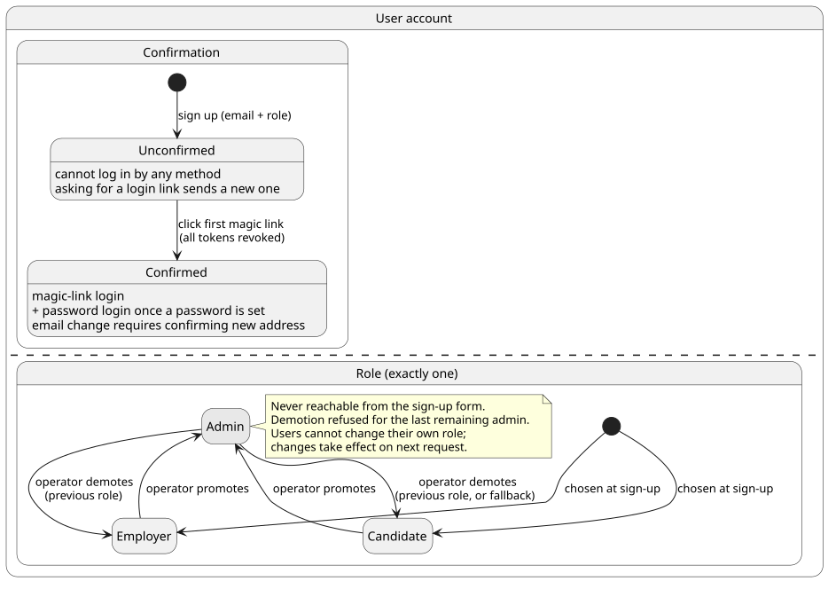
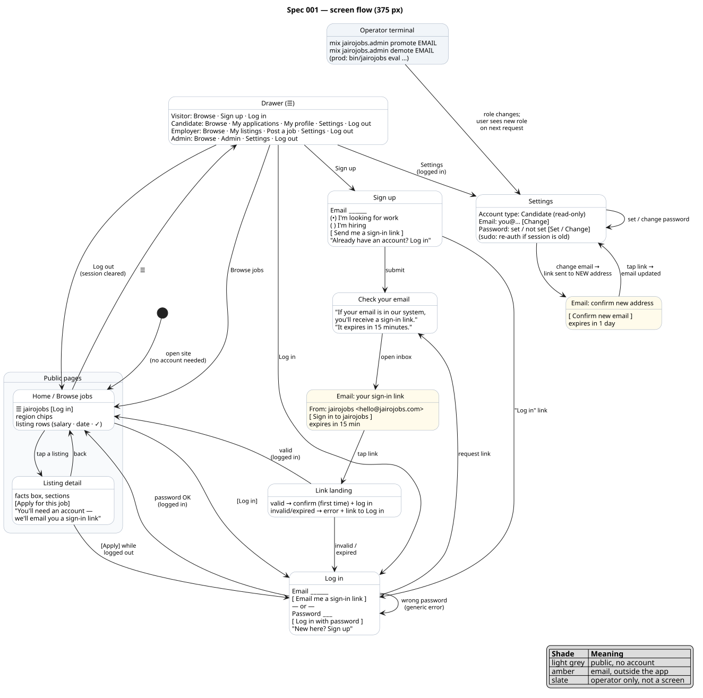
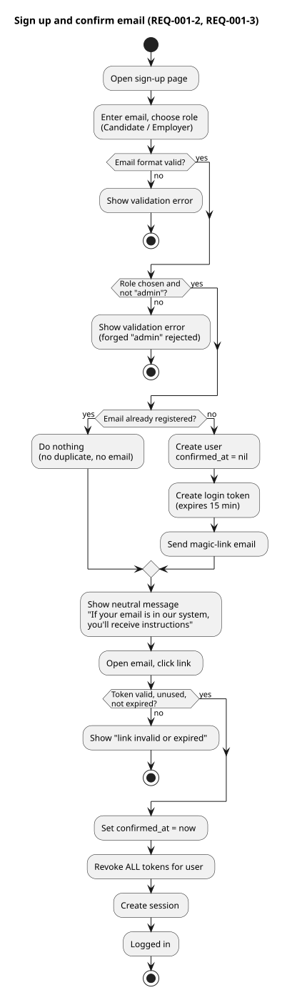
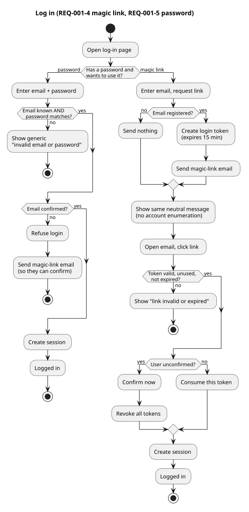
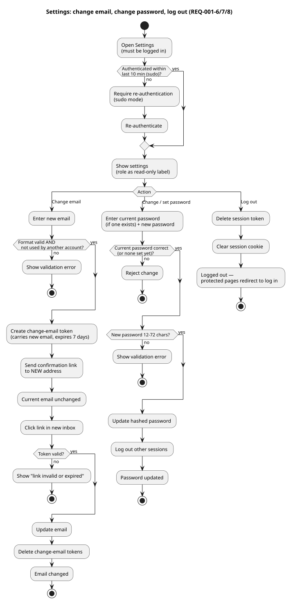
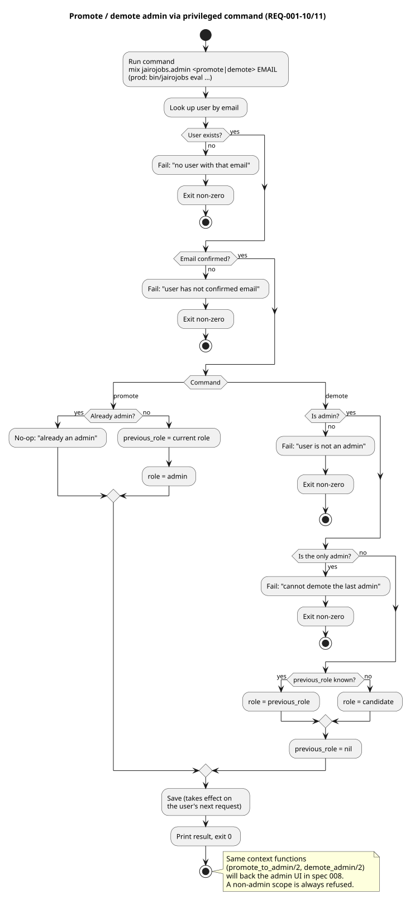
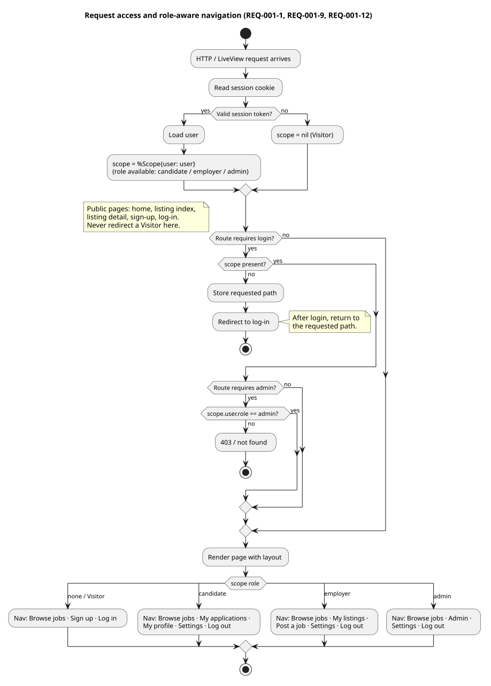
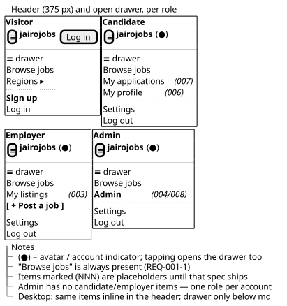

# 001 — Accounts & Authentication

**Status:** Approved
**Created:** 2026-10-29
**Approved:** 2026-10-30
**Owner:** Jairo
**Related ADRs:** 0004 (UUID v7 keys), 0005 (transactional email via Resend)
**Depends on:** 000 (product overview)

## Problem / Why

Every other feature depends on knowing who the user is and what role they hold. Candidates
must sign in to apply and to own a profile; employers must sign in to post; admins must be
identifiable to moderate. Visitors must *not* be forced to sign in to browse.

We need a secure, low-friction authentication system that works well on phones. Signup should
be as simple as entering an email; email ownership is proven by clicking a link; a password is
optional convenience added later.

## Goals

- Visitors browse without an account.
- Anyone can sign up as a **Candidate** or **Employer**; the role is chosen at signup and one
  account has exactly one role.
- Email is confirmed before the account can be used (clicking the signup link both confirms
  and logs in — no separate confirmation step).
- Login via **magic link** (always) and via **email + password** (once a password is set).
- Users can manage their email and password in Settings.
- An **Admin** role exists; it is granted only via a privileged mechanism, never via signup.
- Establish the **`Scope`** (current user + role) passed to every context function, as the
  foundation for authorization in all later specs.

## Non-goals / Out of scope

- Social login (Google / Facebook) — deferred; may become its own spec later.
- Two-factor authentication.
- Multi-user employer / company accounts.
- Collecting names, business names, or any profile data at signup — that belongs to
  spec 006 (Profiles) and spec 003 (Listings).
- Employer business verification — handled by listing approval (spec 004).
- Account deletion / data export — later spec.
- Promote/demote **web UI** — arrives with the admin dashboard (spec 008).
- Rate limiting / CAPTCHA beyond what the generator provides — revisit if abuse appears.

## Personas involved

- **Visitor** — browses without an account; may sign up.
- **Candidate** — signs up, logs in, manages settings.
- **Employer** — signs up, logs in, manages settings.
- **Admin** — created via privileged mechanism; logs in like any user.
- **Operator** — the person with server access who runs privileged commands (initially the owner).

## User stories

**US-001-1**
- As a Visitor,
- I want to browse listings without creating an account,
- so that I can see if the site is useful before committing.

**US-001-2**
- As a Visitor,
- I want to sign up with just my email and pick whether I'm looking for work or hiring,
- so that getting started takes seconds on my phone.

**US-001-3**
- As a Candidate or Employer,
- I want to log in by clicking a link in my email,
- so that I don't have to remember a password.

**US-001-4**
- As a Candidate or Employer,
- I want to optionally set a password,
- so that I can log in faster on a device where email is inconvenient.

**US-001-5**
- As a Candidate or Employer,
- I want to change my email or password,
- so that I keep control of my account.

**US-001-6**
- As a Candidate or Employer,
- I want to log out,
- so that nobody else on a shared phone can act as me.

**US-001-7**
- As a Candidate or Employer,
- I want the site to show me the right menu for my account type,
- so that I'm not confused by options that don't apply to me.

**US-001-8**
- As the Operator,
- I want to create the first Admin without a public admin signup,
- so that nobody can self-grant moderation powers.

**US-001-9**
- As the Operator,
- I want to promote a trusted user to Admin (and demote them later),
- so that moderation can be shared as the community grows.

## Account lifecycle

A user has two independent aspects: a **confirmation state** and exactly one **role**.
The scenarios in REQ-001-2, -3, -9, -10 and -11 must agree with this diagram.



*Source: `diagrams/state-account.puml`.*

## Screen flow

Every screen in this spec with its key elements; arrows are user actions. Each user story is
a path through it.



| Story | Path through the screen flow |
|---|---|
| US-001-1 browse without account | start → Home ⇄ Listing detail |
| US-001-2 sign up with email + role | Home/Drawer → Sign up → Check your email → Email → Link landing → Home (logged in) |
| US-001-3 log in by magic link | Log in → Check your email → Email → Link landing → Home |
| US-001-4 set an optional password | Drawer → Settings → set password; later Log in (password) → Home |
| US-001-5 change email / password | Drawer → Settings → Email: confirm new address → Settings; Settings → change password |
| US-001-6 log out | Drawer → Log out → Home (logged out) |
| US-001-7 role-aware menu | Drawer (four variants); detail in `wireframe-nav` |
| US-001-8 create first admin | Operator terminal → (user's) Settings shows Admin on next request |
| US-001-9 promote / demote | Operator terminal → Settings / Drawer reflect new role |

*Source: `diagrams/screenflow-auth.puml`.*

## Flows (activity diagrams)

Every requirement is covered by one of these five flows. Each diagram must agree with the
Gherkin scenarios of the requirements it covers.

| Flow | Covers | Diagram |
|---|---|---|
| Sign up and confirm email | REQ-001-2, -3 | [activity-signup](diagrams/activity-signup.svg) |
| Log in (magic link / password) | REQ-001-4, -5 | [activity-login](diagrams/activity-login.svg) |
| Settings: change email / password, log out | REQ-001-6, -7, -8 | [activity-settings](diagrams/activity-settings.svg) |
| Promote / demote admin via command | REQ-001-10, -11 | [activity-admin-command](diagrams/activity-admin-command.svg) |
| Request access and role-aware navigation | REQ-001-1, -9, -12 | [activity-request-access](diagrams/activity-request-access.svg) |

### Sign up and confirm email


### Log in


### Settings and log out


### Promote / demote admin


### Request access and navigation


*Sources: `diagrams/activity-*.puml`.*

## Requirements

### REQ-001-1: Public browsing requires no account

**Serves:** US-001-1

Unauthenticated visitors can reach all public pages (home, listing index, listing detail, and
the sign-up / log-in pages). Only protected pages redirect to log-in.

```gherkin
Scenario: Public pages render without login
  Given I am not logged in
  When I open the home page or any public listing page
  Then it renders without redirecting me to log in

Scenario: Protected page redirects and returns
  Given I am not logged in
  When I open a protected page such as Settings
  Then I am redirected to the log-in page
  And after logging in I land on the page I originally asked for
```

### REQ-001-2: Sign up with email and role

**Serves:** US-001-2

A visitor signs up with an email address and a role (`candidate` or `employer`). No password
is collected at signup. A login link is emailed.

```gherkin
Scenario: Successful sign-up
  Given I am on the sign-up page
  When I submit a valid email and choose a role
  Then an account is created with that role
  And a login link is emailed to that address

Scenario: Missing role
  Given I am on the sign-up page
  When I submit without choosing a role
  Then I see a validation error
  And no account is created

Scenario: Existing email is not revealed
  Given an account already exists for an email
  When I sign up again with that email
  Then I see the same neutral success message as a new signup
  And no duplicate account is created

Scenario: Invalid email format
  Given I am on the sign-up page
  When I submit an invalid email format
  Then I see a validation error
```

**Rules**
- The role cannot be `admin` from the sign-up form, even if the parameter is forged.

### REQ-001-3: Email is confirmed by using the first login link

**Serves:** US-001-2, US-001-3

Clicking the emailed link confirms the email address and logs the user in. Until confirmed,
the account cannot log in by any method.

```gherkin
Scenario: Unconfirmed account cannot log in
  Given I signed up and have not yet clicked the link
  When I try to log in by magic link or password
  Then I do not get a session
  And a fresh magic-link email is sent instead of a password login

Scenario: First link confirms and logs in
  Given I have a valid, unused link from the signup email
  When I click it
  Then my account is marked confirmed
  And I am logged in

Scenario: Expired or used link
  Given the link is expired or already used
  When I click it
  Then I see an error
  And I am not logged in
```

### REQ-001-4: Log in via magic link

**Serves:** US-001-3

A confirmed user can request a login link by email at any time.

```gherkin
Scenario: Request and use a magic link
  Given I am a confirmed user
  When I enter my email on the log-in page and request a link
  Then I receive an email with a single-use link
  And clicking it logs me in

Scenario: Unregistered email is not revealed
  Given an email that is not registered
  When I request a link for it
  Then I see the same neutral message
  And no email is sent

Scenario: Used or expired link
  Given a link that has been used or has expired
  When I click it
  Then it does not log me in
```

### REQ-001-5: Optional password; log in via email + password

**Serves:** US-001-4

A logged-in user may set a password in Settings. Once set, email + password login works in
addition to magic link.

```gherkin
Scenario: Set a password, then log in with it
  Given I am logged in and have no password
  When I set a valid password in Settings
  Then I can subsequently log in with email and password

Scenario: Wrong password
  Given I have a password
  When I log in with the wrong password
  Then I see a generic "invalid email or password" error

Scenario: Password login requires confirmed email
  Given I have a password but my email is unconfirmed
  When I try password login
  Then I am refused
```

**Rules**
- Password length: minimum 12 characters, maximum 72 bytes.

### REQ-001-6: Change email

**Serves:** US-001-5

A logged-in user can change their email; the change takes effect only after the new address
is confirmed via a link.

```gherkin
Scenario: Request email change
  Given I am logged in
  When I submit a new email in Settings
  Then a confirmation link is sent to the new address
  And my current email stays unchanged

Scenario: Confirm new email
  Given a confirmation link was sent to my new address
  When I click it
  Then my account email is updated

Scenario: New email already taken
  Given the new email is already used by another account
  When I submit it
  Then I see a validation error
```

### REQ-001-7: Change password

**Serves:** US-001-5

```gherkin
Scenario: Change password
  Given I am logged in and have a password
  When I enter my current password and a valid new password
  Then my password is updated
  And my other sessions are logged out

Scenario: Wrong current password
  Given I am logged in and have a password
  When I enter the wrong current password
  Then the change is rejected
```

### REQ-001-8: Log out

**Serves:** US-001-6

```gherkin
Scenario: Log out
  Given I am logged in
  When I log out
  Then my session is invalidated
  And protected pages redirect me to log in again
```

### REQ-001-9: Role is fixed and exposed via Scope

**Serves:** US-001-2, US-001-7

Each user has exactly one role: `candidate`, `employer`, or `admin`. The current user and
role are available to every LiveView/controller and passed to contexts as a `Scope`.

```gherkin
Scenario: Role available in scope
  Given a user with role candidate
  When they make any authenticated request
  Then scope.user.role == :candidate is available to the LiveView and contexts

Scenario: Role shown in Settings
  Given I am logged in
  When I open Settings
  Then I see my role as a read-only label ("Candidate" / "Employer" / "Admin")

Scenario: Role change takes effect on next request
  Given my role was changed by the operator
  When I make my next request
  Then the new role is in effect
```

**Rules**
- Users cannot change their own role through any user-facing form.

### REQ-001-10: Admin promotion / demotion via privileged command

**Serves:** US-001-8, US-001-9

Admins are created and removed by the operator outside the web UI, using a command run with
server access (a `mix` task locally; a release command in production). There is no admin
sign-up page and no promote/demote web UI in this spec — that arrives with the admin
dashboard (spec 008) and will call the same context functions.

```gherkin
Scenario: Promote a user
  Given a registered, confirmed user's email
  When the operator runs the promote command with that email
  Then the user's role becomes admin

Scenario: Demote an admin
  Given an admin's email
  When the operator runs the demote command
  Then the role reverts to the role held before promotion
  But falls back to candidate if the previous role is unknown

Scenario: Unknown email
  Given an email that does not exist
  When the operator runs either command
  Then it fails with a clear message
  And nothing changes

Scenario: Unconfirmed user cannot be promoted
  Given a registered user whose email is not yet confirmed
  When the operator runs the promote command with that email
  Then it fails with a clear message
  And nothing changes

Scenario: Cannot demote the only admin
  Given the target is the only admin
  When the operator runs demote
  Then it is refused
```

**Rules**
- The command is documented in `plan.md` and the project `README.md`.

### REQ-001-11: Promote / demote rules live in the Accounts context

**Serves:** US-001-8, US-001-9

The rules behind REQ-001-10 are implemented as context functions taking a `Scope`, so the
command now and the admin UI later (spec 008) share one tested implementation.

```gherkin
Scenario: Admin promotes a user
  Given an admin scope
  When promoting a candidate or employer
  Then their role becomes admin
  And their previous role is remembered

Scenario: Admin demotes another admin
  Given an admin scope
  When demoting another admin
  Then their role reverts to the remembered role
  But falls back to candidate if unknown

Scenario: Last admin is protected
  Given the target is the last remaining admin
  When demoting
  Then it is refused

Scenario: Non-admin cannot promote or demote
  Given a non-admin scope
  When calling promote or demote
  Then it is refused
  And nothing changes
```

**Rules**
- The privileged command runs with a system/operator scope that is treated as admin.

### REQ-001-12: Role-aware navigation

**Serves:** US-001-7

The layout shows the right entry points for the current role. Wireframe of the header and
drawer at 375 px (layout only, not visual design):



*Source: `diagrams/wireframe-nav.puml`.*

```gherkin
Scenario: Visitor navigation
  Given I am a Visitor
  When I view any page
  Then I see "Log in" and "Sign up"

Scenario: Candidate navigation
  Given I am a Candidate
  When I view any page
  Then I see links to my applications and profile (placeholders until specs 006/007)
  And I see Settings

Scenario: Employer navigation
  Given I am an Employer
  When I view any page
  Then I see a link to my listings (placeholder until spec 003)
  And I see Settings

Scenario: Admin navigation
  Given I am an Admin
  When I view any page
  Then I additionally see an Admin link
```

## Non-functional requirements

- **Security:** tokens are single-use and expire (magic link ≤ 15 min, email-change ≤ 1 day,
  session ≤ 60 days with sudo-mode re-auth for sensitive settings, as generated); all tokens
  revoked on first confirmation (generator default); no account enumeration on sign-up or
  magic-link request.
- **Mobile-first:** sign-up and log-in forms are usable one-handed at 375 px; email input uses
  `type="email"` + `autocomplete`; no CAPTCHA in phase 1.
- **Email delivery:** dev uses the local Swoosh mailbox; production sends via Resend from
  `hello@jairojobs.com` (ADR-0005). Magic-link emails must state the 15-minute expiry.
- **Privacy:** no PII in logs (constitution §4.12).

## Resolved questions

| Question | Decision |
|---|---|
| Show role in Settings? | Yes, read-only label (REQ-001-9) |
| Promote/demote UI now? | No. Command + context logic now (REQ-001-10/11); UI in spec 008 |
| Social login? | Deferred; possible future spec |

## Open questions

- None.

## Traceability

| Story | Requirements |
|---|---|
| US-001-1 | REQ-001-1 |
| US-001-2 | REQ-001-2, REQ-001-3, REQ-001-9 |
| US-001-3 | REQ-001-3, REQ-001-4 |
| US-001-4 | REQ-001-5 |
| US-001-5 | REQ-001-6, REQ-001-7 |
| US-001-6 | REQ-001-8 |
| US-001-7 | REQ-001-9, REQ-001-12 |
| US-001-8 | REQ-001-10, REQ-001-11 |
| US-001-9 | REQ-001-10, REQ-001-11 |

## Changelog

| Date | Change |
|---|---|
| 2026-10-29 | Created |
| 2026-10-29 | Resolved open questions: role label in Settings; command-only admin management |
| 2026-10-29 | Numbered user stories (US-001-n), added Serves: links and traceability table |
| 2026-10-29 | Reformatted stories one clause per line; acceptance criteria as Gherkin scenarios |
| 2026-10-30 | Added account lifecycle state diagram and nav wireframe; magic-link and change-email sequences drafted for plan.md |
| 2026-10-30 | Approved |
| 2026-10-30 | Added five activity diagrams covering all requirements (rule 5 change) |
| 2026-10-30 | REQ-001-10: added scenario "Unconfirmed user cannot be promoted" (was only in the activity diagram) |
| 2026-10-31 | Added screen-flow diagram with story → path table |
