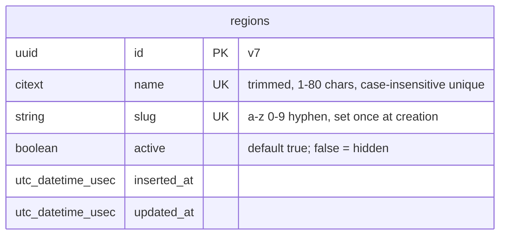

# 002 — Regions — Plan

**Status:** Done (2026-11-10)
**Spec:** [spec.md](./spec.md) (Done 2026-11-10)
**Created:** 2026-11-10
**Approved:** 2026-11-10

## Approach

One new context, `Jairojobs.Regions`, with one table and one schema. Reads are plain
functions; writes take the current `Scope` first and refuse anything that is not an Admin.
The admin UI is three small hand-written LiveViews under the existing `/admin` scope and
`live_session :require_admin` from spec 001: an Admin home, the Regions list, and one form
used for both New and Edit. The launch regions are inserted by an idempotent context
function called from `priv/repo/seeds.exs`.

Main trade-off: we hand-write the LiveViews instead of running `mix phx.gen.live`. The
generator would produce a Show page, a delete action and user-owned scoping that the spec
does not want, and removing them costs more than writing ~150 lines.

No new dependencies. No background jobs, emails or external services.

## Contexts & modules

| Module | New / Changed | Responsibility |
|---|---|---|
| `Jairojobs.Regions` | New | Public API: list, lookup by slug, create, rename, hide, show, seed |
| `Jairojobs.Regions.Region` | New | Schema + changesets (`create_changeset/2`, `rename_changeset/2`); slug derivation |
| `JairojobsWeb.Admin.HomeLive` | New | `/admin` — list of admin sections; only "Regions" for now |
| `JairojobsWeb.Admin.RegionLive.Index` | New | `/admin/regions` — list, Hide / Show |
| `JairojobsWeb.Admin.RegionLive.Form` | New | `/admin/regions/new`, `/admin/regions/:id/edit` |
| `JairojobsWeb.Router` | Changed | Three routes inside the existing `live_session :require_admin` |
| `JairojobsWeb.Layouts` | Changed | "Admin" nav item links to `/admin` (no longer a placeholder) |
| `JairojobsWeb.UserAuth` | Changed | `require_admin/2` plug sends non-admins home with a flash (decision 1) |
| `priv/repo/seeds.exs` | Changed | Calls `Jairojobs.Regions.seed_launch_regions/0` |
| `Jairojobs.RegionsFixtures` | New (test support) | `region_fixture/1`, built on `Regions.create_region/2` |

### `Jairojobs.Regions` API

| Function | Returns | Used by | REQ |
|---|---|---|---|
| `list_regions()` | all regions, A→Z | admin list | 1 |
| `list_active_regions()` | active regions, A→Z | 003, 005, 010 | 6 |
| `get_region_by_slug(slug)` | `%Region{}` or `nil`, active or not | 005, old links | 6 |
| `get_region!(id)` | `%Region{}` or raises | admin edit form | 3 |
| `change_region(region, attrs \\ %{})` | changeset for the form | admin form | 2, 3 |
| `create_region(scope, attrs)` | `{:ok, region}` / `{:error, changeset}` / `{:error, :unauthorized}` | admin form | 2 |
| `rename_region(scope, region, attrs)` | same | admin form | 3 |
| `hide_region(scope, region)` | `{:ok, region}` / `{:error, :unauthorized}` | admin list | 4 |
| `show_region(scope, region)` | same | admin list | 4 |
| `seed_launch_regions()` | `:ok` | seeds only | 5 |

### Slug derivation (REQ-002-2 rules)

Done once, in `Region.create_changeset/2`, from the trimmed name:

1. `String.normalize(name, :nfd)`, then drop everything that is not ASCII, so
   "Parañaque" becomes "Paranaque".
2. Downcase; replace every run of characters outside `a-z0-9` with one hyphen; trim hyphens.
3. If the result is empty (a name like "!!!"), add an error on `:name`.

`rename_changeset/2` casts `:name` only, so the slug cannot change after creation
(REQ-002-3). Neither changeset casts `:slug` or `:active` from params.

## Data model

No associations yet. `listings.region_id` arrives with spec 003.

### Migrations

1. `create_regions` (via `mix ecto.gen.migration create_regions`):
   - `name :citext, null: false` — the `citext` extension already exists (spec 001).
   - `slug :string, null: false`
   - `active :boolean, null: false, default: true`
   - `timestamps()` (usec, from the Repo config)
   - `unique_index(:regions, [:name])`, `unique_index(:regions, [:slug])`
   - CHECK `regions_slug_format`: `slug ~ '^[a-z0-9]+(-[a-z0-9]+)*$'`
   - CHECK `regions_name_length`: `char_length(name) BETWEEN 1 AND 80`

The unique indexes are the hard guarantee for the "Duplicate name" and "Slug collision"
scenarios; the changesets turn them into validation errors with `unique_constraint/3`
(the slug one reports on `:name`, since that is the only field the admin types).

## Routes & LiveViews / Controllers

All three routes go in the existing `scope "/admin", JairojobsWeb.Admin` block, which pipes
through `[:browser, :require_admin]`, inside the existing `live_session :require_admin`
(`on_mount: {JairojobsWeb.UserAuth, :require_admin}`). They belong there because every one
of them is Admin-only (REQ-002-1): the plug guards the first HTTP request and the hook
guards live navigation.

| Method / Live | Path | Module | Auth | REQ |
|---|---|---|---|---|
| live | `/admin` | `Admin.HomeLive` | `require_admin` | 1 (rule: nav links to admin area) |
| live | `/admin/regions` | `Admin.RegionLive.Index`, `:index` | `require_admin` | 1, 4 |
| live | `/admin/regions/new` | `Admin.RegionLive.Form`, `:new` | `require_admin` | 2 |
| live | `/admin/regions/:id/edit` | `Admin.RegionLive.Form`, `:edit` | `require_admin` | 3 |

Admin URLs use the UUID, not the slug (constitution §4.8).

### Screens (per `diagrams/wireframe-regions-admin`)

- **Admin home** — breadcrumb-less page with one list row, "Regions". More rows arrive with
  004 and 008.
- **Regions list** — breadcrumb "Admin ▸ Regions"; "Add region" is the one `btn-accent`
  CTA; rows are a LiveView stream (`stream(:regions, …)`), each showing the name, the
  `/jobs/<slug>` address in muted text, a "hidden" badge when inactive, and Edit plus
  Hide or Show as quiet buttons. Hide / Show call the context and `stream_insert` the
  updated row in place. The list is reloaded on mount, so a new or renamed region lands in
  alphabetical order after the form navigates back.
- **New / Edit form** — stock `<.form>` + `<.input>`, `phx-change="validate"`,
  `phx-submit="save"`; errors inline under Name. Edit shows the web address read-only.
  On success: flash + `push_navigate` to `/admin/regions`.

"Inline add/edit; no modal" in the spec's non-functional requirements is read as: New and
Edit are ordinary pages in the normal flow, as drawn in the screen flow and wireframe. No
modal component is used.

### DOM ids (fixed now so tests can be written first)

| Element | id |
|---|---|
| Admin home list / Regions link | `#admin-sections` / `#admin-section-regions` |
| Regions stream container / row | `#regions` / `#regions-<uuid>` |
| Add button | `#add-region` |
| Row actions | `#edit-region-<uuid>`, `#hide-region-<uuid>`, `#show-region-<uuid>` |
| Hidden badge | `#region-hidden-<uuid>` |
| Form / cancel link | `#region-form` / `#region-form-cancel` |
| Read-only address on Edit | `#region-address` |

## Authorization

- **Writes** (`create_region/2`, `rename_region/3`, `hide_region/2`, `show_region/2`) check
  `Scope.admin?(scope)` first and return `{:error, :unauthorized}` otherwise — for a
  Candidate, an Employer, `nil`, and the system scope (which `Scope` reserves for
  promote / demote only).
- **Reads** take no scope. Region name, slug and active flag are not private data: active
  regions are public by design and hidden ones must resolve by slug for anyone (REQ-002-6).
  The full list including hidden regions is only *rendered* behind `require_admin`.
- **`seed_launch_regions/0`** takes no scope and accepts no input: it can only insert the
  three fixed launch regions. It is called from seeds, never from the web layer.
- LiveView event handlers always pass `socket.assigns.current_scope` to the context. That
  scope is loaded at mount, so an admin demoted while a page is open keeps write access on
  that page until their next navigation or reload, when the `require_admin` hook runs again
  (same "role change applies on the next request" rule as REQ-001-9).

## Background jobs / emails / external services

- None. No sequence diagram is needed (no flow touches three parties).

## Seeding (REQ-002-5)

`seed_launch_regions/0` loops over `[{"Davao City", "davao-city"}, {"Cebu", "cebu"},
{"Metro Manila", "metro-manila"}]`. For each one it skips when a region with that slug
exists, otherwise inserts it as active with `on_conflict: :nothing`, so a clash on the name
(an admin renamed another region to "Cebu") is also skipped instead of crashing. An admin's
rename of a seeded region is never undone because the match is on slug.

- Dev / fresh install: `priv/repo/seeds.exs` calls it; `mix ecto.setup` already runs seeds.
- Production: `Jairojobs.Release` does not exist yet (deferred to the Fly.io deployment in
  spec 001). A `Jairojobs.Release.seed/0` entry point that calls the same function is
  added there, not in this spec's tasks.

## Test strategy

Scenario-first (constitution §3.12). Every Gherkin scenario gets a test named
`REQ-002-n: <scenario name>`.

| REQ | Scenario(s) | Test location | Type |
|---|---|---|---|
| 1 | Admin sees all regions (A→Z, hidden marked) | `test/jairojobs/regions_test.exs`, `test/jairojobs_web/live/admin/region_live_test.exs` | context + LiveView |
| 1 | Non-admin is refused; Visitor is redirected to log in | `region_live_test.exs`, `test/jairojobs_web/live/admin/home_live_test.exs`, `test/jairojobs_web/user_auth_test.exs` | LiveView + plug |
| 1 | Admin nav item links to `/admin` (rule) | `test/jairojobs_web/components/layouts_test.exs` | component |
| 2 | Add a region; Duplicate name; Blank or too-long name; Slug collision | `regions_test.exs`, `region_live_test.exs` | context + LiveView |
| 3 | Rename keeps the slug; Rename to an existing name | `regions_test.exs`, `region_live_test.exs` | context + LiveView |
| 4 | Hide a region; Unhide a region; Hidden region keeps its data | `regions_test.exs`, `region_live_test.exs` | context + LiveView |
| 5 | Fresh install has the launch regions; Seed is safe to run again | `regions_test.exs` | context |
| 6 | Only active regions are offered; Lookup by slug works for hidden regions | `regions_test.exs` | context |
| — | Authorization: every write refuses candidate, employer, `nil` and system scopes | `regions_test.exs` | context (constitution §3.4) |

Notes:
- "Hidden region keeps its data" can only assert that the region still exists and still
  resolves by slug. The "its listings still exist" half gets its test in spec 003, when
  listings exist.
- Slug derivation edge cases (diacritics, punctuation runs, symbols-only name) are extra
  context tests under REQ-002-2.
- Fixtures go through `Regions.create_region(admin_scope, attrs)` (constitution §3.3).

## Risks & mitigations

| Risk | Mitigation |
|---|---|
| Changing the `require_admin` plug alters behaviour tested under spec 001 | One small task (T5) that updates the plug, its doc and its test together; noted in spec 001's tasks notes |
| Two admins add the same name at once | Unique indexes decide; the loser gets a validation error from `unique_constraint` |
| A name with no ASCII letters or digits produces an empty slug | Changeset error on `:name`; CHECK constraint as the backstop |
| Admin microcopy promises `/jobs/<slug>` before spec 005 defines that route | Accepted with the spec; if 005 picks another path, only two strings in the admin screens change |
| Seeds are not run automatically in production | Called out above; `Release.seed/0` lands with the deployment work |
| Stream order after Hide / Show | `stream_insert` keeps the row's position; name order is unaffected by the active flag |

## Decisions confirmed (2026-11-10)

| # | Decision | Choice | Hard to change later? |
|---|---|---|---|
| 1 | Non-admin opening an admin URL directly: spec says "refused and sent home with a message", but the spec-001 `require_admin` plug renders a 403 page (only the LiveView hook redirects home) | Change the plug to redirect to `/` with the same flash as the hook, so both paths match the spec | no |
| 2 | Scope on read functions | None — region data is not private | no |
| 3 | Name column type | `citext`, for case-insensitive uniqueness and ordering | medium — column type |
| 4 | Admin home page at `/admin` | Yes, a one-row section list, as in the screen flow | no |
| 5 | Hand-written LiveViews instead of `phx.gen.live` | Yes | no |
| 6 | Production seed entry point | Deferred to the Fly.io deployment, like `Release.promote_admin/1` | no |

## Alternatives considered

- **`mix phx.gen.live Regions Region regions`** — rejected; see Approach.
- **Seed through a data migration** — rejected; it would run in the test database, mix
  schema and data concerns (constitution §4.10), and make "seed is safe to run again" a
  one-shot instead of a repeatable command.
- **Slug library (`slugify`, `slugger`)** — rejected; ten lines of standard-library code
  cover the rule (constitution §2.2).
- **`lower(name)` unique index on a plain string column** — rejected; `citext` is already
  installed and used for `users.email`, and it also gives case-insensitive `ORDER BY`.
- **Single LiveView with the form swapped in via `live_action`** — rejected; two modules
  are simpler to read and match the three screens in the wireframe.
- **Keep the 403 for direct visits and amend the spec scenario instead** — rejected
  (decision 1); the spec stays and the plug changes.
