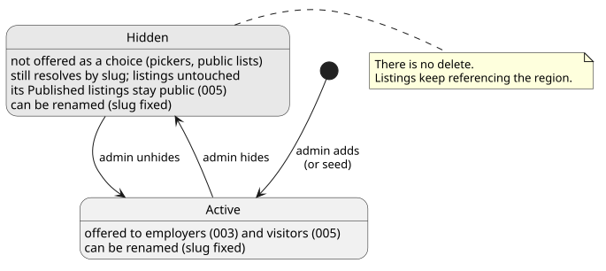
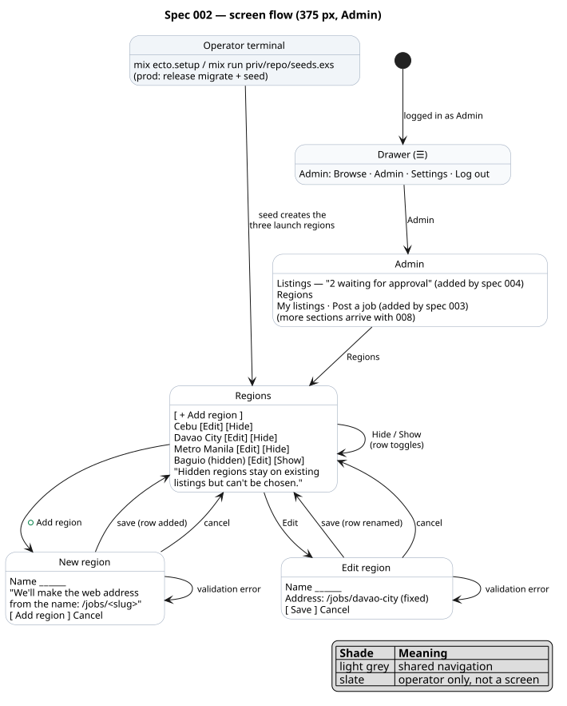
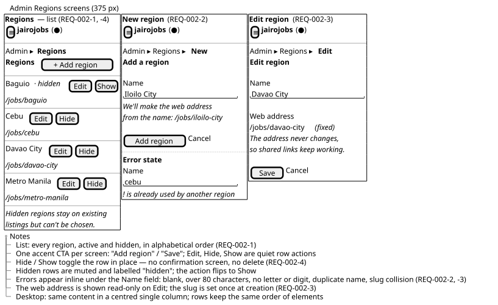
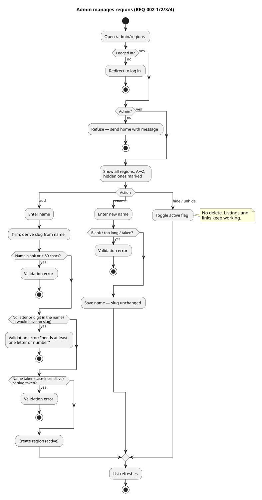
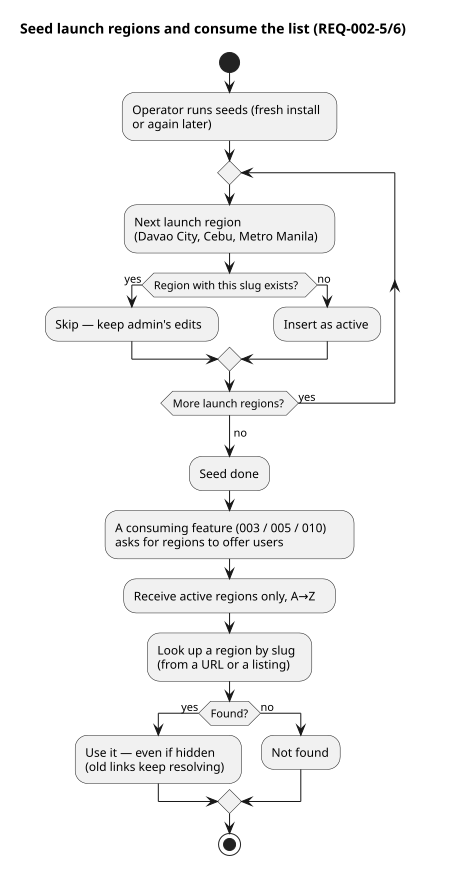

# 002 — Regions

**Status:** Done (2026-11-10)
**Created:** 2026-11-05
**Approved:** 2026-11-10
**Owner:** Jairo
**Related ADRs:** 0004 (UUID v7 keys)
**Depends on:** 000 (product overview), 001 (admin role, `require_admin`)

## Problem / Why

jairojobs is organised by place: a job seeker in Davao wants Davao jobs, not a national pile.
Every Listing belongs to exactly one **Region** (spec 000 glossary), the public index is
browsed by region (005), and alerts are "new jobs in your region" (010). None of that can be
built until the list of supported regions exists and an Admin can maintain it.

This spec creates that list, seeds the three launch regions, and gives Admins a small screen
to manage it. It is also the first real page behind the `/admin` scaffold from spec 001.

## Goals

- A single, admin-managed list of supported regions (PH cities / areas).
- Seeded with the launch regions: **Davao City**, **Cebu**, **Metro Manila**.
- Admins can add a region, rename it, and hide (deactivate) / unhide it.
- Every region has a stable, URL-safe **slug** so public pages (005) get shareable links.
- Other features can rely on a clear contract: *active* regions are offered to users;
  *inactive* ones are hidden but keep their history.

## Non-goals / Out of scope

- Hierarchy (province → city), coordinates, maps, or distance search.
- Deleting a region. Regions are deactivated, never removed (listings will reference them).
- Region pickers on listing forms (003) and the public browse-by-region index (005) — they
  *consume* this list; they are specified there.
- Per-region admins or moderation. One admin role covers all regions (spec 001).
- Public "request a region" form. Admins add regions on their own judgement for now.
- Translations / local-language names.

## Personas involved

- **Admin** — maintains the list.
- **Employer**, **Candidate**, **Visitor** — do not appear in this spec's screens; they
  only ever *see* active regions, through later specs.

## User stories

**US-002-1**
- As an Admin,
- I want to see the list of supported regions,
- so that I know which places the site currently serves.

**US-002-2**
- As an Admin,
- I want to add a new city or area,
- so that employers there can post and job seekers there can browse.

**US-002-3**
- As an Admin,
- I want to rename a region,
- so that a typo or an official name change does not require a developer.

**US-002-4**
- As an Admin,
- I want to hide a region without deleting it,
- so that nobody can post there any more while existing listings and links keep working.

**US-002-5**
- As an Admin,
- I want to unhide a region,
- so that I can bring a place back when it is ready.

**US-002-6**
- As the Operator,
- I want the launch regions created automatically on a fresh install,
- so that the site is usable on day one without typing them in.

## Region lifecycle

A region is either **active** or **inactive**. Scenarios in REQ-002-4 and REQ-002-6 must
agree with this diagram.



*Source: `diagrams/state-region.puml`.*

## Screen flow



| Story | Path through the screen flow |
|---|---|
| US-002-1 see the list | Drawer → Admin → Regions |
| US-002-2 add a region | Regions → New region → Regions (row added) |
| US-002-3 rename | Regions → Edit region → Regions (row updated) |
| US-002-4 hide | Regions → [Hide] → Regions (row marked hidden) |
| US-002-5 unhide | Regions → [Show] → Regions (row active again) |
| US-002-6 seed | Operator terminal → Regions already lists the three launch regions |

*Source: `diagrams/screenflow-regions.puml`.*

### Wireframe: admin Regions screens

Layout of the list and the New / Edit forms at 375 px (layout only, not visual design):



*Source: `diagrams/wireframe-regions-admin.puml`.*

## Flows (activity diagrams)

| Flow | Covers | Diagram |
|---|---|---|
| Admin manages regions | REQ-002-1, -2, -3, -4 | [activity-manage-regions](diagrams/activity-manage-regions.svg) |
| Seed and consume | REQ-002-5, -6 | [activity-seed-and-consume](diagrams/activity-seed-and-consume.svg) |

### Admin manages regions


### Seed and consume


*Sources: `diagrams/activity-*.puml`.*

## Requirements

### REQ-002-1: Admin-only regions page

**Serves:** US-002-1

The regions list lives under the admin area and is only reachable by Admins. It shows every
region, active and inactive, in alphabetical order.

```gherkin
Scenario: Admin sees all regions
  Given I am logged in as an Admin
  And regions "Cebu" (active), "Davao City" (active) and "Baguio" (inactive) exist
  When I open the Regions page
  Then I see all three regions in alphabetical order
  And "Baguio" is marked as hidden

Scenario: Non-admin is refused
  Given I am logged in as a Candidate or Employer
  When I open the Regions page
  Then I am refused and sent home with a message

Scenario: Visitor is redirected to log in
  Given I am not logged in
  When I open the Regions page
  Then I am redirected to the log-in page
```

**Rules**
- Uses the `require_admin` hook and `live_session :require_admin` from spec 001.
- The "Admin" entry in the navigation (spec 001 placeholder) now links to the admin area,
  which lists Regions among its pages.

### REQ-002-2: Add a region

**Serves:** US-002-2

An Admin adds a region by name. A URL-safe slug is derived from the name once, at creation.

```gherkin
Scenario: Add a region
  Given I am an Admin on the Regions page
  When I add a region named "Iloilo City"
  Then "Iloilo City" appears in the list as active
  And its slug is "iloilo-city"

Scenario: Duplicate name
  Given a region named "Cebu" exists
  When I add a region named "cebu" or " Cebu "
  Then I see a validation error
  And no region is created

Scenario: Blank or too-long name
  Given I am an Admin on the Regions page
  When I add a region with an empty name, or a name longer than 80 characters
  Then I see a validation error

Scenario: Slug collision
  Given a region "Cebu" (slug "cebu") exists
  When I add a region named "Cebu!" which would also produce slug "cebu"
  Then I see a validation error

Scenario: Name with no letter or digit
  Given I am an Admin on the Regions page
  When I add a region named "!!!"
  Then I see a validation error
  And no region is created
```

**Rules**
- Names are trimmed; uniqueness is case-insensitive.
- Slug: lowercase ASCII letters, digits and hyphens; derived from the name; unique.
- A name must contain at least one letter or digit, so that it has a slug. The error reads
  "needs at least one letter or number".
- A new region is active by default.

### REQ-002-3: Rename a region

**Serves:** US-002-3

```gherkin
Scenario: Rename keeps the slug
  Given a region "Davao" with slug "davao" exists
  When I rename it to "Davao City"
  Then the list shows "Davao City"
  And its slug is still "davao"

Scenario: Rename to an existing name
  Given regions "Cebu" and "Davao City" exist
  When I rename "Davao City" to "Cebu"
  Then I see a validation error
  And nothing changes
```

**Rules**
- The slug never changes after creation, so shared links (005) keep working. If a slug
  must change, the admin creates a new region and hides the old one.

### REQ-002-4: Hide and unhide a region

**Serves:** US-002-4, US-002-5

```gherkin
Scenario: Hide a region
  Given an active region "Baguio"
  When I hide it
  Then it is marked hidden in the list
  And it is no longer offered to employers or visitors

Scenario: Unhide a region
  Given a hidden region "Baguio"
  When I unhide it
  Then it is active again
  And it is offered to employers and visitors

Scenario: Hidden region keeps its data
  Given a region "Baguio" with existing listings (once spec 003 exists)
  When I hide it
  Then the region and its listings still exist
  And existing links to the region still resolve
```

**Rules**
- There is no delete. Hiding is the only way to retire a region.
- Hiding does not change any listing. A hidden region's *published* listings stay public
  (spec 005, decision 1 and REQ-005-1): they stay on the list of every region, in search
  and at their own addresses. Hiding only stops the region being offered as a choice; its
  own list still opens at its address (REQ-005-3). An Admin who wants such a listing gone
  takes it down or moves it (spec 004).

### REQ-002-5: Launch regions are seeded

**Serves:** US-002-6

```gherkin
Scenario: Fresh install has the launch regions
  Given a fresh database
  When the seed runs
  Then regions "Davao City", "Cebu" and "Metro Manila" exist and are active
  With slugs "davao-city", "cebu" and "metro-manila"

Scenario: Seed is safe to run again
  Given the launch regions already exist and "Cebu" was renamed to "Cebu City" by an Admin
  When the seed runs again
  Then no duplicate regions are created
  And the Admin's rename is not undone
```

**Rules**
- The seed is idempotent: it matches on slug and only inserts what is missing.

### REQ-002-6: Active regions are what the rest of the site sees

**Serves:** US-002-4, US-002-5

Other features (003 listing form, 005 public browse, 010 alerts) consume regions through one
contract: the list of **active** regions, alphabetical, plus lookup of any region (active or
not) by slug.

```gherkin
Scenario: Only active regions are offered
  Given regions "Cebu" (active) and "Baguio" (hidden) exist
  When a feature asks for the regions to offer users
  Then it gets "Cebu" and not "Baguio"

Scenario: Lookup by slug works for hidden regions
  Given a hidden region with slug "baguio"
  When a feature looks up "baguio"
  Then it gets the region (so old links and existing listings still resolve)
```

## Non-functional requirements

- **Mobile-first:** the regions page is usable at 375 px — one column, rows ≥ 44 px;
  adding and editing happen on their own pages, not in a modal.
- **Authorization:** all write operations require an Admin scope; the context refuses any
  other scope (constitution §2.7).
- **Small data:** the list is expected to stay under ~200 rows; no pagination or search.
- **Design:** follows `docs/design.md` — list rows with dividers, one accent CTA
  ("Add region"), plain-language microcopy.

## Open questions

- None.

## Review before approval

Reviewed after the fact. This spec was approved and built before the review rule existed
(constitution §6, 2026-11-20); the owner asked for it to be reviewed as it stands today.
The owner then went through what was found, one item at a time, on 2026-11-24; each item
below says what was done about it.

**Reviewed:** 2026-11-24 at commit `39ff666`

| Checked against | Result |
|---|---|
| This spec's diagrams, scenario by scenario | The 17 scenarios agree with the two activity diagrams, the state diagram, the screen flow and the wireframe. Found and fixed on 2026-11-24: (1) the screen flow and the wireframe listed the hidden region last; they now list every region in alphabetical order, as REQ-002-1 and the app do. (2) The mobile requirement said "inline add/edit"; it now says adding and editing happen on their own pages, as the screen flow, the wireframe and the app have it. (3) The app refused a name with no letter or digit and the spec did not say so; REQ-002-2 has the scenario "Name with no letter or digit" and a rule, with a test named after it at each level, and the activity diagram and the wireframe show the case |
| `architecture/overview.md` (contexts, boundaries, who gets in) | Agrees: Regions context, the `:require_admin` session. REQ-002-1's rule called Regions the admin area's "first page"; it now says the area lists Regions among its pages (the first row has been Listings since spec 004) |
| `architecture/data-model.md` and the ERD | Agrees: `regions` (name unique ignoring case, 1–80; slug unique, set once; active) |
| C4 and use case diagrams | Agrees: "Manage regions" belongs to the Admin |
| ADRs and the constitution | Agrees: ADR-0004 (ids), constitution §2.7 (the context refuses a non-Admin) |
| Earlier specs this one changes ("Notes for the plan") | None listed in this spec. Later specs changed it three times (003, 004, the design guide); each has a changelog row. Spec 005 will change REQ-002-4's rule and `state-region`, as its own table says |
| Not checked | Whether renaming a region to a name with no letter or digit is refused was not checked; the new scenario is about adding one. The screens were read in the source, not opened in a browser |

## Traceability

| Story | Requirements |
|---|---|
| US-002-1 | REQ-002-1 |
| US-002-2 | REQ-002-2 |
| US-002-3 | REQ-002-3 |
| US-002-4 | REQ-002-4, REQ-002-6 |
| US-002-5 | REQ-002-4, REQ-002-6 |
| US-002-6 | REQ-002-5 |

## Changelog

| Date | Change |
|---|---|
| 2026-11-05 | Created |
| 2026-11-10 | Added Salt wireframe of the admin Regions screens (list, New, Edit) |
| 2026-11-10 | Approved |
| 2026-11-10 | Done. Implemented per tasks.md; "Deployed to Fly.io" deferred until a deployment exists |
| 2026-11-12 | Diagrams brought in line with the app: screen flow lists the Admin rows added by spec 003; wireframe shows the real duplicate-name error |
| 2026-11-16 | Changed by spec 004: the screen flow's Admin screen gains "Listings" as its first row, with the waiting count |
| 2026-11-17 | Design guide change (docs/design.md changelog): the breadcrumb links on the Regions pages are 44 px tall; fields and buttons are 44 px and the accent colour is one step darker. No requirement changed |
| 2026-11-23 | "Review before approval" section added after the fact, at the owner's request: the spec as it stands was read against its diagrams and the architecture documents. Findings are listed in that section; nothing else was changed |
| 2026-11-24 | After the review, each item chosen by the owner. Amended: REQ-002-2 gains the scenario "Name with no letter or digit" and its rule (the app already refused such a name; one test renamed to the scenario, one screen test added); REQ-002-1's rule says the admin area lists Regions among its pages, no longer that Regions is its first page; the mobile requirement says adding and editing happen on their own pages, where it said "inline". Diagrams: the screen flow and the wireframe list the hidden region in alphabetical order with the rest; the activity diagram and the wireframe's error list show the new case. No code changed |
| 2026-11-24 | "Review before approval" section brought up to date: it says what was done about each finding and names the commit that holds the fixes |
| 2026-11-26 | Changed by spec 005, after Done: REQ-002-4's rule states what spec 005 decided about a hidden region's published listings (they stay public; the region is only no longer offered as a choice). `state-region` says the same. `activity-seed-and-consume` was read against REQ-005-3 and needed no change. No scenario changed |
