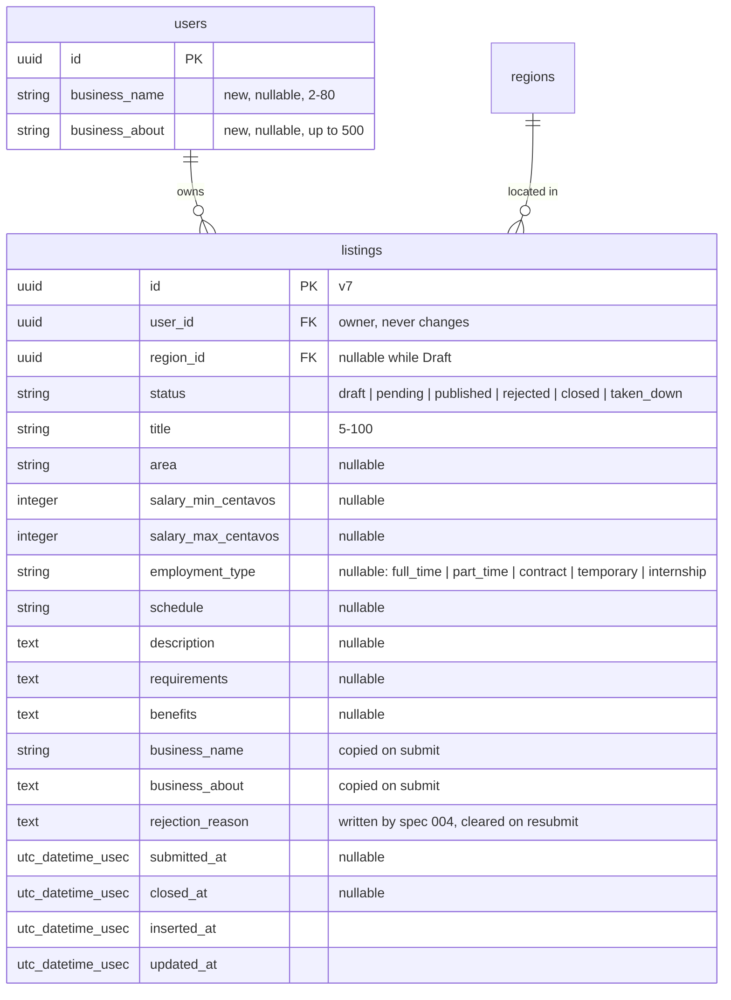

# 003 — Listings: employer posting — Plan

**Status:** Draft
**Spec:** [spec.md](./spec.md) (Approved 2026-11-10)
**Created:** 2026-11-11

## Approach

One new context, `Jairojobs.Listings`, with one table. Every function takes the current
`Scope` first; ownership and role are checked inside the context on every read and write, so
the screens cannot be the only guard. Status changes are small, explicit context functions
(`submit_listing/2`, `withdraw_listing/2`, `close_listing/2`), not a state-machine library.
Business details are two columns on `users`, owned by `Jairojobs.Accounts`; a listing copies
them when it is submitted, which is how "a change never alters a Pending or Live listing"
is kept true.

The screens are four hand-written LiveViews under `/my`, behind a new `require_poster` hook
(Employer or Admin), built the same way as the Regions admin screens from spec 002.

Main trade-off: spec 004 (approve, reject, take down) does not exist yet, but this spec's
scenarios need Published, Rejected and Taken down listings. Tests get them from a
**test-only helper that sets the status directly** (decision 1). That bends the
"fixtures via context functions" rule on purpose, and the helper is replaced by the real
context functions when spec 004 lands.

No new dependencies. No background jobs, emails or external services.

## Contexts & modules

| Module | New / Changed | Responsibility |
|---|---|---|
| `Jairojobs.Listings` | New | Public API for an owner's listings: list, get, create, update, delete, submit, withdraw, close, limit |
| `Jairojobs.Listings.Listing` | New | Schema + changesets (`draft_changeset/2`, `submit_changeset/1`); status and employment-type enums |
| `Jairojobs.Pesos` | New | Ecto type: whole pesos in memory and in forms, integer **centavos** in the database (constitution §4.5) |
| `Jairojobs.Accounts` | Changed | `change_business_details/2`, `update_business_details/2`, `business_details?/1` |
| `Jairojobs.Accounts.User` | Changed | `business_name`, `business_about`; `business_changeset/2` |
| `Jairojobs.Accounts.Scope` | Changed | `poster?/1` — `true` for Employer and Admin |
| `JairojobsWeb.UserAuth` | Changed | `require_poster` plug and `on_mount(:require_poster, …)` |
| `JairojobsWeb.Employer.ListingLive.Index` | New | My listings |
| `JairojobsWeb.Employer.ListingLive.Form` | New | New / edit listing |
| `JairojobsWeb.Employer.ListingLive.Show` | New | Owner view: status box, the listing, the actions the status allows |
| `JairojobsWeb.Employer.BusinessLive` | New | Business details form |
| `JairojobsWeb.ListingComponents` | New | `listing_detail/1` (the listing as visitors will see it — reused by 004 and 005), `status_badge/1` |
| `JairojobsWeb.Format` | New | `salary_range/2,3` — the one money display helper |
| `JairojobsWeb.Layouts` | Changed | Employer items "My listings" and "Post a job" become real links |
| `JairojobsWeb.Admin.HomeLive` | Changed | Two more rows: "My listings", "Post a job" |
| `JairojobsWeb.Router` | Changed | `/my` scope with `live_session :require_poster` |
| `Jairojobs.ListingsFixtures` | New (test support) | `listing_fixture/2`, `complete_listing_attrs/1`, `set_listing_status/3` (decision 1) |

### `Jairojobs.Listings` API

| Function | Returns | REQ |
|---|---|---|
| `list_my_listings(scope)` | the owner's listings, most recently changed first, region preloaded | 13, 14 |
| `get_my_listing!(scope, id)` | the listing, or raises `Ecto.NoResultsError` when it is missing **or not the caller's** | 10, 14 |
| `change_listing(listing, attrs \\ %{})` | changeset for the form | 3, 5 |
| `create_listing(scope, attrs)` | `{:ok, listing}` / `{:error, changeset}` / `{:error, :unauthorized}` / `{:error, :business_details_required}` | 1, 2, 3 |
| `update_listing(scope, listing, attrs)` | `{:ok, listing}` / `{:error, changeset}` / `{:error, :locked}` | 5 |
| `delete_listing(scope, listing)` | `{:ok, listing}` / `{:error, :locked}` | 11 |
| `missing_fields(listing)` | list of required fields still missing, `[]` when complete | 4, 10 |
| `submit_listing(scope, listing)` | `{:ok, listing}` / `{:error, {:incomplete, fields}}` / `{:error, :region_hidden}` / `{:error, :limit_reached}` / `{:error, :invalid_status}` | 4, 6, 8, 12 |
| `withdraw_listing(scope, listing)` | `{:ok, listing}` / `{:error, :invalid_status}` | 7 |
| `close_listing(scope, listing)` | `{:ok, listing}` / `{:error, :invalid_status}` | 9 |
| `count_open_listings(scope)` | integer (Pending + Published) | 12, 13 |
| `open_listing_limit(scope)` | `3` for an Employer, `:unlimited` for an Admin | 12, 13 |

Every write also returns `{:error, :unauthorized}` for a scope that is not an Employer or
Admin, and `{:error, :not_found}` when the listing passed in is not the caller's.

### Field rules — where each one is enforced

| Rule | `draft_changeset/2` (save, edit) | `submit_changeset/1` (submit, resubmit) |
|---|---|---|
| Title required, 5–100 | yes | yes |
| Maximum lengths (area 80, schedule 80, description 5,000, requirements 3,000, benefits 3,000) | yes | yes |
| Salary: whole pesos, min ≥ 1,000, max ≥ min, max ≤ 1,000,000 | yes, when filled in; both or neither | yes |
| Type is one of the five | yes, when filled in | yes |
| Region, area, salary, type, description present | no | yes |
| Description at least 50 characters | no | yes |
| Region is active | not checked; the form offers active regions plus the draft's current one | checked in the context |

Reading of the spec: "a filled-in field must still be valid" is applied to formats and
maximums. The 50-character minimum on "About the job" is checked only on submit, so a
half-written description can be saved as a draft.

### Submitting (REQ-003-6, -8, -12)

`submit_listing/2` runs in one transaction:

1. Lock the owner's `users` row (`FOR UPDATE`), so two submissions by the same account
   queue up instead of both passing the limit check. Same pattern as `demote_admin/2`.
2. Status must be Draft or Rejected, else `:invalid_status`.
3. `submit_changeset/1` must be valid, else `{:incomplete, fields}`.
4. The region must be active, else `:region_hidden`.
5. For an Employer, `count_open_listings < 3`, else `:limit_reached`. Skipped for an Admin.
6. Set status Pending, `submitted_at` now, clear `rejection_reason`, copy the owner's
   current `business_name` and `business_about` onto the listing.

## Data model

### Migrations

1. `add_business_details_to_users` — `business_name :string`, `business_about :string`,
   both nullable. CHECK `users_business_name_length`: null or 2–80 characters.
2. `create_listings`:
   - columns as above; `status` `null: false, default: "draft"`; `title` `null: false`
   - `user_id` and `region_id` reference with `on_delete: :restrict` (regions are never
     deleted; accounts with listings must not vanish silently)
   - `index(:listings, [:user_id, :status])` — My listings and the open count
   - CHECK `listings_status_check`: one of the six statuses
   - CHECK `listings_employment_type_check`: null or one of the five types
   - CHECK `listings_salary_check`: both null, or both set with
     `min >= 100000`, `max >= min`, `max <= 100000000`, and both multiples of 100
   - CHECK `listings_complete_unless_unsubmitted`: `status IN ('draft', 'rejected')` or
     region, area, both salaries, type, description and business name are all present

The last constraint is the database-level guarantee behind "every submitted listing has a
salary range, a region and a named business": no code path, including spec 004's, can make
an incomplete listing Pending or Published.

Spec 004 adds its own columns (who decided, when) and spec 005 the public slug and
`published_at`; neither is created here.

## Routes & LiveViews / Controllers

A new scope `scope "/my", JairojobsWeb.Employer`, piped through
`[:browser, :require_poster]`, holding one new `live_session :require_poster`
(`on_mount: {JairojobsWeb.UserAuth, :require_poster}`). These routes cannot go in the
existing `:require_authenticated_user` session because Candidates must be refused, and not
in `:require_admin` because Employers must get in. A third session with its own hook is the
smallest way to say "Employer or Admin" once, for every screen (REQ-003-1).

| Method / Live | Path | Module | Auth | REQ |
|---|---|---|---|---|
| live | `/my/listings` | `Employer.ListingLive.Index`, `:index` | `require_poster` | 1, 13 |
| live | `/my/listings/new` | `Employer.ListingLive.Form`, `:new` | `require_poster` | 2, 3 |
| live | `/my/listings/:id` | `Employer.ListingLive.Show`, `:show` | `require_poster` + owner | 10 and all actions |
| live | `/my/listings/:id/edit` | `Employer.ListingLive.Form`, `:edit` | `require_poster` + owner | 5 |
| live | `/my/business` | `Employer.BusinessLive`, `:edit` | `require_poster` | 2 |

The UUID is used in these private addresses (constitution §4.8). `/my/listings/:id` for
someone else's listing raises `Ecto.NoResultsError`, which is the same 404 as an id that
does not exist (REQ-003-14).

Like `require_admin`, the plug and the hook send a visitor to log in (returning afterwards)
and a signed-in Candidate home with "You are not authorized to access this page."

### Screens (per `diagrams/wireframe-posting`)

- **My listings** — "Post a job" is the one accent button; "x of 3 open listings used" for
  Employers only; rows are a LiveView stream, each a link to the owner view showing title,
  region · salary (or "Not finished yet"), and the status label; empty state with an
  invitation to post; a footer line with the business name and "Edit business details".
- **Business details** — name and optional "about". After the first save it continues to
  the listing form; later saves return to My listings.
- **Listing form** — opening `/my/listings/new` without business details redirects to
  `/my/business` first. Stock `<.form>` / `<.input>`; region select fed by
  `Regions.list_active_regions/0`, plus the draft's current region marked "(no longer
  available)" when an Admin has hidden it since, so editing never silently clears it and
  submit refuses it as REQ-003-6 describes; two salary inputs with `inputmode="numeric"`; "Save draft"
  is the accent button. Opening the edit form for a locked listing redirects to the owner
  view with a message.
- **Owner view** — a status box (label, one sentence on what happens next, the missing
  fields or the rejection reason when relevant, and only the actions the status allows),
  then `listing_detail`. A Draft or Rejected listing shows the account's **current**
  business name and "about" (what would be submitted); every other status shows the
  listing's own copy, taken at submit. Close and Delete use `data-confirm` with the spec's
  wording; no modal. Submit failures show a flash naming the reason (missing fields, hidden region,
  limit reached).

### DOM ids (fixed now so tests can be written first)

| Element | id |
|---|---|
| My listings stream / row / empty state | `#my-listings` / `#my-listings-<uuid>` / `#no-listings` |
| Post a job button, open-listings line, business footer link | `#post-a-job`, `#open-listings-count`, `#edit-business` |
| Status label on a row or in the status box | `#listing-status-<uuid>` |
| Business form (params under `business`) | `#business-form` |
| Listing form (params under `listing`) / cancel | `#listing-form` / `#listing-form-cancel` |
| Owner view: status box, listing body | `#listing-status-box`, `#listing-detail` |
| Owner view: missing fields, rejection reason | `#listing-missing`, `#listing-rejection-reason` |
| Owner view actions | `#submit-listing`, `#edit-listing`, `#withdraw-listing`, `#close-listing`, `#delete-listing` |
| Listing body fields | `#listing-title`, `#listing-business`, `#listing-salary`, `#listing-location`, `#listing-type`, `#listing-schedule` |
| Admin home rows | `#admin-section-my-listings`, `#admin-section-post-a-job` |

## Authorization

- **Role:** `Scope.poster?/1` is `true` for `:employer` and `:admin`. The hook and plug use
  it for the screens; every `Listings` write and `Accounts.update_business_details/2` check
  it again and return `{:error, :unauthorized}` otherwise.
- **Ownership:** all reads go through `list_my_listings/1` and `get_my_listing!/2`, which
  filter on `user_id == scope.user.id`. Writes compare `listing.user_id` with the scope
  again rather than trusting the struct they were handed. `user_id` is set from the scope
  on create and is never cast.
- **Admins** get no special access to other people's listings from this context; their
  moderation powers are separate functions in spec 004.
- **Status, owner, business snapshot, rejection reason and timestamps** are never cast
  from params.
- As noted in spec 002, the scope is loaded at mount: a role change takes effect on the
  person's next navigation or reload.

## Logging and privacy

The spec requires that listing text and business details are not written to logs
(constitution §4.12).

- The context and LiveViews log nothing about listing content; any log line uses ids only.
- Phoenix logs form parameters at `debug`, which production (`level: :info`) does not emit.
  To make it certain in every environment, `config :phoenix, :filter_parameters` becomes
  `["password", "listing", "business"]` — the two form names — so their values are logged
  as `[FILTERED]`. The business form is therefore named `business`, not `user`.

## Background jobs / emails / external services

- None. No sequence diagram is needed.

## Test strategy

Scenario-first (constitution §3.12). Every Gherkin scenario gets a test named
`REQ-003-n: <scenario name>`. Listing tests use unique titles and business names so they
can stay `async: true`; they depend on regions through `region_fixture/1`, which already
generates unique names.

| REQ | Scenario group | Test location | Type |
|---|---|---|---|
| 1 | Employer / Admin allowed; Candidate refused; Visitor to log in and back | `test/jairojobs_web/user_auth_test.exs`, `test/jairojobs_web/live/employer/listing_live_test.exs` | plug + LiveView |
| 2 | First post asks; name required; later posts skip; change does not alter a Live listing | `test/jairojobs/accounts_test.exs`, `test/jairojobs/listings_test.exs`, `test/jairojobs_web/live/employer/business_live_test.exs` | context + LiveView |
| 3 | Unfinished draft; title required; filled-in field valid; only active regions | `listings_test.exs`, `listing_live_test.exs` | context + LiveView |
| 4 | Complete; salary required; salary makes sense; real monthly amount; same min and max | `listings_test.exs`, `test/jairojobs/pesos_test.exs`, `test/jairojobs_web/format_test.exs` | context + unit |
| 5 | Edit a draft; Pending locked; Live locked; editing a locked listing refused | `listings_test.exs`, `listing_live_test.exs` | context + LiveView |
| 6 | Submit; incomplete; region hidden; submitting twice | `listings_test.exs`, `listing_live_test.exs` | context + LiveView |
| 7 | Withdraw; only pending | `listings_test.exs`, `listing_live_test.exs` | context + LiveView |
| 8 | See the reason; fix and resubmit; same checks | `listings_test.exs`, `listing_live_test.exs` | context + LiveView |
| 9 | Close; closing asks first; only live | `listings_test.exs`, `listing_live_test.exs` | context + LiveView |
| 10 | Owner view of a draft; missing fields; actions follow the status | `listing_live_test.exs` | LiveView |
| 11 | Delete draft; delete rejected; others refused | `listings_test.exs`, `listing_live_test.exs` | context + LiveView |
| 12 | Within limit; limit reached; drafts not limited; closing frees a place; Admins not limited | `listings_test.exs`, `listing_live_test.exs` | context + LiveView |
| 13 | See my listings; unfinished draft row; limit shown; empty state | `listing_live_test.exs` | LiveView |
| 14 | Another employer's listing not found (every action); list shows only mine | `listings_test.exs`, `listing_live_test.exs` | context + LiveView (constitution §3.4) |

Notes:
- **REQ-002-4 "Hidden region keeps its data"** — spec 002 left the "its listings still
  exist" half to this spec. One context test hides a region that has listings in every
  status and asserts that none of them changed.
- **Published, Rejected and Taken down** listings come from
  `ListingsFixtures.set_listing_status/3`, which updates the row directly. It lives only in
  `test/support`, carries a comment pointing at spec 004, and is replaced by the real
  approve / reject / take-down functions there.
- **"Closing asks first"** is asserted on the `data-confirm` text of `#close-listing`; a
  browser confirm dialog cannot be driven from `Phoenix.LiveViewTest`.
- **"Two submissions at the same moment"** (REQ-003-12 rule) gets one context test that
  runs two `submit_listing/2` calls in concurrent tasks against the same owner and asserts
  that exactly three listings end up open. Inside the normal test sandbox both tasks would
  share one transaction and the row lock would prove nothing, so this one test uses
  `Ecto.Adapters.SQL.Sandbox.unboxed_run/2` with real connections, lives in its own
  non-async module, and deletes the rows it committed.
- **The database CHECK constraints** each get one test that tries to break them with a
  direct update.
- **One journey test** (`test/jairojobs_web/live/employer/posting_journey_test.exs`) follows
  a single Employer from "Post a job" through business details, draft, edit, submit,
  withdraw, resubmit, rejection and close, following each redirect as a user would. It is a
  `Phoenix.LiveViewTest` test, not a browser test (constitution §3.1), so JavaScript, CSS and
  the confirm dialogs are outside it. The two Admin steps in the middle (reject, publish) use
  the status helper until spec 004 exists; the full post-to-published journey through real
  screens gets its test there.

## Risks & mitigations

| Risk | Mitigation |
|---|---|
| The status helper hides a mismatch with how spec 004 really sets statuses | The helper goes through `Repo.update` so the `listings_complete_unless_unsubmitted` and status CHECKs still apply; spec 004's first task replaces it and re-runs this suite |
| Between this spec and 004, submitted listings wait with nobody able to approve them | Expected; nothing is public until 005 either. Not deployed in between |
| `Jairojobs.Pesos` is an abstraction before its third use | It is ~25 lines and is the only place pesos become centavos; the alternative (virtual fields plus manual conversion on load and save) spreads that over the schema, context and form |
| Salary inputs with commas or a "₱" typed in | `Pesos.cast/1` accepts digits, optionally with thousands commas and a leading "₱"; anything else is an error on the field |
| An Employer's region is hidden after a listing is Pending or Live | Out of scope here; 004 and 005 decide. Submitting checks the region at that moment only |
| Long plain-text fields rendered unsafely | Rendered as escaped text with `whitespace-pre-line`; never `raw/1` |
| Changing a `users` row lock strategy later (e.g. for billing) | The lock is inside one private function in `Listings` |

## Decisions to confirm

| # | Decision | Proposed | Hard to change later? |
|---|---|---|---|
| 1 | How tests get Published / Rejected / Taken down listings before spec 004 | A test-only helper that sets the status directly; replaced in 004 | no |
| 2 | Where business details live | Two columns on `users`, in `Accounts` | medium — a later company page would move them |
| 3 | Money in code | `Jairojobs.Pesos` Ecto type: pesos in memory, centavos in the database | medium |
| 4 | Addresses | `/my/listings…` and `/my/business`; `/jobs/…` stays free for the public pages in 005 | medium — bookmarks |
| 5 | Access hook | New `require_poster` (Employer or Admin) with its own `live_session` | no |
| 6 | Description minimum (50) enforced on submit only | Yes | no |
| 7 | Columns added now for spec 004's use | `rejection_reason` only (this spec displays it) | no |
| 8 | Deleting an account that owns listings | Blocked by the foreign key (`on_delete: :restrict`); no account deletion exists yet | medium |

## Alternatives considered

- **Implement approve / reject / take down in the context now**, without screens — rejected;
  their rules (who may approve an Admin's own listing, what a reason must contain) belong
  to spec 004 and are not decided.
- **A separate `businesses` table** — rejected for now; one account is one business
  (spec 000) and two columns say that. Revisit with the "employer company page" idea.
- **Reading business details live from the owner instead of copying on submit** — rejected;
  a rename would change Live listings without an Admin seeing it (constitution §2.9).
- **A state-machine library (`machinery`, `fsmx`)** — rejected; five transitions, each a
  short function with its own checks (constitution §2.2).
- **Enforcing the limit with a database trigger or advisory lock** — rejected; a row lock
  on the owner is simpler and already used in `Accounts`.
- **Storing whole pesos** — rejected; the constitution fixes centavos.
- **`mix phx.gen.live Listings Listing listings`** — rejected; the generated CRUD has no
  statuses, and its scoping, delete and form would all be rewritten.
- **Putting these routes in `live_session :require_authenticated_user` and checking the
  role in each LiveView** — rejected; one hook is harder to forget than five checks.
