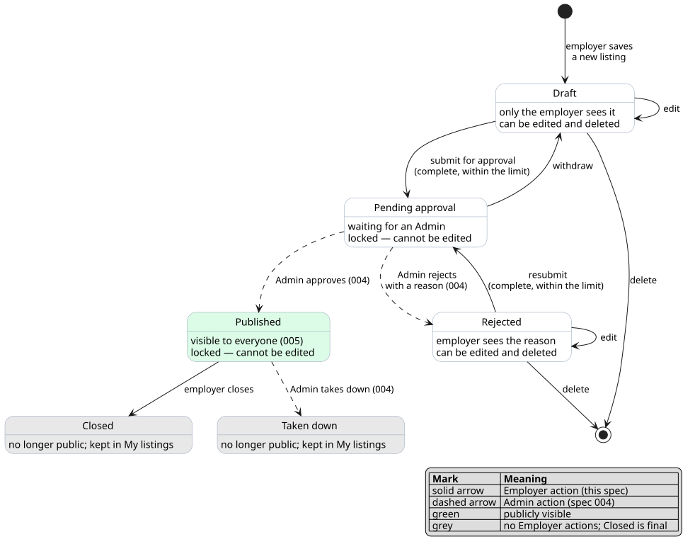
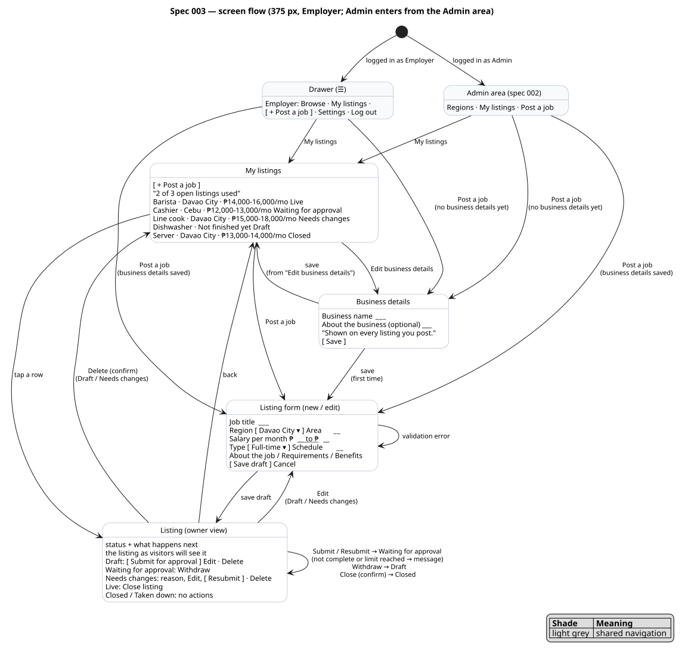
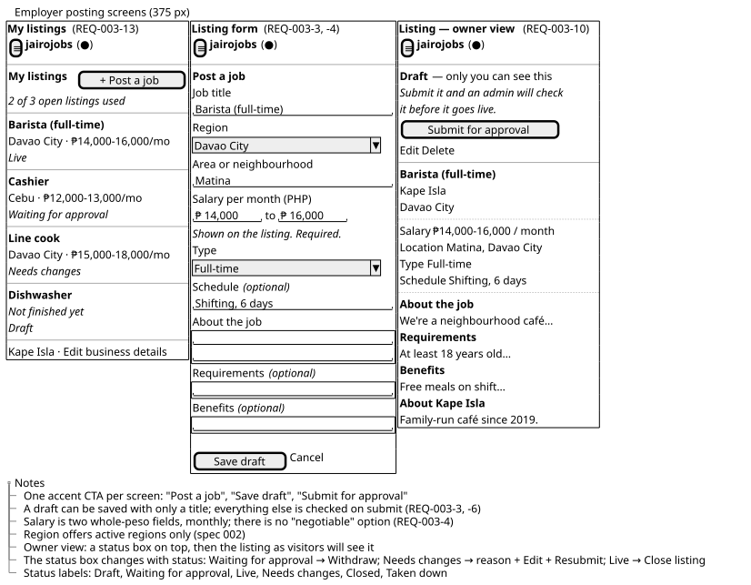
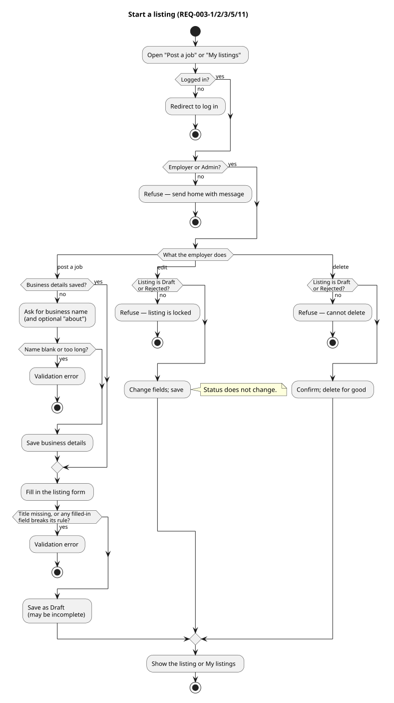
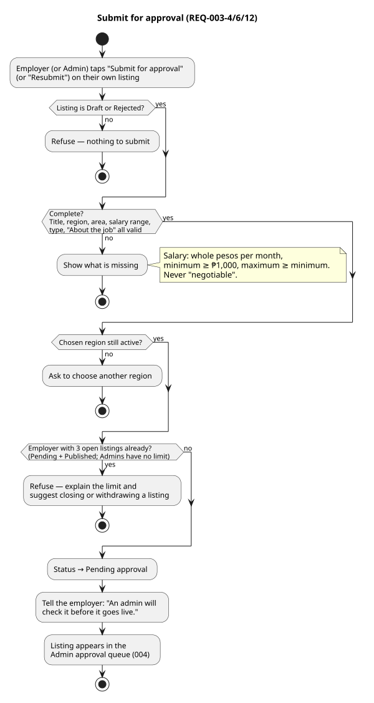
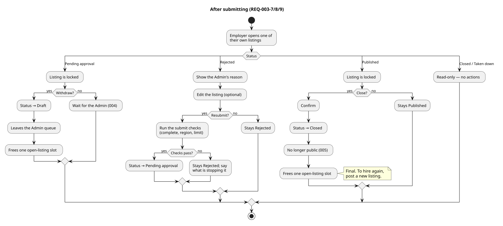
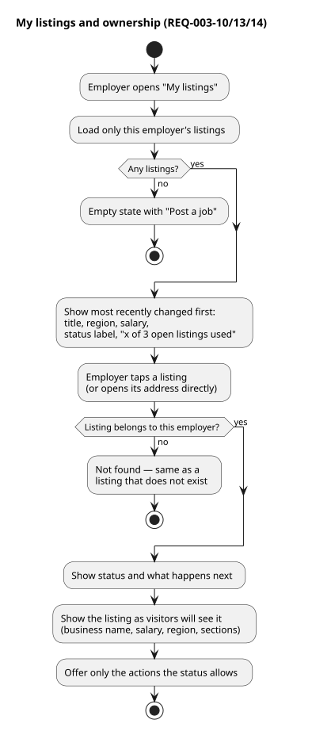

# 003 — Listings: employer posting

**Status:** Done (2026-11-12)
**Created:** 2026-11-10
**Approved:** 2026-11-10
**Owner:** Jairo
**Related ADRs:** 0004 (UUID v7 keys)
**Depends on:** 000 (product overview), 001 (Employer and Admin roles, navigation), 002 (active regions, Admin area)

## Problem / Why

jairojobs has accounts and regions but nothing to browse. A local employer — usually one
person on a phone — needs a short, plain way to write up an opening, say what it pays, and
hand it to the site for checking. Today the "My listings" and "Post a job" items in the
Employer menu lead nowhere.

This spec gives Employers everything they do with a Listing on their own: write it, save it
as a draft, submit it for approval, pull it back, fix it after a rejection, and close it when
the job is filled. It also fixes the two rules that make the board trustworthy: **every
listing states a salary range in PHP**, and **nothing an employer writes goes public without
an Admin approving it** (constitution §2.9). The Admin side of that hand-off is spec 004;
the public pages are spec 005.

## Goals

- An Employer can post an opening from a phone in a few minutes.
- A listing can be saved unfinished and completed later.
- Every submitted listing has a monthly salary range in PHP, a region, and a named business.
- The Employer always knows where each listing stands and what happens next.
- A free-tier limit on open listings exists from day one (spec 000, product decisions).
- Specs 004 and 005 get a clear contract: what a *Pending* and a *Published* listing contain.

## Non-goals / Out of scope

- Approving, rejecting, taking down, or Admin editing of listings — spec 004. Those
  transitions are drawn in the lifecycle diagram here only so the picture is whole.
- Public listing pages, search, shareable addresses and their slugs — spec 005.
- Applying to a listing and the emails that follow — spec 007.
- Telling Admins that something is waiting, and emailing Employers each decision (approved,
  rejected with the reason, taken down) — spec 004. In this spec the Employer sees the
  outcome in "My listings".
- Editing a listing while it is Pending or Published. To change a Live listing the Employer
  closes it and posts a new one.
- Reopening a Closed listing, or copying an old listing into a new draft. Closed is final;
  to hire again the Employer posts a new listing.
- Automatic expiry. Listings end only when the Employer closes them or an Admin takes them
  down (spec 000, product decisions).
- Paid plans and raising the limit — spec 011.
- A public company page, logos, photos, attachments, rich text.
- More than one person per Employer account.

## Personas involved

- **Employer** — the main persona; every screen in this spec is written for them.
- **Admin** — may post listings through the same screens (REQ-003-1); acts on submitted
  listings in spec 004.
- **Candidate**, **Visitor** — never see anything from this spec until a listing is
  Published (spec 005).

## User stories

**US-003-1**
- As an Employer,
- I want to say once which business I am hiring for,
- so that every listing I post shows who the employer is.

**US-003-2**
- As an Employer,
- I want to start a listing and save it before it is finished,
- so that I can come back to it when I have the details.

**US-003-3**
- As an Employer,
- I want to change a listing I have not submitted yet,
- so that it is right before anyone else reads it.

**US-003-4**
- As an Employer,
- I want to submit a finished listing for approval,
- so that it can go live once the site has checked it.

**US-003-5**
- As an Employer,
- I want to see all my listings with their current status,
- so that I know what is live, what is waiting, and what needs my attention.

**US-003-6**
- As an Employer,
- I want to take back a listing that is waiting for approval,
- so that I can fix a mistake I noticed after submitting.

**US-003-7**
- As an Employer,
- I want to see why a listing was rejected, fix it, and send it again,
- so that a rejection is not a dead end.

**US-003-8**
- As an Employer,
- I want to close a live listing,
- so that people stop applying once the job is filled.

**US-003-9**
- As an Employer,
- I want to delete a listing I never got published,
- so that abandoned drafts do not clutter my list.

**US-003-10**
- As an Employer,
- I want to see my listing the way a job seeker will,
- so that I can judge it before I submit it.

**US-003-11**
- As the Operator,
- I want a limit on how many listings one free account can have open at once,
- so that the board stays fair and a paid plan later has something to offer.

**US-003-12**
- As an Admin,
- I want to post a listing myself,
- so that I can add an opening to the board without keeping a second account.

## Listing lifecycle

A Listing is in exactly one status. Solid arrows are Employer actions specified here; dashed
arrows are Admin actions specified in spec 004. The scenarios in REQ-003-5 to REQ-003-11
must agree with this diagram.



*Source: `diagrams/state-listing.puml`.*

| Status | Label the Employer sees | Who can see the listing | Counts toward the limit |
|---|---|---|---|
| Draft | Draft | the Employer | no |
| Pending approval | Waiting for approval | the Employer, Admins | yes |
| Published | Live | everyone | yes |
| Rejected | Needs changes | the Employer, Admins | no |
| Closed | Closed | the Employer, Admins | no |
| Taken down | Taken down | the Employer, Admins | no |

## Screen flow



| Story | Path through the screen flow |
|---|---|
| US-003-1 business details | Drawer → Post a job → Business details → Listing form; later: My listings → Business details → My listings |
| US-003-2 save a draft | Drawer or My listings → Post a job → Listing form → Listing (Draft) |
| US-003-3 edit | My listings → Listing → Edit → Listing form → Listing |
| US-003-4 submit | Listing (Draft) → Submit for approval → Listing (Waiting for approval) |
| US-003-5 see my listings | Drawer → My listings |
| US-003-6 withdraw | My listings → Listing (Waiting for approval) → Withdraw → Listing (Draft) |
| US-003-7 fix and resubmit | My listings → Listing (Needs changes) → Edit → Listing form → Listing → Resubmit |
| US-003-8 close | My listings → Listing (Live) → Close listing → Listing (Closed) |
| US-003-9 delete | My listings → Listing (Draft / Needs changes) → Delete → My listings |
| US-003-10 see it as a job seeker will | Listing form → Listing (owner view) |
| US-003-11 limit | My listings shows "x of 3 open listings used"; Listing → Submit → message when the limit is reached |
| US-003-12 Admin posts | Admin area → Post a job → same path as US-003-1, US-003-2 and US-003-4 |

*Source: `diagrams/screenflow-posting.puml`.*

### Wireframe: employer posting screens

Layout of My listings, the listing form and the owner view at 375 px (layout only, not
visual design):



*Source: `diagrams/wireframe-posting.puml`.*

## Flows (activity diagrams)

| Flow | Covers | Diagram |
|---|---|---|
| Start a listing | REQ-003-1, -2, -3, -5, -11 | [activity-start-a-listing](diagrams/activity-start-a-listing.svg) |
| Submit for approval | REQ-003-4, -6, -12 | [activity-submit-for-approval](diagrams/activity-submit-for-approval.svg) |
| After submitting | REQ-003-7, -8, -9 | [activity-after-submitting](diagrams/activity-after-submitting.svg) |
| My listings and ownership | REQ-003-10, -13, -14 | [activity-my-listings](diagrams/activity-my-listings.svg) |

### Start a listing


### Submit for approval


### After submitting


### My listings and ownership


*Sources: `diagrams/activity-*.puml`.*

## Requirements

### REQ-003-1: Posting is for Employers and Admins

**Serves:** US-003-2, US-003-5, US-003-12

"My listings", "Post a job" and every screen behind them are reachable only by a logged-in
Employer or Admin. Wherever this spec says "Employer", an Admin posting a listing is treated
the same way unless a rule says otherwise.

```gherkin
Scenario: Employer opens My listings
  Given I am logged in as an Employer
  When I choose "My listings" in the menu
  Then I see the My listings page

Scenario: Admin posts a listing
  Given I am logged in as an Admin
  When I choose "Post a job" in the Admin area
  Then I go through the same steps as an Employer
  And a listing I submit is Waiting for approval like any other

Scenario: Candidate is refused
  Given I am logged in as a Candidate
  When I open My listings or Post a job
  Then I am refused and sent home with a message

Scenario: Visitor is redirected to log in
  Given I am not logged in
  When I open My listings or Post a job
  Then I am redirected to the log-in page
  And after logging in as an Employer I land on the page I asked for
```

**Rules**
- The Employer menu items "My listings" and "Post a job" (placeholders since spec 001) now
  lead to these screens.
- An Admin reaches the same screens from the Admin area (spec 002); the Admin menu from
  spec 001 does not change.
- An Admin posts under their own business details, exactly like an Employer (REQ-003-2).
  Posting on behalf of another business is not part of this spec.
- A listing posted by an Admin still needs an approval (spec 000 capability table); who may
  approve it is decided in spec 004.

### REQ-003-2: Business details come first

**Serves:** US-003-1

Before their first listing, an Employer says which business is hiring. The business name is
shown on every listing they post; there are no anonymous listings.

```gherkin
Scenario: First post asks for business details
  Given I am an Employer who has not saved business details
  When I choose "Post a job"
  Then I am asked for my business details first
  And after saving them I continue to the listing form

Scenario: Business name is required
  Given I am on the business details form
  When I save with an empty business name, or one longer than 80 characters
  Then I see a validation error
  And nothing is saved

Scenario: Later posts skip the question
  Given I have saved business details
  When I choose "Post a job"
  Then I go straight to the listing form

Scenario: Change business details
  Given I have saved business details and have a Live listing
  When I change my business name
  Then new listings I submit show the new name
  And the Live listing still shows the name it was submitted with
```

**Rules**
- Business name: required, 2–80 characters, trimmed.
- About the business: optional, up to 500 characters, plain text.
- A listing shows the business details it had when it was last submitted. Changing them
  never alters a Pending or Published listing, so nothing reaches the public without having
  been in front of an Admin (constitution §2.9).

### REQ-003-3: Save a draft

**Serves:** US-003-2

An Employer can save a listing with only a title. Everything else can be filled in later;
completeness is checked when the listing is submitted (REQ-003-4, REQ-003-6).

```gherkin
Scenario: Save an unfinished draft
  Given I am an Employer on the listing form
  When I enter the title "Barista (full-time)" and nothing else, and save
  Then a listing is created with status Draft
  And I see it on its own page marked "Draft — only you can see this"

Scenario: Title is required
  Given I am on the listing form
  When I save without a title
  Then I see a validation error
  And no listing is created

Scenario: A filled-in field must still be valid
  Given I am on the listing form
  When I enter a title and a salary minimum of "abc" or a maximum below the minimum, and save
  Then I see a validation error on the salary
  And no listing is created

Scenario: Only active regions are offered
  Given regions "Cebu" (active) and "Baguio" (hidden) exist
  When I open the listing form
  Then I can choose "Cebu" and cannot choose "Baguio"
```

**Rules**
- A Draft is visible only to the Employer who wrote it — not to Admins, not to the public.
- Drafts do not count toward the limit in REQ-003-12.

### REQ-003-4: What a complete listing contains

**Serves:** US-003-4, US-003-10

A listing is *complete* when every required field below is filled in and valid. Only a
complete listing can be submitted.

```gherkin
Scenario: Complete listing
  Given a draft with a title, an active region, an area and a type
  And a salary of 14000 to 16000
  And an "About the job" text of at least 50 characters
  When the listing is checked for completeness
  Then it is complete

Scenario: Salary range is required
  Given a draft that is complete except that the salary is empty
  When the listing is checked for completeness
  Then it is not complete
  And the salary is named as missing

Scenario: Salary range must make sense
  Given a draft with a salary minimum of 16000 and maximum of 14000
  When I save it
  Then I see "The maximum must be at least the minimum"

Scenario: Salary must be a real monthly amount
  Given a draft
  When I enter a minimum below 1000, or a maximum above 1000000, or an amount with centavos
  Then I see a validation error on the salary

Scenario: Same minimum and maximum is allowed
  Given a draft with a salary of 15000 to 15000
  When the listing is shown
  Then the salary reads "₱15,000 / month"
```

**Rules**

| Field | Required to submit | Rule |
|---|---|---|
| Job title | yes (also to save a draft) | 5–100 characters |
| Region | yes | one active region (spec 002) |
| Area | yes | up to 80 characters, e.g. "Matina" or "Remote" |
| Salary minimum, maximum | yes | whole pesos per month; minimum ≥ ₱1,000; maximum ≥ minimum; maximum ≤ ₱1,000,000 |
| Type | yes | one of Full-time, Part-time, Contract, Temporary, Internship |
| Schedule | no | up to 80 characters, e.g. "Shifting, 6 days" |
| About the job | yes | 50–5,000 characters |
| Requirements | no | up to 3,000 characters |
| Benefits | no | up to 3,000 characters |

- Salary is always a stated monthly range in PHP. There is no "negotiable", "competitive"
  or hidden option (design guide, principle 3).
- Salary is displayed with thousands separators: "₱14,000–16,000 / month" on a listing's
  page and "₱14,000–16,000/mo" in list rows.
- Text fields are plain text; line breaks are kept; no formatting, links or HTML.
- The Employer's business name and "about" text are part of the listing as shown
  (REQ-003-2).

### REQ-003-5: Edit a draft or rejected listing

**Serves:** US-003-3, US-003-7

```gherkin
Scenario: Edit a draft
  Given I have a Draft listing
  When I change its title and salary and save
  Then the listing shows the new values
  And its status is still Draft

Scenario: Pending listing is locked
  Given I have a listing that is Waiting for approval
  When I open it
  Then there is no way to edit it
  And I am told I can withdraw it to make changes

Scenario: Live listing is locked
  Given I have a Live listing
  When I open it
  Then there is no way to edit it

Scenario: Editing a locked listing is refused
  Given I have a listing that is Waiting for approval, Live, Closed or Taken down
  When I try to save changes to it anyway
  Then the changes are refused
  And the listing is unchanged
```

**Rules**
- Only Draft and Rejected listings can be edited. Editing never changes the status.
- The same field rules apply as when saving a new draft (REQ-003-3).

### REQ-003-6: Submit for approval

**Serves:** US-003-4

```gherkin
Scenario: Submit a complete draft
  Given I have a complete Draft listing and fewer than 3 open listings
  When I submit it for approval
  Then its status is Waiting for approval
  And I am told an admin will check it before it goes live
  And it is not visible to the public

Scenario: Incomplete draft cannot be submitted
  Given I have a Draft with no salary and no "About the job" text
  When I submit it for approval
  Then it stays a Draft
  And I am shown that the salary and "About the job" are missing

Scenario: Region was hidden in the meantime
  Given I have a complete Draft in region "Baguio"
  And an Admin has since hidden "Baguio"
  When I submit it for approval
  Then it stays a Draft
  And I am asked to choose another region

Scenario: Submitting twice does nothing
  Given I have a listing that is Waiting for approval
  When I submit it again
  Then nothing changes
```

**Rules**
- From the moment of submission the listing is available to the Admin approval queue
  (spec 004), with the time it was submitted.
- A submitted listing never becomes public by itself; only an Admin approval publishes it.

### REQ-003-7: Withdraw a pending listing

**Serves:** US-003-6

```gherkin
Scenario: Withdraw
  Given I have a listing that is Waiting for approval
  When I withdraw it
  Then its status is Draft
  And it is no longer in the Admin approval queue
  And I can edit it again

Scenario: Only pending listings can be withdrawn
  Given I have a Draft, Live, Rejected, Closed or Taken down listing
  When I try to withdraw it
  Then nothing changes
```

### REQ-003-8: Fix and resubmit a rejected listing

**Serves:** US-003-7

When an Admin rejects a listing (spec 004) the Employer sees why and can try again.

```gherkin
Scenario: See the reason
  Given an Admin rejected my listing with the reason "Salary looks like a typo"
  When I open the listing
  Then it is marked "Needs changes"
  And I see the reason "Salary looks like a typo"

Scenario: Fix and resubmit
  Given I have a Rejected listing
  When I edit it and resubmit it
  Then its status is Waiting for approval
  And the old reason is no longer shown

Scenario: Resubmit follows the same checks
  Given I have a Rejected listing that is incomplete, or I already have 3 open listings
  When I resubmit it
  Then it stays Rejected
  And I am told what is stopping it
```

**Rules**
- A Rejected listing may be resubmitted without changes; the Admin decides again.

### REQ-003-9: Close a live listing

**Serves:** US-003-8

```gherkin
Scenario: Close
  Given I have a Live listing
  When I close it and confirm
  Then its status is Closed
  And it is no longer visible to the public
  And it stays in My listings

Scenario: Closing asks first
  Given I have a Live listing
  When I choose "Close listing"
  Then I am asked to confirm, and told it cannot be reopened

Scenario: Only live listings can be closed
  Given I have a Draft, Waiting for approval, Rejected, Closed or Taken down listing
  When I try to close it
  Then nothing changes
```

**Rules**
- Closed is final. A Closed or Taken down listing has no Employer actions.
- Closing frees one place under the limit (REQ-003-12).

### REQ-003-10: See the listing as a job seeker will

**Serves:** US-003-10, US-003-5

Each of an Employer's listings has its own page: a status box on top, then the listing laid
out the way visitors will see it once it is Live, without the trust line (approved badge
and posted date), which only exists after approval.

```gherkin
Scenario: Owner view of a draft
  Given I have a complete Draft listing
  When I open it
  Then I see its title, my business name, region, salary, area, type, schedule and text sections
  And I see that it is a Draft and that only I can see it
  And I can submit, edit or delete it

Scenario: Unfinished draft shows what is missing
  Given I have a Draft with only a title
  When I open it
  Then I see which required fields are still missing

Scenario: Actions follow the status
  Given I have listings in each status
  When I open each one
  Then Waiting for approval offers only Withdraw
  And Needs changes offers Edit, Resubmit and Delete
  And Live offers only Close listing
  And Closed and Taken down offer nothing
```

**Rules**
- The status box always says what happens next in one plain sentence, e.g. "An admin will
  check it before it goes live."

### REQ-003-11: Delete an unpublished listing

**Serves:** US-003-9

```gherkin
Scenario: Delete a draft
  Given I have a Draft listing
  When I delete it and confirm
  Then it is gone from My listings
  And it cannot be opened any more

Scenario: Delete a rejected listing
  Given I have a Rejected listing
  When I delete it and confirm
  Then it is gone from My listings

Scenario: Other listings cannot be deleted
  Given I have a Waiting for approval, Live, Closed or Taken down listing
  When I try to delete it
  Then it is refused
  And the listing still exists
```

**Rules**
- Deleting is permanent. Listings that were ever Published are never deleted, so
  applications and history (specs 007, 008) keep something to point at.

### REQ-003-12: Free-tier limit on open listings

**Serves:** US-003-11, US-003-12

An Employer may have at most **3 open listings** at a time. A listing is *open* while it is
Pending approval or Published.

```gherkin
Scenario: Within the limit
  Given I have 2 open listings
  When I submit a third complete listing
  Then it is accepted

Scenario: Limit reached
  Given I have 3 open listings
  When I submit another complete listing
  Then it stays a Draft
  And I am told I can have 3 open listings at a time and can close or withdraw one to post another

Scenario: Drafts are not limited
  Given I have 3 open listings
  When I save a new draft
  Then the draft is saved

Scenario: Closing or withdrawing frees a place
  Given I have 3 open listings
  When I close a Live one or withdraw a Pending one
  Then I can submit another listing

Scenario: Admins are not limited
  Given I am an Admin with 3 open listings
  When I submit another complete listing
  Then it is accepted
```

**Rules**
- Draft, Rejected, Closed and Taken down listings do not count.
- The limit is one number for every Employer in this spec; spec 011 may vary it by plan.
- The limit does not apply to Admins, and they are not shown the "x of 3" line.
- Two submissions at the same moment must not take an Employer over the limit.

### REQ-003-13: My listings

**Serves:** US-003-5, US-003-11

```gherkin
Scenario: See my listings
  Given I have listings in several statuses
  When I open My listings
  Then I see each one with its title, region, salary range and status label
  And the most recently changed is first

Scenario: Unfinished draft in the list
  Given I have a Draft with only a title
  When I open My listings
  Then it is shown with its title and "Not finished yet" in place of region and salary

Scenario: Limit is shown
  Given I have 2 open listings
  When I open My listings
  Then I see "2 of 3 open listings used"

Scenario: No listings yet
  Given I have no listings
  When I open My listings
  Then I see a short invitation to post my first job
```

**Rules**
- Status labels are those in the lifecycle table: Draft, Waiting for approval, Live, Needs
  changes, Closed, Taken down.
- The list is expected to stay small (tens of rows per Employer); no search or filters.

### REQ-003-14: An Employer only ever touches their own listings

**Serves:** US-003-3, US-003-5

```gherkin
Scenario: Another employer's listing is not found
  Given another Employer has a listing in any status
  When I open its owner page, or try to edit, submit, withdraw, close or delete it
  Then I get "not found", exactly as for a listing that does not exist
  And the listing is unchanged

Scenario: My listings shows only mine
  Given another Employer has listings
  When I open My listings
  Then none of their listings appear
  And my open-listing count ignores them
```

**Rules**
- Ownership is checked on every read and every action, whatever identifier is in the
  address (constitution §2.7).
- A listing's owner never changes.

## Non-functional requirements

- **Mobile-first:** every screen is usable at 375 px — one column, labels above fields, tap
  targets ≥ 44 px, numeric keypad for the salary fields.
- **Design:** follows `docs/design.md` — one accent action per screen, salary always shown,
  plain-language microcopy, list rows with dividers, no modals for forms.
- **Authorization:** every listing action is checked against the current Employer in the
  domain layer, not only in the screens (constitution §2.7).
- **Money:** salary is entered and shown in whole pesos; storage follows constitution §4.5.
- **Privacy:** listing text and business details are not written to logs (constitution §4.12).
- **Accessibility:** every status is conveyed in words, not by colour alone.

## Open questions

- None.

## Decisions (resolved 2026-11-10)

| # | Question | Decision |
|---|---|---|
| 1 | Free-tier limit | 3 open listings (Pending + Published) per Employer (REQ-003-12). Also settles the open question in spec 000 |
| 2 | Editing a Live listing | Not possible; the Employer closes it and posts a new one (REQ-003-5) |
| 3 | Business details in this spec | Yes — name plus optional "about" (REQ-003-2) |
| 4 | Admins posting listings | Admins can, through the same screens and rules as an Employer, without the limit (REQ-003-1, REQ-003-12) |
| 5 | Very wide salary ranges | No automatic rule; an Admin rejects them with a reason (spec 004) |
| 6 | Reopening a Closed listing | Not possible; Closed is final (REQ-003-9) |

## Hand-offs to later specs

Sentences the following specs inherit from this one (settled 2026-11-11).

| Spec | Inherits |
|---|---|
| 004 | Spec 004 emails the Employer each decision — approved, rejected (with the reason), taken down — as part of the Admin action. |
| 004 | An Admin edit to a listing's business name or "about" changes that listing's copy only, never the account's business details. |
| 004 | Closed is final for everyone; whether an Admin can restore a Taken down listing is decided in spec 004. |
| 004 | Hiding a region changes no listing's status; spec 004 decides whether a Pending listing in a hidden region can still be approved. |
| 004 | Who may approve a listing that an Admin posted is decided in spec 004 (REQ-003-1). |
| 005 | Hiding a region changes no listing's status; spec 005 decides whether a Published listing in a hidden region stays visible. |
| 007 | Applications to a listing are emailed to the account that owns it, whatever its role; an Admin who posts a listing receives its applications like an Employer. |

## Traceability

| Story | Requirements |
|---|---|
| US-003-1 | REQ-003-2 |
| US-003-2 | REQ-003-1, REQ-003-3 |
| US-003-3 | REQ-003-5, REQ-003-14 |
| US-003-4 | REQ-003-4, REQ-003-6 |
| US-003-5 | REQ-003-1, REQ-003-10, REQ-003-13, REQ-003-14 |
| US-003-6 | REQ-003-7 |
| US-003-7 | REQ-003-5, REQ-003-8 |
| US-003-8 | REQ-003-9 |
| US-003-9 | REQ-003-11 |
| US-003-10 | REQ-003-4, REQ-003-10 |
| US-003-11 | REQ-003-12, REQ-003-13 |
| US-003-12 | REQ-003-1, REQ-003-12 |

## Changelog

| Date | Change |
|---|---|
| 2026-11-10 | Created (Draft) with lifecycle, screen flow, wireframe and four activity diagrams |
| 2026-11-10 | Open questions resolved; Admins can post (US-003-12, REQ-003-1, REQ-003-12) |
| 2026-11-10 | Approved |
| 2026-11-11 | Consistency pass after review: decision emails belong to spec 004; hand-offs table added; salary display in rows vs. page; owner view has no trust line; limit message mentions withdrawing; diagrams aligned (Admin business gate, rejected branch, legend, wording) |
| 2026-11-12 | Done. Implemented per tasks.md; "Deployed to Fly.io" deferred until a deployment exists |
| 2026-11-12 | Wireframe brought in line with the app: status pill at the right of each row, no separate region line in the owner view, salary hint wording |
