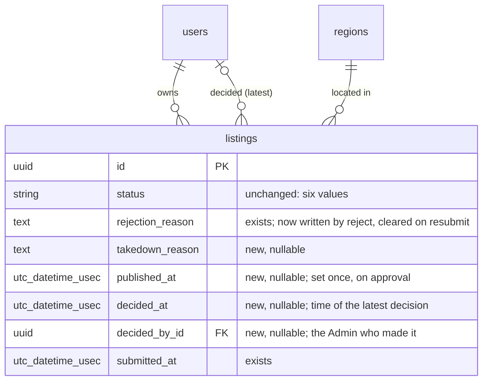
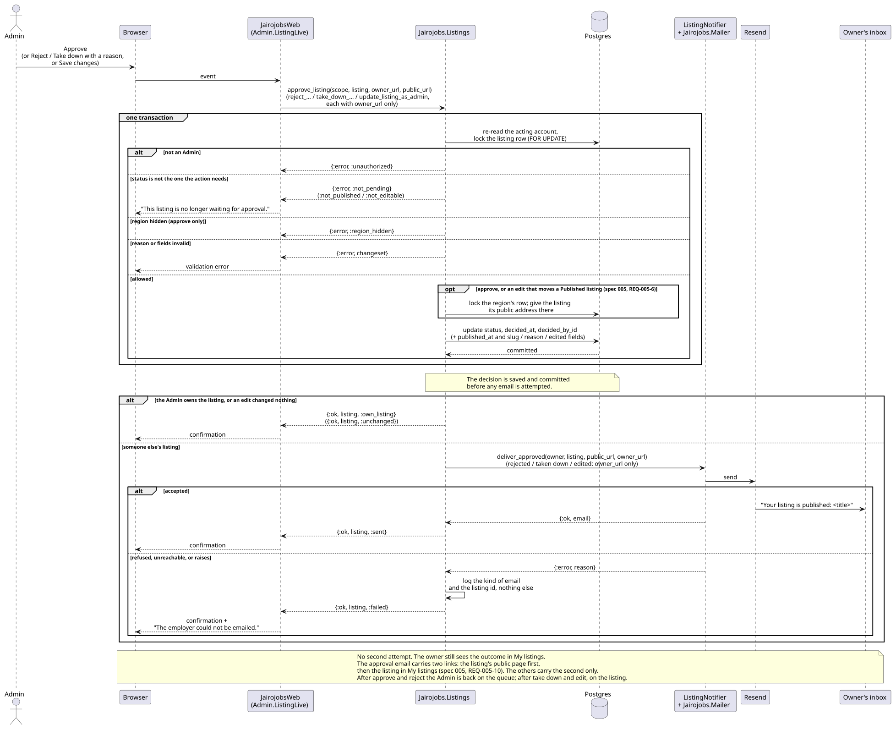
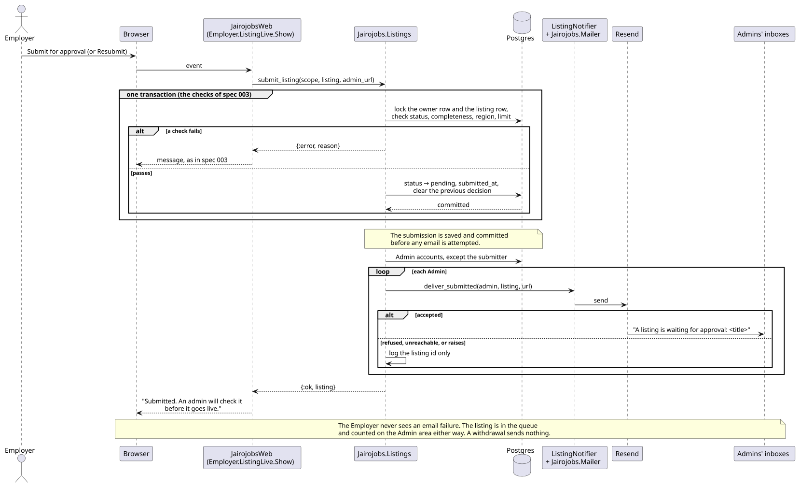

# 004 — Listings: admin moderation — Plan

**Status:** Draft
**Spec:** [spec.md](./spec.md) (Approved 2026-11-14)
**Created:** 2026-11-14

## Approach

Moderation is added to the existing `Jairojobs.Listings` context; there is no new context
and no new table. Each Admin action is one small function that takes the Admin's `Scope`
first, runs in a transaction that **locks the listing row**, checks the status again, and
only then changes it. Four columns are added to `listings` to record the latest decision.

Emails are sent by a new `Jairojobs.Listings.ListingNotifier`, called by the context
**after** the transaction has committed, so a mail failure can never undo a decision
(REQ-004-9, REQ-004-10). The context reports what happened to the email, and the screen
turns that into the message the Admin sees.

The screens are three hand-written LiveViews under `/admin/listings`, inside the existing
`live_session :require_admin`, built the same way as the Regions screens (spec 002) and
reusing `listing_detail` and `status_badge` from spec 003.

Main trade-off: links in emails. A context cannot build web addresses, so, as the
generated auth code already does, each function that sends an email takes a function that
turns a listing into its address. That changes `submit_listing/2` to `submit_listing/3`
and touches its 29 existing call sites (decision 4).

No new dependencies. No background jobs.

## Contexts & modules

| Module | New / Changed | Responsibility |
|---|---|---|
| `Jairojobs.Listings` | Changed | Moderation API (below); `submit_listing/3` also emails Admins; every status change locks the listing row |
| `Jairojobs.Listings.Listing` | Changed | New fields; `approve_changeset/3`, `reject_changeset/4`, `take_down_changeset/4`, `admin_changeset/2`; `submit_changeset/3` also clears the previous decision |
| `Jairojobs.Listings.ListingNotifier` | New | The five emails, plain text, same `deliver/3` shape as `Accounts.UserNotifier` |
| `JairojobsWeb.Admin.ListingLive.Index` | New | Listings page: the queue and the other status lists |
| `JairojobsWeb.Admin.ListingLive.Show` | New | Admin view; the reject and take-down forms are its `:reject` and `:take_down` actions |
| `JairojobsWeb.Admin.ListingLive.Form` | New | Admin edit form |
| `JairojobsWeb.Admin.HomeLive` | Changed | "Listings" row with the waiting count |
| `JairojobsWeb.ListingComponents` | Changed | `listing_fields/1`: the listing form's inputs, now used by two forms (constitution §4.9) |
| `JairojobsWeb.Employer.ListingLive.Form` | Changed | Uses `listing_fields/1`; no change in behaviour |
| `JairojobsWeb.Employer.ListingLive.Show` | Changed | Passes the Admin-view address to `submit_listing/3`; shows the take-down reason |
| `JairojobsWeb.Format` | Changed | `time_ago/2` and `manila_date/1`: the one time helper (constitution §4.6) |
| `JairojobsWeb.Router` | Changed | Four routes in the `/admin` scope |
| `Jairojobs.ListingsFixtures` | Changed (test support) | `set_listing_status/3` removed; statuses reached through the real functions |
| `Jairojobs.FailingMailAdapter` | New (test support) | A Swoosh adapter that always returns an error |

### `Jairojobs.Listings` moderation API

| Function | Returns | REQ |
|---|---|---|
| `count_pending_listings(scope)` | integer; `0` for a non-Admin | 1, 2 |
| `list_listings_for_moderation(scope, status, opts)` | `{listings, more?}`; `opts`: `:offset`, `:limit` (50). Pending: longest-waiting first. Others: most recently changed first. Region preloaded. `{[], false}` for a non-Admin or for `:draft` | 2, 3 |
| `get_listing_for_moderation!(scope, id)` | the listing with region, owner and deciding Admin preloaded; raises `Ecto.NoResultsError` for a non-Admin, an unknown id, or a Draft | 4 |
| `approve_listing(scope, listing, owner_url)` | `{:ok, listing, email}` / `{:error, :not_pending}` / `{:error, :region_hidden}` | 5, 9 |
| `change_reason(attrs \\ %{})` | changeset for the reject and take-down forms (`reason`, 10–500, trimmed) | 6, 7 |
| `reject_listing(scope, listing, attrs, owner_url)` | `{:ok, listing, email}` / `{:error, changeset}` / `{:error, :not_pending}` | 6, 9 |
| `take_down_listing(scope, listing, attrs, owner_url)` | `{:ok, listing, email}` / `{:error, changeset}` / `{:error, :not_published}` | 7, 9 |
| `change_listing_as_admin(listing, attrs \\ %{})` | changeset for the Admin edit form | 8 |
| `update_listing_as_admin(scope, listing, attrs, owner_url)` | `{:ok, listing, email}` / `{:ok, listing, :unchanged}` / `{:error, changeset}` / `{:error, :not_editable}` | 8, 9 |
| `submit_listing(scope, listing, admin_url)` (was `/2`) | as in spec 003; after committing, emails every Admin except the submitter | 10 |

- `email` is `:sent`, `:own_listing` (the Admin owns the listing, nothing sent) or `:failed`.
- `owner_url` and `admin_url` are functions from a listing to an absolute address, passed in
  by the LiveView: `&url(~p"/my/listings/#{&1}")` and `&url(~p"/admin/listings/#{&1}")`.
- Every function above also returns `{:error, :unauthorized}` for a scope that is not an
  Admin, and `{:error, :not_found}` when the listing no longer exists (its owner deleted
  it).
- A listing that has become a Draft because its Employer withdrew it is **not** "not
  found" to the four writes. They answer with the status refusal — `:not_pending`,
  `:not_published` or `:not_editable` — because the spec's scenarios ask for "This listing
  is no longer waiting for approval." in exactly that case (REQ-004-5, -6, -8). Only the
  two reads hide Drafts.

### What each action does, in order

All four run in one transaction, then send the email after it commits (see the sequence
diagrams below).

1. Re-read the acting account from the database; refuse unless its role is Admin. The
   scope in a LiveView socket can be stale (spec 002).
2. Lock the listing row (`FOR UPDATE`) and read it fresh; the struct passed in is never
   trusted.
3. Check the status: Pending for approve and reject, Published for take down, Pending or
   Published for edit.
4. Approve only: the region must be active, else `:region_hidden`.
5. Reject, take down: the reason must be valid. Edit: `admin_changeset/2` must be valid
   and the chosen region must be active or unchanged.
6. Edit only: if the changeset has no changes, stop with `{:ok, listing, :unchanged}`.
7. Write: status, `decided_at`, `decided_by_id`, and `published_at` (approve),
   `rejection_reason` (reject) or `takedown_reason` (take down). An edit writes only the
   changed fields; it does not touch the decision columns.
8. After commit: unless the Admin owns the listing, send the email. A returned error or a
   raised exception is caught, logged with the listing id only, and reported as `:failed`.

**Spec 003's own transitions change too.** `withdraw_listing/2`, `close_listing/2`,
`update_listing/3` and `delete_listing/2` read the listing and then write it without a
lock. Until now only the owner could change a listing, so that was safe. With an Admin
acting at the same time, a withdraw could overwrite an approval that landed between its
read and its write. They now lock the row inside a transaction, like the new functions.
`submit_listing/3` already runs in a transaction and gains the same lock.

### `admin_changeset/2` (REQ-004-8)

Casts the ten fields of `draft_changeset/2` plus `business_name` and `business_about`.
Applies the same rules as spec 003 with everything required: title 5–100; region, area,
both salary ends, type present; description 50–5,000; business name 2–80; "about" up to
500. Never casts status, owner, `submitted_at` or the decision columns.

The names of changed parts for the email come from one map in `ListingNotifier`:
Job title, Region, Area, Salary, Type, Schedule, About the job, Requirements, Benefits,
Business name, About the business. `salary_min` and `salary_max` both read "Salary".

These are the short names REQ-004-9 lists: the form's labels without their hints ("Area",
not "Area or neighbourhood"). The spec's rule was amended to say so on 2026-11-14, when
this plan showed that the rule and its scenario disagreed (decision 9; spec decision 16).

## Data model

What the latest decision *was* is not stored: it follows from the status. Published and
Closed mean approved; Rejected means rejected; Taken down means taken down. Pending and
Draft have none, because `submit_changeset/3` clears `decided_at`, `decided_by_id` and
`rejection_reason` on every submission (REQ-004-4).

`published_at` is kept apart from `decided_at` because a take-down overwrites the latter.
It is the "posted" date spec 005 needs and the end of the interval spec 008 will measure.

### Migrations

1. `add_moderation_to_listings`
   - `takedown_reason :text`, `published_at :utc_datetime_usec`,
     `decided_at :utc_datetime_usec`, all nullable
   - `decided_by_id` references `users`, `on_delete: :nilify_all` (decision 3)
   - `index(:listings, [:status, :submitted_at])` for the queue, the count and the status lists
2. `add_moderation_checks_to_listings`
   - CHECK `listings_published_has_time`: `published_at` is present when the status is
     published, closed or taken_down
   - CHECK `listings_rejected_has_reason`: `rejection_reason` is present when rejected
   - CHECK `listings_taken_down_has_reason`: `takedown_reason` is present when taken_down

Both are additive. The checks are a second migration because they are a separate concern
(constitution §4.10) and would fail on a database that already holds Published, Rejected or
Taken down rows. The dev database has none: nothing could create them before this spec.
The migration says so in a comment and there is no production database yet.

Order matters: the test-only status helper writes Published and Taken down rows without
`published_at` or a take-down reason, so the checks would fail the existing suite while
the helper exists. Migration 1 lands with task 1; migration 2 lands in its own task
**after** task 2 has removed the helper.

## Routes & LiveViews / Controllers

All four routes go in the existing `scope "/admin", JairojobsWeb.Admin`, piped through
`[:browser, :require_admin]`, inside the existing `live_session :require_admin`. That
session already sends a visitor to log in (and back) and a signed-in non-Admin home with a
message, which is exactly REQ-004-1. No new plug, hook or session is needed.

| Method / Live | Path | Module | Auth | REQ |
|---|---|---|---|---|
| live | `/admin/listings` | `Admin.ListingLive.Index`, `:index` | `require_admin` | 1, 2, 3 |
| live | `/admin/listings/:id` | `Admin.ListingLive.Show`, `:show` | `require_admin` | 4, 5 |
| live | `/admin/listings/:id/reject` | `Admin.ListingLive.Show`, `:reject` | `require_admin` | 6 |
| live | `/admin/listings/:id/take-down` | `Admin.ListingLive.Show`, `:take_down` | `require_admin` | 7 |
| live | `/admin/listings/:id/edit` | `Admin.ListingLive.Form`, `:edit` | `require_admin` | 8 |

The UUID is used in these private addresses (constitution §4.8). A Draft, an unknown id
and a malformed id all raise `Ecto.NoResultsError`, the same 404.

### Screens

- **Admin area** — a "Listings" row between Regions and My listings. Its second line is
  "2 waiting for approval" or "Nothing waiting".
- **Listings** — a row of five status links, labelled by `status_label/1` (Waiting for
  approval, Live, Needs changes, Taken down, Closed); the chosen one is in the address as
  `?status=live`, `needs-changes`, `taken-down` or `closed`, and no parameter means Waiting
  for approval. An unknown value falls back to Waiting. "Waiting for approval" carries the
  count. Rows are a LiveView stream: title, business name, region · salary, then
  "submitted 3 h ago" (queue) or "changed 2 d ago" (other lists), and "Your listing" when
  the Admin owns it. "Show more" appends the next 50 and is shown only when there are more.
  Each row links to the Admin view with `?from=<status>`. The empty state is one sentence:
  "Nothing is waiting for approval." for the queue (fixed by the spec), and "No listings
  are live.", "No listings need changes.", "No listings have been taken down." and "No
  listings are closed." for the others.
- **Admin view** — a box on top, then `listing_detail` with the listing's own copy of the
  business name and "about". The box holds: the status pill and "Your listing"; who posted
  it (business name, account email); when it was submitted; the latest decision with its
  Admin's email and the reason; the hidden-region line; one sentence on what the actions
  do; the actions. The hidden-region line appears whenever the listing's region is hidden,
  whatever the status: the region's name with the neutral "hidden" pill
  (`badge badge-sm badge-ghost rounded-full`, as on the Regions page). Only while the
  listing is Waiting for approval it adds the sentence from the `:region_hidden` row
  below. Approve stays on the page. Approve is `variant="accent"`. "Reject", "Take down" and "Edit" are
  plain buttons that open the form or the edit page. The back link goes to the list named
  in `from` (decision 6).
- **Reject / Take down** — the same page with the form in place of the actions: one
  textarea, the fixed sentence from the spec, a submit button in the error style
  (`btn-error`, passed as `class`), and Cancel. The form is named `decision`.
- **Admin edit** — `listing_fields/1` plus "Business name" and "About the business", the
  sentence "The employer will be told what you changed.", "Save changes" as the accent
  button, and Cancel. The region select offers active regions plus the listing's own
  region marked "(hidden)". The form is named `listing`.

Where the Admin lands (spec decision 12): approve and reject `push_navigate` to
`/admin/listings`; take down and edit `push_navigate` to the Admin view. A save with
nothing changed also returns to the Admin view. Approve has no confirm step: opening the
listing and tapping Approve are the two taps the spec's goal counts.

After a refusal the Admin view is loaded again from the database and shows the message,
so the Admin sees the listing as it now is. If it can no longer be shown (withdrawn, so a
Draft again, or deleted), the Admin goes to the queue with the message.

Opening `/reject`, `/take-down` or `/edit` for a listing whose status does not allow it
(by a stale link or a typed address) redirects to the Admin view with the matching message
from the table below; no form is shown.

Every screen is one column at 375 px, with rows and buttons at least 44 px tall
(`min-h-11`), like the Regions and posting screens.

### Messages

| Event | Message |
|---|---|
| Approved | "Approved. It is live." |
| Rejected | "Sent back to the employer." |
| Taken down | "Taken down." |
| Edited | "Changes saved." |
| Edited, nothing changed | "Nothing was changed." |
| Any of the first four with `email == :failed` | the message, then " The employer could not be emailed." |
| `:not_pending` | "This listing is no longer waiting for approval." (spec) |
| `:not_published` | "This listing is no longer live." (spec) |
| `:not_editable` | "This listing can no longer be edited." |
| `:region_hidden` | "Its region is hidden, so it cannot be approved as it is. Show the region again, move the listing to another region with Edit, or reject it with a reason." |
| `:not_found` | "That listing is not available.", then back to the queue |

The sentence in the box: "Approving makes it public and emails the employer." (Pending)
and "Taking it down removes it from public view for good and emails the employer." (Live).
When the listing is the Admin's own, "and emails the employer" is left out.

### DOM ids (fixed now so tests can be written first)

| Element | id |
|---|---|
| Admin area row, its count line | `#admin-section-listings`, `#admin-listings-waiting` |
| Status links | `#filter-waiting`, `#filter-live`, `#filter-needs-changes`, `#filter-taken-down`, `#filter-closed` |
| Count beside "Waiting for approval" | `#waiting-count` |
| List stream / row / empty state | `#admin-listings` / `#admin-listings-<uuid>` / `#no-admin-listings` |
| Row: time line, own mark | `#listing-when-<uuid>`, `#your-listing-<uuid>` |
| Show more | `#show-more` |
| Admin view: back link, box | `#back-to-admin-listings`, `#moderation-box` |
| Box: status pill (existing), own mark | `#listing-status-<uuid>`, `#your-listing` |
| Box: poster, submitted time, latest decision, its reason | `#listing-poster`, `#listing-submitted`, `#listing-decision`, `#listing-decision-reason` |
| Box: hidden-region line, the one-sentence help | `#listing-region-hidden`, `#moderation-help` |
| Box actions | `#approve-listing`, `#reject-listing`, `#take-down-listing`, `#admin-edit-listing` |
| Reason form (params under `decision`), its submit, cancel | `#decision-form`, `#decision-submit`, `#decision-cancel` |
| Admin edit form (params under `listing`), cancel | `#listing-form`, `#listing-form-cancel` |
| Employer's owner view: take-down reason | `#listing-takedown-reason` |
| Listing body (existing, from spec 003) | `#listing-detail`, `#listing-title`, … |

## Authorization

- **Screens:** `live_session :require_admin` and its plug, unchanged.
- **Context:** every moderation function checks the role itself and, for the four writes,
  re-reads it from the database inside the transaction. An Employer or Candidate calling
  any of them gets `{:error, :unauthorized}` (or an empty list, `0`, or a 404 for the
  reads), and the listing is untouched. This is the test for "Only an Admin can decide".
- **Drafts** are excluded in the queries of `list_listings_for_moderation/3` and
  `get_listing_for_moderation!/2`, not in the screens.
- **Own listings:** no special case for acting. The only difference is that no email is
  sent and the screens say "Your listing".
- **Never cast from params:** status, owner, `submitted_at`, `published_at`, `decided_at`,
  `decided_by_id`. The two reasons are cast only by their own changesets.
- **The poster's email address** is read only by `get_listing_for_moderation!/2` and shown
  only on the Admin view.

## Logging and privacy

- `config :phoenix, :filter_parameters` gains `"decision"` (the reason form). The Admin
  edit form reuses the name `listing`, which is already filtered.
- A failed email is logged as a warning with the listing id and the kind of email, never
  the address, the title or the reason (constitution §4.12).
- `test/jairojobs_web/endpoint_log_test.exs` gets one case proving a posted reason is not
  in the log.

## Background jobs / emails / external services

No background jobs. Email goes through the existing `Jairojobs.Mailer` (Resend in
production, ADR-0005), sent from `config :jairojobs, :mailer_from`. Each flow touches three
parties, so each has a sequence diagram (README, Diagrams rule 2).

**An Admin decision and the email to the owner**

**An Employer's submission and the email to Admins**

*Sources: `diagrams/sequence-decision-email.puml`, `diagrams/sequence-submission-email.puml`.*

### The five emails

Plain text, like the existing ones. Subjects are fixed by the spec.

| Email | To | Body says |
|---|---|---|
| Your listing is live: ‹title› | owner | It was approved and is live. It stays up until you close it. Link to the listing in My listings. |
| Your listing needs changes: ‹title› | owner | It was not approved yet. The reason, quoted. You can edit it and send it again. Link. |
| Your listing was taken down: ‹title› | owner | It is no longer public. The reason, quoted. This cannot be undone; to list the job again, post a new listing. Link. |
| We edited your listing: ‹title› | owner | jairojobs changed these parts: ‹names›. Nothing else changed. Open the listing to see how it reads now. Link. |
| A listing is waiting for approval: ‹title› | each Admin but the submitter | Business name and region. Link to the listing's Admin view. |

No email greets by name or includes any listing text other than the title, the reason, and
(Admin email only) the business name and region.

The owner's email goes to the account that owns the listing, whatever its role is now.
Nothing is built for an owner who can no longer open My listings (REQ-004-9's rule; handed
to spec 008).

Admins are found by a private query in `Listings` (role is Admin, id is not the
submitter's). No public function that lists Admin accounts is added to `Accounts`.

## Time display

`JairojobsWeb.Format` gains the project's one time helper:

- `time_ago(datetime, now \\ DateTime.utc_now())` — "just now", "20 min ago", "3 h ago",
  "2 d ago" for anything under 7 days; otherwise `manila_date/1`.
- `manila_date(datetime)` — "14 Nov 2026", in Manila time.

Manila time is UTC+8 all year; the Philippines has not used daylight saving since 1990.
The helper adds eight hours, so no time zone database is needed (decision 5).

## Test strategy

Scenario-first (constitution §3.12). Each of the 56 scenarios gets a test named
`REQ-004-n: <scenario name>`; `mix jairojobs.spec_coverage 004` must end at zero missing.

| REQ | Scenario group | Test location | Type |
|---|---|---|---|
| 1 | Admin opens Listings; Employer or Candidate refused; Visitor to log in and back | `test/jairojobs_web/live/admin/listing_live_test.exs` | LiveView |
| 1 | Only an Admin can decide (all four actions, Employer and Candidate) | `test/jairojobs/listings_moderation_test.exs` | context (constitution §3.4) |
| 2 | Order; row contents; empty; no Drafts; withdrawn leaves; own listing marked | `listings_moderation_test.exs`, `admin/listing_live_test.exs` | context + LiveView |
| 2 | Admin area count; "Nothing waiting" | `test/jairojobs_web/live/admin/home_live_test.exs`, `admin/listing_live_test.exs` | LiveView |
| 3 | Choose a status; the five choices; nothing with that status; 50 then more; Back | `listings_moderation_test.exs`, `admin/listing_live_test.exs` | context + LiveView |
| 4 | Review; actions follow status; latest decision; hidden region flagged; Draft not found | `admin/listing_live_test.exs` | LiveView |
| 5 | Approve; content unchanged; hidden region; no longer waiting; own listing | `listings_moderation_test.exs`, `admin/listing_live_test.exs` | context + LiveView |
| 6 | Reject; reason required; only waiting; frees a place | `listings_moderation_test.exs`, `admin/listing_live_test.exs` | context + LiveView |
| 7 | Take down; reason required; asks first; only live; final; frees a place | `listings_moderation_test.exs`, `admin/listing_live_test.exs`, `employer/listing_live_test.exs` | context + LiveView |
| 8 | Fix waiting; fix live; stays complete; business name on listing only; others refused; regions; no changes; changed while editing | `listings_moderation_test.exs`, `admin/listing_live_test.exs` | context + LiveView |
| 9 | Approved, rejected, taken-down and edit emails; no email for own action | `listings_moderation_test.exs` | context, `assert_email_sent` / `refute_email_sent` |
| 9 | Decision stands if the email cannot be sent | `test/jairojobs/listings_email_failure_test.exs` | context, not async |
| 10 | Submission and resubmission email Admins; submitter not emailed; withdrawing sends nothing | `listings_moderation_test.exs` | context |
| 10 | Submission stands if the email cannot be sent | `listings_email_failure_test.exs` | context, not async |
| — | `time_ago/2`, `manila_date/1` | `test/jairojobs_web/format_test.exs` | unit |

Notes:

- **The status helper is retired before anything is built on it.** The real functions
  have to exist before the helper can go, so this takes two tasks (decision 8):
  - Task 1 delivers migration 1 (the columns) and `approve_listing`, `reject_listing` and
    `take_down_listing` — status change and recording only, with their own tests. They
    return their final shape from the start, `{:ok, listing, email}`, with `email` fixed at
    `:own_listing` (nothing sent) until the notifier exists, so the later email task
    changes no call site. The helper is still there and the suite stays green.
  - Task 2 removes `ListingsFixtures.set_listing_status/3` and makes
    `listing_in_status_fixture/3` reach each status through the real functions with a
    throwaway Admin. Nothing else is in that commit, and all existing tests must pass, so
    a failure points at the swap alone.
- **Fixtures send emails.** Reaching Published through the real functions sends "waiting"
  and "live" emails to the test process. `ListingsFixtures` empties the mailbox of
  `{:email, _}` messages before returning, so a test's `assert_email_sent` and
  `refute_email_sent` only ever see emails from its own steps.
- **Fixtures create Admins.** Each status fixture uses a throwaway Admin, who would then
  also receive "waiting" emails. The REQ-004-10 tests that say who is emailed build their
  listings as Drafts and submit them themselves, and assert on named recipients, never on
  a count of emails.
- **Email assertions in LiveView tests work.** The LiveView process is started with the
  test as its caller, and Swoosh's test adapter delivers to callers; the registration test
  from spec 001 already relies on this. LiveView tests assert the message shown; the
  content of each email is asserted in the context tests.
- **Email failure.** `Jairojobs.FailingMailAdapter` returns `{:error, :unavailable}`. One
  test module sets it as the mailer's adapter in `setup` and restores the test adapter in
  `on_exit`. The mailer configuration is global, so this module is `async: false`, with a
  comment saying why (constitution §3.5). A second case uses an adapter that raises.
- **"Taking down asks first"** is asserted on the take-down form: the reason field and the
  sentence "This cannot be undone." are on the page before anything changes.
- **"Taken down is final"** asserts that neither the Admin view nor the owner view of a
  Taken down listing has any action element, and that approve, submit and edit are refused
  for it in the context.
- **"No longer visible to the public"** is asserted as the status being Taken down
  (REQ-004-7's rule); there are no public pages until spec 005.
- **Approve against withdraw at the same moment.** One test in
  `test/jairojobs/listings_concurrency_test.exs` runs both in concurrent tasks with real
  connections (`unboxed_run`, as the existing limit test does) and asserts the listing
  ends as either Draft with no decision or Published with one, never a mix.
- **The three new CHECK constraints** each get one test that tries to break them with a
  direct update.
- **One journey test** (`test/jairojobs_web/live/moderation_journey_test.exs`): an
  Employer posts and submits; an Admin finds it in the queue, rejects it; the Employer
  fixes and resubmits; the Admin edits a typo, approves; later takes it down. It follows
  every redirect and asserts the five emails along the way. This is the post-to-published
  journey through real screens that spec 003's plan left for this spec. The two status
  shortcuts in `posting_journey_test.exs` are replaced with real Admin actions.
- **Unique values.** Tests use the fixtures' unique titles, business names and regions so
  they stay `async: true` (handoff pitfall on fixed names).

## Documents to update when the behaviour lands

The spec's table "Earlier documents this spec changes" is the checklist. Each row is done
in the commit that builds the behaviour it describes, with a changelog row in the document
changed. In short: spec 000 (feature map, glossary), spec 001 `wireframe-nav`, spec 002
`screenflow-regions`, spec 003 (REQ-003-2, -5, -6, -8, -10 and six diagrams),
`architecture/overview.md`, `data-model.md`, the ERD, both C4 diagrams and the use case
diagram.

## Risks & mitigations

| Risk | Mitigation |
|---|---|
| Replacing the status helper changes what 394 tests build on | It is task 2 and a commit of its own, straight after the functions it needs; the suite must be green before anything else is added |
| A decision email delays the Admin's click, or a submission email delays the Employer's, while Resend answers | One request per recipient, a handful of Admins. Accepted (spec decision 7); spec 010 may move delivery to the background |
| Resend's free tier allows 100 emails a day (ADR-0005); this spec adds one per decision and one per Admin per submission | Fine at launch volume. A refused send is reported as `:failed` and logged, so hitting the cap is visible, not silent |
| An exception inside the mail adapter crashes the LiveView after the decision is saved | The notifier call is wrapped; any error or raise becomes `:failed` |
| Locking the listing row in spec 003's functions changes working code | The change is mechanical and covered by spec 003's existing tests plus the new concurrency test |
| `submit_listing/3` breaks 29 call sites | All in one commit with the notifier; the compiler finds every one (warnings are errors) |
| "3 h ago" goes stale on a page left open | Accepted; the lists do not update by themselves (spec, out of scope). The text is right at load |
| The new CHECKs reject rows on a database that has Published or Rejected listings without the new columns | None can exist before this spec; the checks are their own migration, after the columns |
| Admin edit quietly changes a salary | The owner is emailed the names of the parts changed (spec decision 6); nothing more is built |
| Moving the form inputs into `listing_fields/1` alters the Employer form | Pure markup move; spec 003's form tests and the journey test cover it |

## Decisions to confirm

| # | Decision | Proposed | Hard to change later? |
|---|---|---|---|
| 1 | Where moderation lives | In `Jairojobs.Listings`; no new context. Spec 000's glossary puts Approval there | medium |
| 2 | What is stored per decision | `decided_at`, `decided_by_id`, `takedown_reason`, plus `published_at` kept separately; the kind of decision follows from the status | medium — times cannot be filled in afterwards |
| 3 | Deleting an Admin account that made decisions | `decided_by_id` is set to null (`on_delete: :nilify_all`); the Admin view then shows the decision without a name. No account deletion exists yet | no |
| 4 | Links in emails | The LiveView passes a function that builds the address, as the generated auth code does; `submit_listing/2` becomes `/3` | no |
| 5 | Manila time | Add eight hours in one helper; no time zone dependency | no — one function |
| 6 | "Back returns to the same list" | Row links carry `?from=<status>`; the Admin view's back link uses it and defaults to the queue | no |
| 7 | Reject and take-down forms | Two extra actions of the Admin view (`/reject`, `/take-down`), not separate LiveViews or modals | no |
| 8 | "First task replaces the status helper" | Two tasks: task 1 builds approve, reject and take down without emails; task 2 removes the helper and re-runs the suite, with nothing else in the commit (owner's choice, 2026-11-14) | no |
| 9 | Names of changed parts in the edit email | Short names ("Area", "Salary"), not the form labels with their hints. Confirmed by the owner 2026-11-14; REQ-004-9 amended to match | no |
| 10 | "Show more" | Appends the next 50 to the page; the count shown is not kept in the address, so Back returns to the first 50 | no |
| 11 | Row locks on every status change, including spec 003's withdraw, close, edit and delete | Yes | no |
| 12 | Database checks for the reasons and `published_at` | Yes, in their own migration | medium — a later change needs a migration |
| 13 | Order of rows in the Admin area | Regions, Listings, My listings, Post a job (as in the screen flow) | no |

## Alternatives considered

- **A separate `Jairojobs.Moderation` context** — rejected; it would reach into the
  `listings` table from two contexts and the glossary already assigns Approval to Listings.
- **A `listing_decisions` table with one row per decision** — rejected; the spec keeps only
  the latest decision (spec decision 9). Four columns say that. Spec 008 can add history.
- **Reusing `rejection_reason` for take-downs, or renaming it** — rejected; a rename is not
  additive (constitution §4.10) and one column with two meanings invites mistakes.
- **Building addresses inside the context from a configured base address** — rejected; the
  context would have to know the router's paths.
- **Having the LiveView send the email after the context returns** — rejected; another
  caller could forget, and the spec makes the email part of the action.
- **Sending the email inside the transaction** — rejected; a slow or failing mail service
  would hold a row lock, and a raise would roll the decision back.
- **A time zone library (`tz`, `tzdata`)** — rejected; one fixed offset does not justify a
  dependency (constitution §2.2).
- **Conditional `UPDATE … WHERE status = …` instead of row locks** — workable, but the edit
  and approve paths need to read the row (region, changed fields) before writing, and the
  lock keeps all four actions the same shape.
- **One LiveView per form (reject, take down)** — rejected; each is one textarea on a page
  that already has the listing loaded.
- **Putting the Admin edit in the Employer's form LiveView** — rejected; it sits in a
  different `live_session` and calls different context functions. The inputs are shared
  through a component instead.
