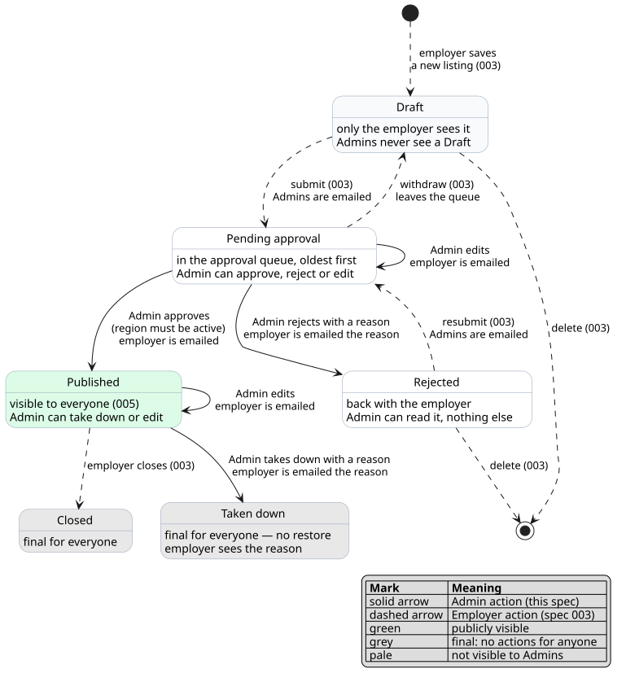
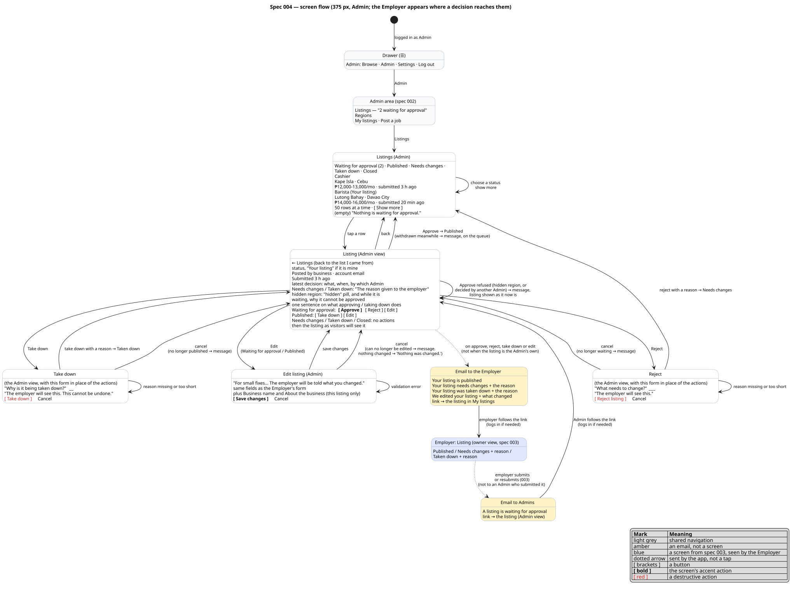
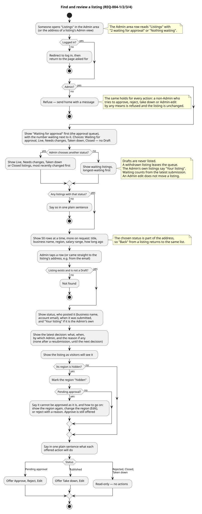
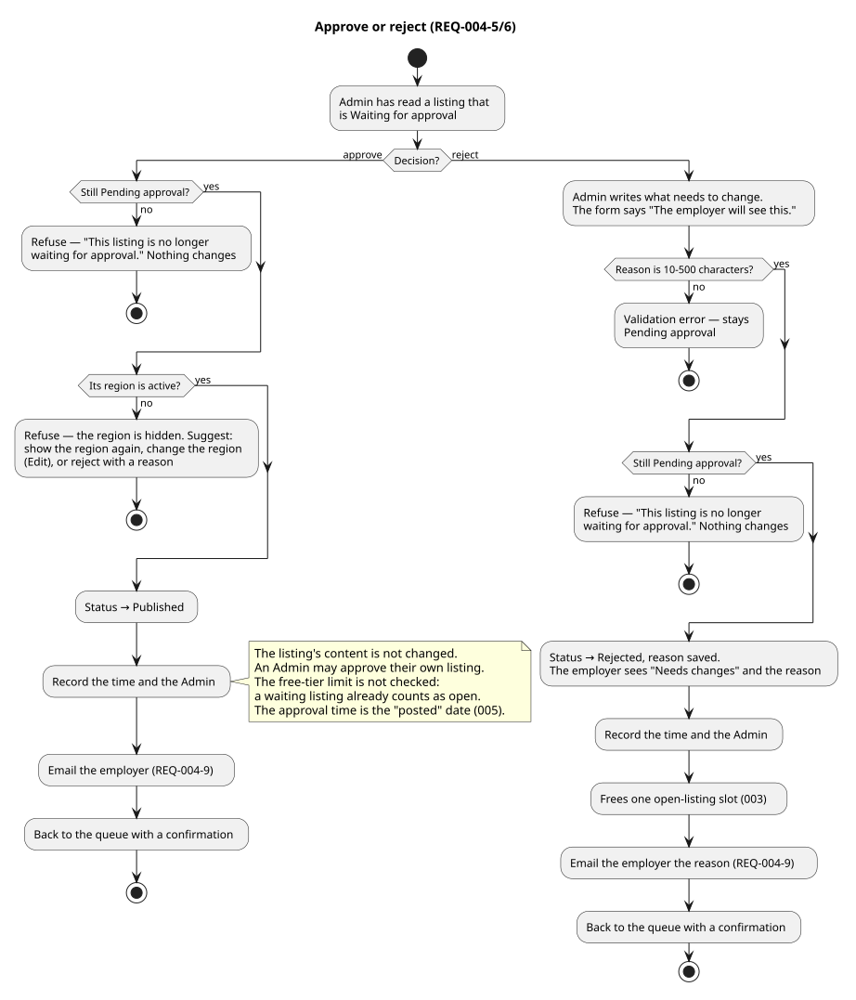
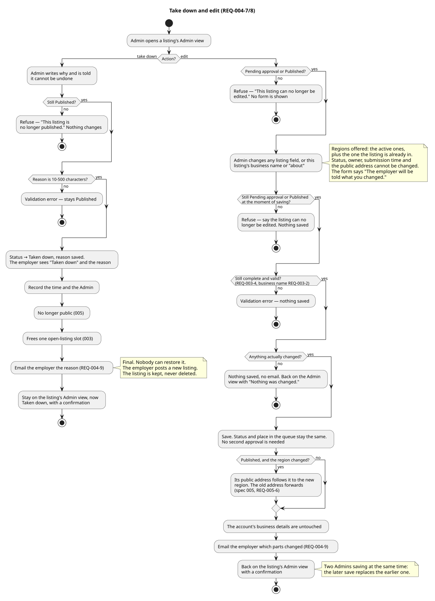
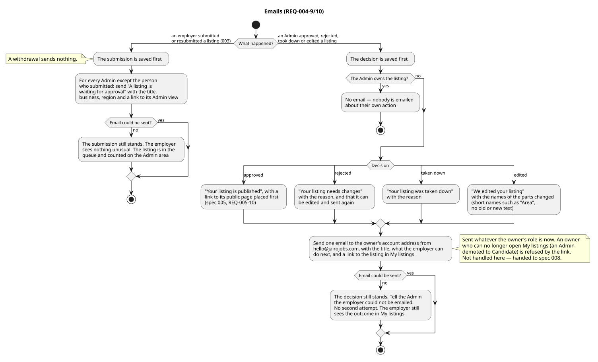

# 004 — Listings: admin moderation

**Status:** Done (2026-11-16)
**Created:** 2026-11-14
**Approved:** 2026-11-14
**Owner:** Jairo
**Related ADRs:** 0004 (UUID v7 keys), 0005 (transactional email via Resend)
**Depends on:** 000 (product overview), 001 (Admin role, navigation), 002 (regions, Admin area), 003 (listings, lifecycle, hand-offs)

## Problem / Why

An Employer can write a listing and submit it, and then nothing happens: no screen lets an
Admin see it, so every submitted listing stays "Waiting for approval" for ever and the board
has nothing to show. The rule that makes the board trustworthy — **nothing an employer
writes goes public without an Admin approving it** (constitution §2.9) — has only its first
half built.

This spec builds the second half. It gives Admins a queue of what is waiting, a page to read
each listing the way a job seeker will, and four actions: approve it, reject it with a
reason, take a published one down, or fix a small mistake themselves. It also makes sure the
other side hears about it: the Employer is emailed each decision, and Admins are emailed
when something is submitted, so approval does not depend on anyone remembering to look.
Spec 000 sets the target: median approval time under 24 hours.

## Goals

- An Admin can see everything waiting for approval, longest-waiting first.
- An Admin can read a listing in full, and see who posted it, before deciding.
- Approving a clear listing takes two taps from the queue: open it, approve it.
- A rejection or a take-down always carries a reason the Employer can read.
- The Employer is emailed each decision on their listing, so they do not have to check the
  site.
- Admins are emailed each submission.
- Only Admins can do any of this, and each decision records who made it and when.
- Specs 005, 007 and 008 get a clear contract: what "approved" means and what is recorded.

## Non-goals / Out of scope

- Public listing pages, the "✓ Approved" badge and the posted date — spec 005. Until then a
  Published listing is visible only to its owner and to Admins.
- Restoring a Taken down listing. Taken down is final, like Closed (decision 1).
- Seeing or touching Drafts. A Draft belongs to its Employer alone (REQ-003-3).
- Admin editing of a Rejected, Closed or Taken down listing.
- A history of every decision on a listing. Only the latest decision is kept (decision 9);
  a fuller log can come with spec 008 if it is needed.
- Ready-made rejection reasons, bulk approve, search inside the Admin lists, filters other
  than status.
- The queue updating by itself while an Admin is looking at it. It shows what was true when
  it was opened; an action on a listing that has since changed is refused with a message.
- Reports from the public ("report a listing") — a later idea in spec 000.
- Suspending or banning an Employer account, and promote / demote screens — spec 008.
- Email preferences, digests, or delivery in the background — spec 010 if needed. Each
  email here is sent once, at the moment of the action.
- Posting or editing a listing on behalf of another business beyond the small fixes in
  REQ-004-8.

## Personas involved

- **Admin** — the main persona; every screen in this spec is written for them.
- **Employer** — sees nothing new on screen except the reason on a Taken down listing;
  receives the emails in REQ-004-9.
- **Candidate**, **Visitor** — not involved. They see a listing only once it is Published
  and spec 005 exists.

## User stories

**US-004-1**
- As an Admin,
- I want to see every listing that is waiting for approval, longest-waiting first,
- so that nothing waits longer than it has to.

**US-004-2**
- As an Admin,
- I want to read a waiting listing the way a job seeker will, and see who posted it,
- so that I can judge it before it becomes public.

**US-004-3**
- As an Admin,
- I want to approve a listing,
- so that it is published.

**US-004-4**
- As an Admin,
- I want to reject a listing and say what needs to change,
- so that the employer can fix it and send it again.

**US-004-5**
- As an Admin,
- I want to take down a published listing and say why,
- so that something that should not be public is removed at once.

**US-004-6**
- As an Admin,
- I want to fix a small mistake in a waiting or published listing myself,
- so that a typo does not cost the employer a rejection and a second wait.

**US-004-7**
- As an Admin,
- I want to find any submitted listing by its status,
- so that I can check on published listings and look up what was decided earlier.

**US-004-8**
- As an Admin,
- I want to be emailed when a listing is submitted,
- so that I can approve it within a day without watching the queue.

**US-004-9**
- As an Employer,
- I want an email when my listing is approved, rejected or taken down,
- so that I know where it stands without checking the site.

**US-004-10**
- As an Employer,
- I want to be told when jairojobs changed something in my listing,
- so that nothing is published under my business name without my knowing.

**US-004-11**
- As the Operator,
- I want only Admins to be able to decide, and each decision to record who made it and when,
- so that the approval rule can be trusted and questions can be answered later.

## Listing lifecycle

This is spec 003's lifecycle with the Admin half filled in. The statuses and the Employer's
transitions are unchanged. Solid arrows are Admin actions specified here; dashed arrows are
Employer actions specified in spec 003. The scenarios in REQ-004-5 to REQ-004-8 must agree
with this diagram, and it must stay in agreement with `state-listing` in spec 003.



*Source: `diagrams/state-listing.puml`.*

| Status | Label (same as the Employer sees) | Admin can see it | Admin actions |
|---|---|---|---|
| Draft | Draft | no | none |
| Pending approval | Waiting for approval | yes, in the queue | Approve, Reject, Edit |
| Published | Published | yes | Take down, Edit |
| Rejected | Needs changes | yes, with the reason | none — it is back with the Employer |
| Closed | Closed | yes | none — final |
| Taken down | Taken down | yes, with the reason | none — final |

## Screen flow



| Story | Path through the screen flow |
|---|---|
| US-004-1 see the queue | Drawer → Admin area → Listings (opens on Waiting for approval) |
| US-004-2 read before deciding | Listings → tap a row → Listing (Admin view) |
| US-004-3 approve | Listing (Admin view) → Approve → Listings |
| US-004-4 reject with a reason | Listing (Admin view) → Reject → write the reason → Listings |
| US-004-5 take down | Listings → Published → Listing (Admin view) → Take down → write the reason → Listing (Taken down) |
| US-004-6 fix a small mistake | Listing (Admin view) → Edit → Edit listing → save → Listing (Admin view) |
| US-004-7 find by status | Listings → choose a status → tap a row → Listing (Admin view) |
| US-004-8 told of a submission | Employer submits (spec 003) → Email to Admins → link → Listing (Admin view) |
| US-004-9 told of a decision | Approve / Reject / Take down → Email to the Employer → link → Employer's listing (owner view, spec 003) |
| US-004-10 told of an edit | Edit listing → save → Email to the Employer ("We edited your listing") |
| US-004-11 only Admins, on record | Every screen sits behind the Admin area; Listing (Admin view) shows the latest decision, when, and by which Admin |

*Source: `diagrams/screenflow-moderation.puml`.*

No wireframe is included. The five new screens follow patterns already
built: the Listings page is a list of rows; the listing's Admin view is the owner view from
spec 003 with a different box on top; the reject and take-down forms are one text field
each; and the Admin edit form is the Employer's listing form with two more fields.

## Flows (activity diagrams)

| Flow | Covers | Diagram |
|---|---|---|
| Find and review a listing | REQ-004-1, -2, -3, -4 | [activity-find-and-review](diagrams/activity-find-and-review.svg) |
| Approve or reject | REQ-004-5, -6 | [activity-approve-or-reject](diagrams/activity-approve-or-reject.svg) |
| Take down and edit | REQ-004-7, -8 | [activity-take-down-and-edit](diagrams/activity-take-down-and-edit.svg) |
| Emails | REQ-004-9, -10 | [activity-emails](diagrams/activity-emails.svg) |

### Find and review a listing


### Approve or reject


### Take down and edit


### Emails


*Sources: `diagrams/activity-*.puml`.*

## Requirements

### REQ-004-1: Moderation is for Admins only

**Serves:** US-004-1, US-004-11

The Admin "Listings" page and every screen and action behind it are reachable only by a
logged-in Admin.

```gherkin
Scenario: Admin opens Listings
  Given I am logged in as an Admin
  When I choose "Listings" in the Admin area
  Then I see the Listings page, opened on "Waiting for approval"

Scenario: Employer or Candidate is refused
  Given I am logged in as an Employer or a Candidate
  When I open the Admin Listings page or a listing's Admin view
  Then I am refused and sent home with a message

Scenario: Visitor is redirected to log in
  Given I am not logged in
  When I open the Admin Listings page or a listing's Admin view
  Then I am redirected to the log-in page
  And after logging in as an Admin I land on the page I asked for

Scenario: Only an Admin can decide
  Given I am an Employer, and a listing of mine is Waiting for approval
  When I try to approve, reject, take down or Admin-edit it by any means
  Then it is refused
  And the listing is unchanged
```

**Rules**
- The Admin area (spec 002) gains a "Listings" row. It says how many listings are waiting,
  e.g. "2 waiting for approval", or "Nothing waiting" when there are none.
- The check is made where the decision is carried out, not only by the screens
  (constitution §2.7): an Employer cannot approve their own listing however the request is
  made.

### REQ-004-2: The approval queue

**Serves:** US-004-1, US-004-8

The Listings page opens on the listings that are Waiting for approval. This is the queue.

```gherkin
Scenario: Longest-waiting first
  Given "Cashier" was submitted 3 hours ago and "Barista" 20 minutes ago
  When I open the queue
  Then "Cashier" is listed above "Barista"

Scenario: What a row shows
  Given a listing is Waiting for approval
  When I open the queue
  Then its row shows the title, the business name, the region, the salary range
  And how long ago it was submitted

Scenario: Empty queue
  Given no listing is Waiting for approval
  When I open the queue
  Then I see "Nothing is waiting for approval."

Scenario: Drafts are not in the queue
  Given an Employer has a Draft listing
  When I open the queue
  Then the Draft is not listed

Scenario: A withdrawn listing leaves the queue
  Given a listing is Waiting for approval
  When its Employer withdraws it
  And I open the queue
  Then it is not listed

Scenario: My own listing is marked
  Given I am an Admin and I submitted a listing myself
  When I open the queue
  Then its row says "Your listing"

Scenario: The Admin area shows how many are waiting
  Given 2 listings are Waiting for approval
  When I open the Admin area
  Then the "Listings" row says "2 waiting for approval"
  And the Listings page shows 2 next to "Waiting for approval"

Scenario: Nothing waiting
  Given no listing is Waiting for approval
  When I open the Admin area
  Then the "Listings" row says "Nothing waiting"
```

**Rules**
- "How long it has waited" counts from the latest submission. A listing that was rejected
  and sent again starts at the back.
- An Admin edit (REQ-004-8) does not move a listing in the queue.
- The number of waiting listings is shown next to "Waiting for approval" and on the Admin
  area row (REQ-004-1).

### REQ-004-3: Find a listing by status

**Serves:** US-004-7

Until the public pages exist (spec 005) this page is the only way for an Admin to reach a
Published listing, so it lists every submitted listing, one status at a time.

```gherkin
Scenario: Choose a status
  Given listings that are Published, Needs changes, Taken down and Closed
  When I choose "Published" on the Listings page
  Then I see only the Published listings
  And the most recently changed is first

Scenario: Each status can be chosen
  Given I am on the Listings page
  When I look at the choices
  Then they are Waiting for approval, Published, Needs changes, Taken down and Closed
  And there is no choice for Draft

Scenario: Nothing with that status
  Given no listing is Taken down
  When I choose "Taken down"
  Then I see a plain sentence saying there are none

Scenario: A long list is shown in parts
  Given 60 listings are Published
  When I choose "Published"
  Then I see the first 50
  And I can ask for more

Scenario: Back returns to the same list
  Given I chose "Published" and opened a listing from that list
  When I go back
  Then I am on the Published list again
```

**Rules**
- Status labels are the ones in `docs/design.md` (Status labels); no new ones.
- Rows show the title, business name, region and salary range, as in the queue, and how
  long ago the listing last changed.
- The choice of status is part of the page's address, so "Back" from a listing returns to
  the same list.

### REQ-004-4: Review a listing

**Serves:** US-004-2, US-004-7, US-004-11

Each submitted listing has an Admin view: a box on top with its status, who posted it and
the latest decision, then the listing laid out as visitors will see it (the same layout as
the Employer's owner view, REQ-003-10).

```gherkin
Scenario: Review a waiting listing
  Given a listing is Waiting for approval
  When I open its Admin view
  Then I see its title, business name, "about the business", region, area, salary, type, schedule and text sections
  And I see the email address of the account that posted it and when it was submitted
  And I can Approve, Reject or Edit it

Scenario: Actions follow the status
  Given listings in each status other than Draft
  When I open each one's Admin view
  Then Waiting for approval offers Approve, Reject and Edit
  And Published offers Take down and Edit
  And Needs changes, Closed and Taken down offer nothing

Scenario: The latest decision is shown
  Given a listing was rejected by the Admin "ana@example.com" with the reason "Salary looks like a typo"
  When I open its Admin view
  Then I see that it was rejected, when, by "ana@example.com", and the reason

Scenario: A hidden region is flagged
  Given a listing is Waiting for approval in region "Baguio", which is hidden
  When I open its Admin view
  Then the region is marked "hidden"
  And I am told the listing cannot be approved as it is, and what I can do instead
  And Approve is still offered

Scenario: A Draft is not found
  Given a listing is a Draft, or was withdrawn after I opened the queue
  When I open its Admin view
  Then I get "not found", exactly as for a listing that does not exist
```

**Rules**
- "Approve" is the one accent action on the page (design guide, principle 4). Reject and
  Take down are not accent buttons.
- The box says in one plain sentence what the main action will do: "Approving makes it
  public and emails the employer." on a waiting listing, and what taking it down does on a
  published one. Reject and Edit explain themselves on their own pages ("The employer will see
  this.", "The employer will be told what you changed.").
- The latest decision is one of: approved, rejected, taken down — with the time and the
  Admin who made it. A listing that was rejected and sent again shows no decision until the
  next one; the old reason is gone (REQ-003-8).
- An Admin's own listing is marked "Your listing" here as well.
- A hidden region is marked with the neutral "hidden" pill from the design guide, on a
  listing in any status. The warning about approval is shown only while the listing is
  Waiting for approval, and names the three ways forward in REQ-004-5. Tapping Approve
  anyway is refused as REQ-004-5 says.

### REQ-004-5: Approve a listing

**Serves:** US-004-3, US-004-11

Approval is the only way a listing becomes Published.

```gherkin
Scenario: Approve
  Given a listing is Waiting for approval in an active region
  When I approve it
  Then its status is Published
  And the time and my account are recorded as the approval
  And its Employer sees it marked "Published" in My listings
  And I am back on the queue with a confirmation

Scenario: Approving does not change the listing
  Given a listing is Waiting for approval
  When I approve it
  Then its title, salary, texts, region and business details are exactly as submitted

Scenario: Hidden region blocks approval
  Given a listing is Waiting for approval in region "Baguio"
  And "Baguio" has been hidden since it was submitted
  When I approve it
  Then it stays Waiting for approval
  And I am told the region is hidden and what I can do instead

Scenario: Listing is no longer waiting
  Given I have a listing's Admin view open
  And its Employer has withdrawn it, or another Admin has already decided it
  When I approve it
  Then nothing changes
  And I am told "This listing is no longer waiting for approval."

Scenario: Admin approves their own listing
  Given I am an Admin and my own listing is Waiting for approval
  When I approve it
  Then its status is Published
```

**Rules**
- For a listing in a hidden region the Admin has three ways forward, and is told them:
  show the region again (spec 002), move the listing to an active region (REQ-004-8), or
  reject it with a reason so the Employer picks another region.
- Any Admin may approve any waiting listing, including one they posted themselves. The
  listing still passes through the queue and the approval is still recorded
  (constitution §2.9 asks for an Admin's approval, which it then has).
- Approval does not look at the free-tier limit: a waiting listing already counts as open
  (REQ-003-12).
- The approval time is the listing's "posted" date for spec 005.

### REQ-004-6: Reject a listing with a reason

**Serves:** US-004-4, US-004-11

```gherkin
Scenario: Reject with a reason
  Given a listing is Waiting for approval
  When I reject it with the reason "Salary looks like a typo — did you mean 14,000?"
  Then its status is Rejected
  And its Employer sees it marked "Needs changes" with that reason
  And the time and my account are recorded as the rejection
  And I am back on the queue with a confirmation

Scenario: A reason is required
  Given a listing is Waiting for approval
  When I reject it with no reason, one shorter than 10 characters, or one longer than 500
  Then I see a validation error
  And it stays Waiting for approval

Scenario: Only a waiting listing can be rejected
  Given a listing is Published, Needs changes, Closed or Taken down, or has been withdrawn
  When I try to reject it
  Then nothing changes
  And I am told "This listing is no longer waiting for approval."

Scenario: Rejecting frees a place
  Given an Employer has 3 open listings, one of them Waiting for approval
  When I reject that one
  Then the Employer can submit another listing
```

**Rules**
- The reason is plain text, 10–500 characters, trimmed. It is written for the Employer:
  the form says "The employer will see this."
- What the Employer does next is spec 003: edit, resubmit or delete (REQ-003-8,
  REQ-003-11).

### REQ-004-7: Take down a published listing

**Serves:** US-004-5, US-004-11

```gherkin
Scenario: Take down with a reason
  Given a listing is Published
  When I take it down with the reason "The business asked us to remove it."
  Then its status is Taken down
  And it is no longer visible to the public
  And its Employer sees it marked "Taken down" with that reason
  And the time and my account are recorded as the take-down
  And I am on the listing's Admin view, which shows it as Taken down, with a confirmation

Scenario: A reason is required
  Given a listing is Published
  When I take it down with no reason, one shorter than 10 characters, or one longer than 500
  Then I see a validation error
  And it stays Published

Scenario: Taking down asks first
  Given a listing is Published
  When I choose "Take down"
  Then I am asked for the reason and told it cannot be undone

Scenario: Only a published listing can be taken down
  Given a listing is Waiting for approval, Needs changes, Closed or Taken down
  When I try to take it down
  Then nothing changes
  And I am told "This listing is no longer published."

Scenario: Taken down is final
  Given a listing is Taken down
  When an Admin or its Employer opens it
  Then there is no action that makes it Published again

Scenario: Taking down frees a place
  Given an Employer has 3 open listings, all Published
  When I take one down
  Then the Employer can submit another listing
```

**Rules**
- The reason follows the same rule as a rejection reason (REQ-004-6) and is shown to the
  Employer in the status box of the listing (an addition to the owner view of spec 003).
- Taken down is final for everyone. To be listed again the Employer posts a new listing,
  which goes through approval like any other.
- A Taken down listing is kept, never deleted (REQ-003-11).
- Until spec 005 there are no public pages. "No longer visible to the public" is met by the
  status being Taken down; spec 005 must not show a Taken down listing.

### REQ-004-8: Fix a listing as an Admin

**Serves:** US-004-6, US-004-10

An Admin can correct a listing that is Waiting for approval or Published. This is meant for
small fixes — a typo, a wrong area, stray formatting. Anything that changes what the
Employer is offering is a reason to reject, not to edit.

```gherkin
Scenario: Fix a waiting listing
  Given a listing is Waiting for approval
  When I change its title and save
  Then the listing shows the new title
  And it is still Waiting for approval, at the same place in the queue
  And I am back on the listing's Admin view with a confirmation

Scenario: Fix a published listing
  Given a listing is Published
  When I change its "About the job" text and save
  Then the listing shows the new text
  And it is still Published
  And I am back on the listing's Admin view with a confirmation

Scenario: The listing must stay complete
  Given a listing is Waiting for approval
  When I empty its salary, or enter a maximum below the minimum, and save
  Then I see a validation error
  And nothing is saved

Scenario: Business name changes on the listing only
  Given a listing by an Employer whose business name is "Kape Isla Cafe"
  When I change the listing's business name to "Kape Isla Café" and save
  Then the listing shows "Kape Isla Café"
  And the Employer's business details still say "Kape Isla Cafe"

Scenario: Other listings cannot be edited
  Given a listing is Needs changes, Closed or Taken down
  When I try to save changes to it as an Admin
  Then the changes are refused
  And the listing is unchanged

Scenario: Only active regions can be chosen
  Given a Published listing in region "Baguio", which is hidden, and an active region "Cebu"
  When I open the Admin edit form
  Then I can keep "Baguio" or choose "Cebu"
  And I cannot choose any other hidden region

Scenario: Saving without changes does nothing
  Given a listing is Published
  When I open the Admin edit form and save without changing anything
  Then nothing is saved
  And no email is sent

Scenario: The listing changed while I was editing
  Given I have the Admin edit form open for a listing that is Waiting for approval
  And its Employer withdraws it
  When I save
  Then the changes are refused
  And I am told the listing can no longer be edited
```

**Rules**
- Editable: every field in REQ-003-4's table, plus this listing's business name and
  "about the business". The field rules are those of REQ-003-4 and REQ-003-2, and all
  required fields must stay filled in.
- Not editable: status, owner, time of submission.
- An Admin edit never changes the account's business details and never needs a second
  approval; the Admin who saves it is the approver.
- The form tells the Admin: "The employer will be told what you changed."
- If two Admins edit the same listing at the same time, the later save replaces the
  earlier one. This is accepted while there are few Admins.

### REQ-004-9: The Employer is emailed each decision

**Serves:** US-004-9, US-004-10

An Admin action on someone else's listing sends one email to the account that owns it.
The exceptions are in the rules below.

```gherkin
Scenario: Approved email
  Given an Employer's listing "Barista (full-time)" is Waiting for approval
  When an Admin approves it
  Then the Employer receives an email saying the listing "Barista (full-time)" is published
  And the email links to the listing in My listings

Scenario: Rejected email carries the reason
  Given an Employer's listing is Waiting for approval
  When an Admin rejects it with the reason "Salary looks like a typo — did you mean 14,000?"
  Then the Employer receives an email saying the listing needs changes
  And the email contains that reason and says the listing can be edited and sent again

Scenario: Taken-down email carries the reason
  Given an Employer's listing is Published
  When an Admin takes it down with the reason "The business asked us to remove it."
  Then the Employer receives an email saying the listing was taken down
  And the email contains that reason

Scenario: Edit email names what changed
  Given an Employer's listing is Published
  When an Admin changes its job title and area and saves
  Then the Employer receives an email saying jairojobs edited the listing
  And the email names "Job title" and "Area" as the parts that changed

Scenario: No email for your own action
  Given I am an Admin and the listing is my own
  When I approve, reject, take down or edit it
  Then no email is sent

Scenario: The decision stands if the email cannot be sent
  Given an Employer's listing is Waiting for approval
  And email cannot be delivered at the moment
  When an Admin approves it
  Then the listing is Published
  And the Admin is told the employer could not be emailed
```

**Rules**
- One email per action, sent to the owner account's email address, from
  `hello@jairojobs.com` (ADR-0005), as part of the Admin's action.
- Every email names the listing by its title, says in plain words what happened and what
  the Employer can do next, and links to the listing in My listings. Following the link
  asks the Employer to log in if they are not (REQ-003-1).
- The edit email names the parts that changed by their short names: Job title, Region,
  Area, Salary, Type, Schedule, About the job, Requirements, Benefits, Business name, About
  the business. These are the form's labels without their hints ("Area", not "Area or
  neighbourhood"). It does not quote the old or new text.
- Nobody is emailed about an action they took themselves.
- The email goes to the owner whatever their role is now. An owner who can no longer open
  My listings (an Admin demoted to Candidate, spec 001) still gets the email, but the link
  will refuse them. That case is not handled here; it is handed to spec 008.
- The decision is saved before the email is sent and is never undone because of it. There
  is no automatic second attempt; the Employer still sees the outcome in My listings.
- Subjects: "Your listing is published: <title>", "Your listing needs changes: <title>",
  "Your listing was taken down: <title>", "We edited your listing: <title>".

### REQ-004-10: Admins are emailed when a listing is submitted

**Serves:** US-004-8

```gherkin
Scenario: Submission emails the Admins
  Given two Admins exist
  When an Employer submits the listing "Barista (full-time)" for approval
  Then each Admin receives an email saying "Barista (full-time)" is waiting for approval
  And the email links to the listing's Admin view

Scenario: A resubmission emails the Admins again
  Given an Employer has a Rejected listing
  When the Employer resubmits it
  Then each Admin receives the email again

Scenario: The Admin who submitted is not emailed
  Given two Admins exist
  When one of them submits their own listing
  Then the other Admin receives the email
  And the Admin who submitted does not

Scenario: The submission stands if the email cannot be sent
  Given email cannot be delivered at the moment
  When an Employer submits a complete listing
  Then its status is Waiting for approval
  And the Employer is told an admin will check it, as usual

Scenario: Withdrawing sends nothing
  Given a listing is Waiting for approval
  When its Employer withdraws it
  Then no email is sent
```

**Rules**
- This adds a step to the Employer's "Submit for approval" and "Resubmit" in spec 003
  (REQ-003-6, REQ-003-8). Nothing the Employer sees changes.
- Subject: "A listing is waiting for approval: <title>". The email names the business and
  the region and nothing else from the listing.
- The Employer is never shown an email failure; the listing is in the queue either way and
  is counted on the Admin area row (REQ-004-1).

## Non-functional requirements

- **Mobile-first:** every screen is usable at 375 px — one column, rows and buttons ≥ 44 px.
  An Admin can clear the queue from a phone.
- **Design:** follows `docs/design.md` — list rows with dividers, one accent action per
  screen ("Approve" on the Admin view, "Save changes" on the edit form). The "Reject listing"
  and "Take down" buttons on their forms use the destructive (error) style, not the accent,
  so those two forms have no accent action. Status pills come from `status_badge`, and
  empty states are plain sentences. The reject, take-down and edit forms are pages or
  sections, not modals.
- **Authorization:** every moderation action is checked against the current Admin in the
  domain layer, not only in the screens (constitution §2.7, §4.3). Tests prove an Employer
  and a Candidate cannot read the Admin views or decide (constitution §3.4).
- **Emails are asserted** in tests for every scenario in REQ-004-9 and REQ-004-10
  (constitution §3.7).
- **Privacy:** listing text, reasons, business details and email addresses are not written
  to logs (constitution §4.12). An Admin sees the poster's email address on the Admin view
  only.
- **Time:** times are shown in `Asia/Manila`, relative under 7 days and absolute after
  (design guide, trust signals).
- **Accessibility:** every status is conveyed in words, not by colour alone.

## Open questions

- None.

## Decisions (resolved 2026-11-14)

Questions 1–3 are the ones spec 003's hand-offs left to this spec; 4–10 came up while
drafting; 11–15 came out of checking the draft against its diagrams and the earlier specs;
16 came out of writing the plan, and 17 out of reconciling the spec with the built screens.
The owner went through them one at a time and chose the proposed answer for each.

| # | Question | Decision |
|---|---|---|
| 1 | Can an Admin restore a Taken down listing? | No. Taken down is final for everyone, like Closed; the take-down asks for a reason and says it cannot be undone (REQ-004-7). Known cost: a mistaken take-down means the Employer posts the listing again |
| 2 | Can a Pending listing in a hidden region be approved? | No. The Admin is told why and can show the region again, move the listing to an active region, or reject it with a reason (REQ-004-5) |
| 3 | Who may approve a listing that an Admin posted? | Any Admin, including the one who posted it. It still goes through the queue and the approval is recorded (REQ-004-5). Revisit when there are several Admins |
| 4 | Does a take-down need a reason the Employer can read? | Yes: required, 10–500 characters, shown on the listing and in the email (REQ-004-7, REQ-004-9). There is no Admin-only note |
| 5 | Which listings can an Admin edit, and which fields? | Waiting for approval and Published; every listing field plus the listing's business name and "about". Meant for small fixes; that is left to the Admin's judgement (REQ-004-8) |
| 6 | Is the Employer told when an Admin edits their listing? | Yes, by an email naming the parts that changed, without quoting old or new text; one email per save (REQ-004-8, REQ-004-9). A fourth email beyond the three in spec 003's hand-off |
| 7 | How do Admins learn that a listing is waiting? | An email to every Admin on each submission and resubmission, plus a count on the Admin area (REQ-004-10, REQ-004-1). Adds a step to spec 003's submit action |
| 8 | Is anyone emailed about their own action? | No. An Admin gets no email for submitting, approving, rejecting, taking down or editing their own listing (REQ-004-9, REQ-004-10) |
| 9 | What is recorded about a decision? | The latest decision only: what, when, which Admin, and the reason if any. No history; Admin edits are not recorded beyond the email (REQ-004-4 to REQ-004-7) |
| 10 | What if the email cannot be sent? | The decision or submission stands; after a decision the Admin is told the Employer could not be emailed; no second attempt (REQ-004-9, REQ-004-10) |
| 11 | Is the Admin warned about a hidden region before tapping Approve? | Yes. The Admin view marks the region "hidden" on a listing in any status and, while the listing is waiting, says it cannot be approved as it is and what to do. Approve stays visible; the queue rows are not marked (REQ-004-4) |
| 12 | Where does the Admin land after each action? | After approve and reject, back on the queue; after a take-down or an edit, on the listing's Admin view. "Back" from a listing returns to the same status list (REQ-004-3, REQ-004-5 to REQ-004-8) |
| 13 | What if two Admins edit the same listing at once? | The later save replaces the earlier one; nothing guards against it. Accepted while there are few Admins; handed to spec 008 (REQ-004-8) |
| 14 | What about an owner who can no longer open My listings? | The email is sent whatever the owner's role is now; the link refuses an Admin who was demoted to Candidate. Not handled here; spec 008 decides what happens to such an account's listings (REQ-004-9) |
| 15 | How are buttons marked in the screen flow? | Brackets for every button, bold for the screen's accent action, red for a destructive one, stated in the diagram's legend. Applies to this spec's screen flow only; the README and the screen flows of specs 002 and 003 are unchanged |
| 16 | How does the edit email name the parts that changed? | By short names ("Area", "Salary"), not the form labels with their hints. Settled after approval, when the plan showed the rule ("the form's labels") and its scenario ("Area") disagreed (REQ-004-9) |
| 17 | What does the Admin view say about its actions? | One sentence, for the main action (approving, or taking down). Reject and Edit explain themselves on their own pages. Settled when the diagrams were reconciled with the built screens (REQ-004-4) |

## Notes for the plan

Not requirements; reminders for whoever writes `plan.md`.

- **Sequence diagram required.** The decision emails and the submission email each touch
  three parties (Admin or Employer → the app → the mail service → the other person), so
  `plan.md` needs a sequence diagram for them (README, Diagrams rule 2), showing that the
  change is saved before the email is sent and what happens when sending fails.
- **Earlier documents this spec changes.** To be updated in the same commits as the
  behaviour, each with a changelog row (README, Feature lifecycle step 5):

  | Document | Change |
  |---|---|
  | 000 feature map and glossary | the 004 row says it also emails Admins each submission and the Employer each Admin edit; the Listing entry says an Admin may edit a Pending or Published listing and that Taken down is final |
  | 001 `wireframe-nav` | the note listing what the Admin area holds gains "Listings" |
  | 002 `screenflow-regions` | the Admin screen gains the "Listings" row, as its first row |
  | 003 REQ-003-6, REQ-003-8, `activity-submit-for-approval` and the resubmit branch of `activity-after-submitting` | submitting and resubmitting also email the Admins (REQ-004-10) |
  | 003 REQ-003-10, `activity-my-listings`, `activity-after-submitting`, `screenflow-posting`, `wireframe-posting` | a Taken down listing shows the reason (REQ-004-7) |
  | 003 REQ-003-5 | the rule becomes "An Employer can edit only Draft and Rejected listings; an Admin's edit is REQ-004-8". Its scenarios already speak for the Employer and do not change |
  | 003 `state-listing` | "locked — cannot be edited" on Pending and Published becomes "locked for the Employer"; then re-check the whole diagram against this spec's |
  | 003 REQ-003-2 | the rule gains an exception: a listing shows the business details it was last submitted with, unless an Admin has since edited that listing's copy (REQ-004-8). Its scenario does not change |
  | `architecture/overview.md`, `data-model.md`, ERD | Listings context gains moderation; the `:require_admin` routes; what is recorded per decision. The ERD's planning comment puts the published time under spec 005; the approval time recorded here is that time, so the comment moves it to 004 |
  | `c4-context-system`, `c4-container-system` | Resend also delivers moderation emails (decisions to the Employer, submissions to Admins). In the context diagram every person reads the inbox, not only the Employer: all accounts get sign-in links (inaccurate since spec 001), and Admins now get submission emails |
  | `usecase-product` | the Admin use case reads "Approve / reject / edit / take down listing", matching spec 000's capability table |

## Hand-offs to later specs

| Spec | Inherits |
|---|---|
| 005 | Only a Published listing is public. Rejected, Closed and Taken down listings are never shown, whatever address is used. |
| 005 | The time of approval is the listing's "posted" date, and an approval is what the "✓ Approved" badge stands for. |
| 005 | Once public pages exist, the "Your listing is published" email also links to the public page; spec 005 amends REQ-004-9. |
| 005 | An Admin looking at a public listing page gets a link to its Admin view, so a take-down is one step from where the problem is seen. |
| 005 | An Admin can still edit or take down a Published listing in a hidden region; whether the public sees it is for spec 005 (also in spec 003's hand-offs). |
| 007 | A Taken down listing accepts no new applications. What happens to applications already sent is decided in spec 007. |
| 008 | Each decision records when it was made and by which Admin, and each listing the time it was submitted; the "median approval time" in spec 000 is measured from these. A full decision history, if wanted, is decided in spec 008. |
| 008 | When promoting and demoting move to the screen, spec 008 decides what happens to the listings of an Admin who is demoted to Candidate: they still own them and are emailed each decision, but cannot open My listings. |
| 008 | Two Admins saving an edit to the same listing at the same time is not guarded: the later save wins (REQ-004-8). Revisit when there are several Admins. |
| 010 | Emails in this spec are sent once, at the moment of the action, with no preferences. Spec 010 may add preferences, digests or delivery in the background. |

## Review before approval

Reviewed after the fact. This spec was approved and built before the review rule existed
(constitution §6, 2026-11-20); the owner asked for it to be reviewed as it stands today.
What was found is listed here and has **not** been changed: each item waits for the owner.

**Reviewed:** 2026-11-23 at commit `94a2e82`

| Checked against | Result |
|---|---|
| This spec's diagrams, scenario by scenario | The 56 scenarios agree with the four activity diagrams, the state diagram, the screen flow and the two sequence diagrams. No difference found. The change of wording on 2026-11-20 is the same in the spec, the diagrams and the app ("Published", "Your listing is published", "This listing is no longer published.") |
| `architecture/overview.md` (contexts, boundaries, who gets in) | Agrees: moderation in the Listings context, the `/admin/listings…` routes in `:require_admin`, emails sent after the change is saved |
| `architecture/data-model.md` and the ERD | Agrees: `published_at`, `decided_at`, `decided_by_id`, `takedown_reason`, and the checks that tie them to the status |
| C4 and use case diagrams | Agrees: Resend delivers the moderation emails; "Approve / reject / edit / take down listing" belongs to the Admin |
| ADRs and the constitution | Agrees: ADR-0005 (sender), §2.7 and §4.3 (checked in the context), §3.7 (emails asserted), §4.12 (nothing private in logs) |
| Earlier specs this one changes ("Notes for the plan") | The table in "Notes for the plan" was walked when the spec closed (2026-11-16). It was not walked again here |
| Not checked | The scenarios were read in full on 2026-11-20, before the change of wording, and the diagrams on 2026-11-23; the comparison was not repeated line by line after the wording changed. Scenario text mixes a status name with screen labels in places ("Published offers Take down and Edit… Needs changes, Closed and Taken down offer nothing"), which follows the owner's decision to rename one label only. Two phone-check screenshots were looked at |

## Traceability

| Story | Requirements |
|---|---|
| US-004-1 | REQ-004-1, REQ-004-2 |
| US-004-2 | REQ-004-4 |
| US-004-3 | REQ-004-5 |
| US-004-4 | REQ-004-6 |
| US-004-5 | REQ-004-7 |
| US-004-6 | REQ-004-8 |
| US-004-7 | REQ-004-3, REQ-004-4 |
| US-004-8 | REQ-004-2, REQ-004-10 |
| US-004-9 | REQ-004-9 |
| US-004-10 | REQ-004-8, REQ-004-9 |
| US-004-11 | REQ-004-1, REQ-004-4, REQ-004-5, REQ-004-6, REQ-004-7 |

## Changelog

| Date | Change |
|---|---|
| 2026-11-14 | Created (Draft) with the extended lifecycle, screen flow and four activity diagrams; ten open questions, each with a proposed answer written into the requirements |
| 2026-11-14 | Open questions resolved: the owner chose the proposed answer for all ten; no requirement or diagram changed |
| 2026-11-14 | All six diagrams checked against the requirements, scenario by scenario, and brought in line; the spec text did not change |
| 2026-11-14 | Checked against the architecture documents and the design guide: reject and take-down buttons use the destructive style, not the accent; C4, use case and the ERD's published-time comment added to the earlier documents this spec changes |
| 2026-11-14 | Four contradictions resolved with the owner: screen flow marks buttons in brackets, the accent one bold and destructive ones red; REQ-003-5, REQ-003-2 and spec 003's state diagram added to the earlier documents this spec changes; Goals and REQ-004-9's opening no longer promise an email in every case |
| 2026-11-14 | Table of earlier documents completed (spec 000, two more spec 003 activity diagrams); US-004-11 also traced to REQ-004-6 and REQ-004-7 |
| 2026-11-14 | Gaps closed with the owner: scenarios for the waiting count, for where the Admin lands after a take-down or edit, for "Back", and for a hidden region flagged on the Admin view; rules for two Admins editing at once and for an owner who can no longer open My listings, both handed to spec 008 |
| 2026-11-14 | Minor points settled with the owner: REQ-004-7 says what "no longer visible to the public" means until spec 005; the C4 row also covers the inbox arrows missing since spec 001. Left as they are: the test-helper note (moves to plan.md) and the screen flow's example wording (reconciled at close) |
| 2026-11-14 | Full pass of all six diagrams against the requirements after the day's edits: three diagrams brought in line (owner's role and the outcome in My listings in the emails flow; arriving by a listing's address; refusal messages and the hidden-region wording in the screen flow); the spec text did not change |
| 2026-11-14 | "No wireframe" note names all five new screens; decisions 11–15 added to the Decisions table |
| 2026-11-14 | Approved |
| 2026-11-14 | The test-helper note moved from "Notes for the plan" to `plan.md` (Test strategy), as agreed; no requirement changed |
| 2026-11-15 | Amended after approval (owner's choice): REQ-004-9's rule says the edit email uses short names of the parts, matching its scenario; `activity-emails` updated; decision 16 added |
| 2026-11-16 | Screen flow: "Listings" is the first row of the Admin area (plan decision 13, owner's choice); no requirement changed |
| 2026-11-16 | Plan and tasks approved; status In Progress |
| 2026-11-16 | Diagrams reconciled with the built screens and code (tasks T14): the screen flow shows the rows, the Admin view and the forms as built, and where a refused action leads; the two action flows check the status before the reason or the fields, as the code does; the sequence diagrams say what a failed email logs. No requirement changed |
| 2026-11-16 | Amended after approval (owner's choice): REQ-004-4's rule asks for one sentence on the main action, not one per action, matching the built screen; `activity-find-and-review` updated; decision 17 added |
| 2026-11-16 | Done. Implemented per tasks.md; "Deployed to Fly.io" deferred until a deployment exists |
| 2026-11-17 | Design guide change (docs/design.md changelog), after Done: the breadcrumb link on the Admin Listings page is 44 px tall; fields and buttons are 44 px; the accent, status and confirmation colours are one step darker. No requirement changed; the 15 pages were re-checked at 375 px |
| 2026-11-20 | Wording only, after Done (owner's decision, docs/design.md changelog): the Published status is called "Published" everywhere, no longer "Live". Changed with it: the lifecycle table's label, REQ-004-7's title, the scenario names "Only a published listing can be taken down" and "Fix a published listing", the message "This listing is no longer published.", the email subject "Your listing is published: <title>" (REQ-004-9), and the address of the Admin list (`?status=published`). Six diagrams were changed to match, and the tests renamed. No requirement changed meaning. Earlier changelog rows, plan.md and tasks.md keep the old word |
| 2026-11-23 | "Review before approval" section added after the fact, at the owner's request: the spec as it stands was read against its diagrams and the architecture documents. Findings are listed in that section; nothing else was changed |
