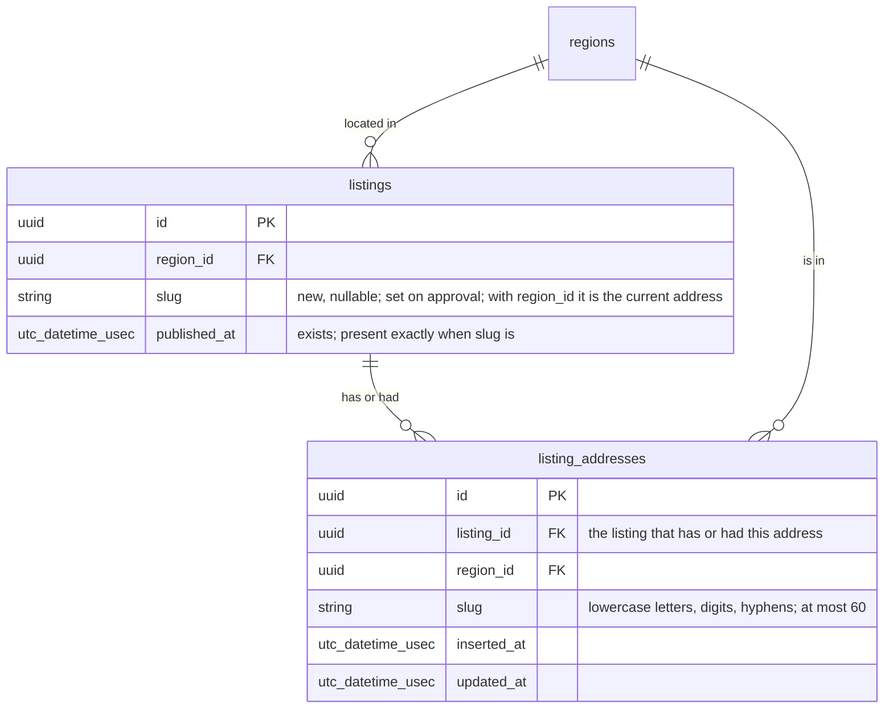

# 005 — Public browse and search — Plan

**Status:** In Progress
**Spec:** [spec.md](./spec.md) (Approved 2026-11-23)
**Created:** 2026-11-26
**Approved:** 2026-11-26

## Approach

The public side is added to the existing `Jairojobs.Listings` context; there is no new
context. Three things are built.

1. **Addresses.** A listing gets a `slug` when it is approved. A new table,
   `listing_addresses`, holds every address a listing has or ever had, one row each. One
   unique index on that table is the whole rule "an address is never given to another
   listing". Approval and an Admin's move to another region are the only two places that
   write an address, and both already run inside the transaction spec 004 built.
2. **Public reads.** One private query, "Published listings", is the base of every public
   function: the list, the search, the lookup of an address and the sitemap. Nothing public
   can be fetched any other way (REQ-005-1).
3. **Screens.** The two lists (`/` and `/jobs/<region>`) are one LiveView, where the
   address is the state: region, search words, type and how far the list is opened are all
   read from it. The listing page, the "no longer listed" page and the sitemap are plain
   controller pages, because they must answer with "gone", "moved" and "not found", which a
   LiveView cannot do by itself, and because nothing on them needs a live connection.

Main trade-off: going from a list to a listing and back is an ordinary page load, not a
live one (decision 1). In exchange every answer a search engine needs is a normal HTTP
answer, a shared link opens without a live connection, and the page is complete as first
delivered by construction.

No new dependencies. No background jobs. One small JavaScript hook (Share).

## Contexts & modules

| Module | New / Changed | Responsibility |
|---|---|---|
| `Jairojobs.Listings` | Changed | Public reads (below); `approve_listing` gives the listing its address; `update_listing_as_admin` moves the address with the region |
| `Jairojobs.Listings.Listing` | Changed | Field `slug`; `approve_changeset` takes the slug; never cast from params |
| `Jairojobs.Listings.ListingAddress` | New | Schema for `listing_addresses`: one address a listing has or had |
| `Jairojobs.Listings.Slug` | New | Pure functions: a slug from a title (60 characters, cut at a word, "job"), and the next free one given the taken ones |
| `Jairojobs.Listings.ListingNotifier` | Changed | `deliver_approved/4`: the public link first, then My listings |
| `Jairojobs.Regions` | Changed | `get_region_by_slug!/1` (raises for an unknown slug) |
| `JairojobsWeb.ListingLive.Index` | New | The two lists: region choices, search, type, rows, "Show more" |
| `JairojobsWeb.ListingController`, `ListingHTML` | New | The listing's public page, the "no longer listed" page, the forwarding of earlier addresses |
| `JairojobsWeb.SitemapController` | New | `/sitemap.xml` |
| `JairojobsWeb.PublicAddress` | New | The one place that builds `/jobs/<region>` and `/jobs/<region>/<listing>`, as a path or a full address. Used by rows, both management views, the email, the sitemap and the page's own stated address |
| `JairojobsWeb.Seo` | New | Builds what goes in a page's head: description, the page's one address, "do not list", the preview, the job details |
| `JairojobsWeb.ListingComponents` | Changed | `listing_detail/1` gains a `trust` slot under the business name and can render the title as the page's `h1` |
| `JairojobsWeb.Layouts` (`root.html.heex`) | Changed | Renders the head tags from `Seo`; title suffix (decision 10) |
| `JairojobsWeb.Employer.ListingLive.Show`, `Admin.ListingLive.Show` | Changed | "See the public page" on a Published listing; the Admin view passes the public address to `approve_listing/4` |
| `JairojobsWeb.Router` | Changed | Routes below; `get "/"` to `PageController` goes |
| `JairojobsWeb.PageController`, `PageHTML`, `home.html.heex` | Removed | The home page is the list |
| `Jairojobs.ListingsFixtures` | Changed (test support) | `approve_listing_fixture/1` passes the public address function |

Names follow the glossary: the code says `Listing` everywhere; only the addresses and the
words on screen say "jobs" (constitution §4.7, spec 000).

### `Jairojobs.Listings` public API

| Function | Returns | REQ |
|---|---|---|
| `list_public_listings(opts)` | `{listings, total}`: Published only, newest approval first (`published_at` then `id`, descending), region preloaded. `opts`: `:region` (a `Region`), `:search` (text), `:type` (an employment type), `:limit` (20), `:offset` (0). `total` counts everything that matched, not the page | 1, 2, 3, 4 |
| `resolve_public_address(region_slug, listing_slug)` | `{:ok, listing}`, the current address of a Published listing · `{:moved, %{region_slug, slug}}`, an earlier address of any listing, with its current one · `{:gone, %{id, user_id, region}}`, the current address of a Closed or Taken down listing · `:not_found` | 5, 6, 7 |
| `list_public_addresses()` | for the sitemap: region slug, listing slug and `updated_at` of every Published listing | 9 |
| `approve_listing(scope, listing, owner_url, public_url)` (was `/3`) | as in spec 004; the listing comes back with its `slug` | 6, 10 |
| `update_listing_as_admin/4` | unchanged shape; a changed region on a Published listing also changes its `slug` and records the new address | 6 |

- None of the three reads takes a scope: what they return is public, the same for everyone
  (as `Regions.list_active_regions/0`). They are all built on one private function,
  `published/0`, which is `from l in Listing, where: l.status == :published`.
- `:gone` carries only what the page needs: the region for "See jobs in …", and the
  listing's id and owner id so the screen can offer the owner's and the Admin's link. The
  title, the text and the reason never leave the context, so the page cannot show them by
  mistake (REQ-005-7). `:moved` carries only the address to forward to.
- `public_url` is a function from a listing to its full public address, passed in by the
  Admin view, like `owner_url` (spec 004, decision 4).

### The slug (REQ-005-6)

`Slug.from_title/1` applies the region rule (`Region.slugify/1`: lowercase ASCII letters,
digits, hyphens), then cuts to 60 characters. If the cut falls inside a word and there is an
earlier hyphen, it cuts back to that hyphen. An empty result is `"job"`.
"Café Staff — ₱500/day!!" gives `cafe-staff-500-day`.

`Slug.free/2` takes the wanted slug and the slugs already taken in that region. If the
wanted one is free it is used. Otherwise it gets the lowest number from 2 that is free:
`barista-full-time-2`, `-3`. With its number a slug is still at most 60 characters: the
words are cut further to make room.

### What approval and a move do, in order

Both run inside `moderate/3`, the transaction of spec 004, after the listing row is locked
and its status checked.

**Approve**
1. Lock the listing's region row (`FOR UPDATE`) and check it is active. This replaces the
   unlocked read spec 004 used, and makes approvals in one region take turns (decision 4).
2. Read the slugs taken in that region from `listing_addresses`.
3. `Slug.from_title(listing.title)`, then `Slug.free/2`.
4. Insert the `listing_addresses` row; write `status`, `published_at`, the decision and
   `slug` in one update.

**Edit that changes the region of a Published listing**
1. Lock the new region's row (it must be active, as today).
2. If the listing already has an address in that region (it was there before), take that
   slug again. Otherwise `Slug.free/2` with the slug the listing has now, and insert the
   row.
3. Write the edited fields, `region_id` and `slug` in one update.

An edit that leaves the region alone, or that moves a Pending listing, touches no address.
Nothing else writes `slug`: not the title, not the business name, not a region's rename.

## Data model

- **`listings.slug`** is the listing's current slug. Its current address is its region's
  slug plus this. It is on the listing, not only in the new table, so that every existing
  read (My listings, the Admin view, the email) has it without a join.
- **`listing_addresses`** has one row per address, the current one included. Rows are only
  ever inserted. It has both timestamps like every table (data-model conventions), though
  `updated_at` never differs.
  - `unique(region_id, slug)`: an address belongs to one listing for good (decision 24 of
    the spec).
  - `unique(listing_id, region_id)`: a listing has one address per region, so a listing
    moved back finds the one it had.
- An earlier address is any row whose region is not the listing's current region.
- A Draft, Pending or Rejected listing has no slug and no row. A listing with a row can
  never be deleted: the foreign key refuses, and spec 003 already deletes only listings
  that were never Published.

### Migrations

1. `add_public_addresses`
   - `listings.slug :string`, nullable
   - table `listing_addresses` with the two unique indexes above; both foreign keys refuse
     a delete
   - CHECK `listing_addresses_slug_format`: `slug ~ '^[a-z0-9]+(-[a-z0-9]+)*$'` and at
     most 60 characters (the same pattern `regions.slug` has)
2. `give_addresses_to_approved_listings` (data only, decision 6)
   - every listing that has `published_at` and no slug gets one, oldest approval first, by
     the rule above. That is Published, Closed and Taken down listings alike
   - written so it needs no module of the app: the rule is copied into the migration, which
     keeps it runnable after the app's code changes
3. `add_public_address_checks`
   - CHECK `listings_slug_iff_approved`: `slug` is present exactly when `published_at` is
   - foreign key `listings(id, region_id, slug)` → `listing_addresses(listing_id,
     region_id, slug)`, with the unique index it needs: the database refuses a listing
     whose current address is not one of its own recorded addresses (decision 3)

All additive. Three migrations because they are three concerns (constitution §4.10) and
because the checks would fail before the data is filled in. Migration 1 lands with the
task that makes approval write a slug, so from that commit on every Published listing the
tests create has one; migrations 2 and 3 land together in the next task.

**Listings already Published.** There is no production database. The dev database has one,
"Software Engineer" in Davao City, which migration 2 puts at
`/jobs/davao-city/software-engineer`. The task runs the migration on the dev database and
records the address it produced in `tasks.md`.

## Routes & LiveViews / Controllers

| Method / Live | Path | Module | Session, pipeline | REQ |
|---|---|---|---|---|
| live | `/` | `ListingLive.Index`, `:all` | `live_session :current_user`, `:browser` | 1, 2, 4 |
| live | `/jobs/:region` | `ListingLive.Index`, `:region` | `live_session :current_user`, `:browser` | 3, 4 |
| get | `/jobs/:region/:listing` | `ListingController`, `:show` | `:browser`, no session block | 5, 6, 7, 8, 10 |
| get | `/jobs` | `ListingController`, `:index` | `:browser` | decision 15 |
| get | `/sitemap.xml` | `SitemapController`, `:index` | no pipeline | 9 |

Where each goes, and why:

- **The two lists** go in the existing `scope "/", JairojobsWeb` that pipes through
  `[:browser]`, inside the existing `live_session :current_user` block, beside sign-up and
  log-in. That session lets anyone in and mounts the scope when someone is logged in,
  which is exactly REQ-005-1: no account needed, and the menu still follows the role. A
  `live_session` name may be defined only once, so they join that block. Both addresses
  are one LiveView, so choosing a region is a patch, not a new page.
- **The listing page and `/jobs`** go in the same scope and the same `:browser` pipeline,
  outside the `live_session` block, as controller routes. The pipeline already puts
  `current_scope` on the connection, which is all the owner's and the Admin's links need.
  They are not in `:require_authenticated_user` or any other guarded scope because they
  must open without an account.
- **The sitemap** goes in a scope with no pipeline. It is XML read by machines: it needs
  no session, no CSRF token and no layout, and `:browser` accepts only HTML.
- The route `get "/", PageController, :home` is removed; `/` is the list (REQ-005-2).
  "Browse jobs" and the wordmark keep pointing to `/`.

### What the listing's address answers

| The address is | Answer |
|---|---|
| the current address of a Published listing | 200, the public page |
| an earlier address of a listing, whatever its status now | 301 (moved for good) to its current address, which then answers by this table |
| the current address of a Closed or Taken down listing | 410 (gone), the "no longer listed" page |
| anything else: never a listing, a listing's id, an unknown region | 404, the usual "not found" |

An earlier address forwards first and the status is looked at second, as
`activity-open-a-listing` draws it. So the old address of a listing that was moved and
then closed forwards to the address that says "no longer listed".

`/jobs/atlantis` raises from `Regions.get_region_by_slug!/1`, the same 404.

### The lists

- **Region choices.** A row of pill links (`min-h-11`): the active regions in alphabetical
  order, then "All regions". The row scrolls sideways inside itself when it is wider than
  the phone, as in the mock; the page does not. The chosen one has
  `aria-current="page"` as well as the primary colour. On a hidden region's list none is
  chosen. Each choice keeps the search words and the type.
- **Search.** One form: a search field (`type="search"`, at most 100 characters), the type
  select ("Any type" and the five types), and a "Search" button. It is an ordinary GET
  form that the LiveView also handles, so it works before the live connection is up.
  Choosing a type applies at once. Submitting patches the address. "Search" is a primary
  (blue) button, not the accent: no public screen in this spec has an accent action.
- **In the address:** `?search=barista&type=part-time&shown=40` (decision 8). Words are
  trimmed and cut at 100 characters; nothing typed, or only spaces, removes the parameter.
  An unknown type or a `shown` that is not a number is ignored.
- **How search matches** (decision 7): Postgres full-text search with the `simple`
  configuration over the title, business name, area, "About the job", Requirements and
  Benefits. Every word typed must be found; capitals do not matter; a word matches a whole
  word. Words made only of punctuation find nothing. No stored column and no index yet:
  at launch size the Published listings are read directly.
- **Count and heading.** A region's list has the heading "Jobs in Davao City". The home
  page has no visible headline (spec decision 7); it has a heading for screen readers
  only. Under it: "3 jobs · newest first", "2 jobs in Davao City · newest first", "1 job".
  The count is of everything that matched. An empty list has no count line, only its
  message, as `activity-browse-and-search` draws it.
- **Rows.** A LiveView stream of links. Title; "Kape Isla · Matina, Davao City" on the
  home page and "Kape Isla · Matina" on a region's list; then the salary
  (`Format.salary_range/3`, `:short`), `Format.time_ago/2` of `published_at`, and
  "✓ Approved". The whole row is the link to the listing's address. A row's DOM id is made
  from its address, not its id, so no listing id appears in a public page (decision 17).
- **"Show more".** Shown only when there are more. It appends the next 20 and replaces
  the address with `shown=40`, `60`, … up to 200.
- **Empty states.** "No jobs are listed yet." · "No jobs are listed in Cebu yet." with
  "See all regions" · "No jobs match your search." When words or a type are set, an empty
  list always gets the third message, in a region too. "Clear search" is shown whenever
  words or a type are set, and leads to the same list without them.
- **The trust line** sits under the list always, rows or none.

### What the browser's back button restores

The spec leaves this to the plan (spec decisions 9 and 20).

- **From a listing back to the list:** the browser asks for the list's address again. The
  address holds the region, the words, the type and `shown`, so the visitor gets the same
  list, opened as far as it was, and the browser puts them back where they were on the
  page. All the rows are in the page as delivered, so this does not wait for the live
  connection.
- **Inside the list:** each search, type and region is a step in the browser's history,
  so Back undoes one. "Show more" replaces the current step instead of adding one, so
  Back never has to be pressed once per "Show more".
- **Limits.** `shown` is kept up to 200. Past that "Show more" still works, but the
  address stays at 200, so Back returns to the first 200. The list is fetched again on
  return, so a listing approved or closed in between shows as it is now.

### The listing page

Top to bottom: "← Jobs in Davao City" (always the listing's region); `listing_detail` with
the trust line in its new slot ("✓ Approved · Posted 2 h ago · Davao City"); "Share", a
plain button; "Applying through jairojobs is coming soon."; and last, for the owner and
for Admins only, a small box with their links. The way back is at the top, where the
screen flow draws it; the box is last, where both the screen flow and
`activity-open-a-listing` put those links. (That activity diagram names the way back near
its end; it lists what the page offers, not where.)

- The business name and "about" are the listing's own copy. `listing_detail` already
  leaves out an empty schedule, Requirements, Benefits and "About …", and shows no status.
- The trust line is added here and nowhere else; the owner view and the Admin view stay
  without it.
- "Share" and the "coming soon" line sit at the end of the page, not in a bar fixed to
  the bottom. Spec 007 puts "Apply for this job" where the line is (decision 19).
- **The owner's box:** "This is your listing." and "Manage this listing" → My listings,
  shown when the logged-in account owns the listing and may still post (an owner demoted
  to Candidate is not shown it). **The Admin's:** "Open the Admin view". An Admin who owns
  it sees both. Nobody else gets either.

### The "no longer listed" page

Status 410. "This job is no longer listed." and "See jobs in Davao City". The same two
links for the owner and for Admins, by the same rule as on the listing page. Built from
the `:gone` result, which holds nothing of the listing. It also asks not to be listed.

### Head tags (REQ-005-8, REQ-005-9)

| Page | Title | Also in the head |
|---|---|---|
| Home | Jobs in the Philippines, with the salary shown \| jairojobs | description; its one address `/` |
| A region | Jobs in Davao City \| jairojobs | description; its one address `/jobs/davao-city` |
| Either list with words or a type | as above | "do not list" |
| A hidden region's list | as above | "do not list" |
| A listing | Barista (full-time) — Kape Isla, Davao City \| jairojobs | description; its one address; the preview; the job details |
| No longer listed | This job is no longer listed \| jairojobs | "do not list" |

- "Its one address" is `<link rel="canonical">` with the full address and no parameters.
  "Do not list" is `<meta name="robots" content="noindex">`.
- **The preview:** `og:title` "Barista (full-time) — Kape Isla", `og:description`
  "₱14,000–16,000 / month · Matina, Davao City", `og:url`, `og:type`, `og:site_name`. No
  image.
- **The job details:** one `JobPosting` block in the format search engines publish
  (schema.org, as JSON-LD): title, description (the three texts), `datePosted`
  (`published_at`), `hiringOrganization` (the business name), `jobLocation` (area, region,
  country PH), `baseSalary` (PHP, minimum and maximum, per month), `employmentType`. No
  closing date and no id. It is produced by `Jason.encode!` with HTML-safe escaping, so an
  employer's text cannot close the block (decision 11).
- The head is written when a page is first delivered. When a visitor changes the list
  without a reload, only the title follows. That is enough: search engines and chat apps
  read the first delivery of each address.
- **Title suffix.** The layout's suffix becomes " | jairojobs" on every page (decision 10).

### The sitemap

`/sitemap.xml`, built on each request: the home page, `/jobs/<slug>` for each active
region, and the address of each Published listing (those in a hidden region included, spec
decision 25) with its `updated_at` as the last change. Nothing else. `priv/static/robots.txt`
gains one line naming it (decision 12).

### The Share hook

A colocated hook, `.Share`, on the button. The button carries the title and the full
address in `data-share-title` and `data-share-url`. On tap:

1. if the browser has a share sheet (`navigator.share`), open it with the title and the
   address; a cancelled sheet does nothing;
2. otherwise copy the address and write "Link copied" in the line beside the button
   (`aria-live="polite"`);
3. if neither is possible, write the address in that line so it can be copied by hand.

LiveView runs hooks on pages that have no LiveView as well, without opening a connection
(checked in `phoenix_live_view` 1.2.13, `joinDeadView`). The test asserts what the button
carries. The tap is checked by hand on a phone at close and written in `tasks.md`
(REQ-005-8).

### DOM ids (fixed now so tests can be written first)

| Element | id |
|---|---|
| List page | `#jobs` |
| Region choices; one choice; "All regions" | `#region-choices`; `#region-choice-<region slug>`; `#region-choice-all` |
| Search form; words; type; button; clear | `#search-form`; `#search-words` (name `search`); `#search-type` (name `type`); `#search-submit`; `#clear-search` |
| Heading; count line | `#jobs-heading`; `#jobs-count` |
| Rows (stream); one row | `#job-rows`; `#job-<region slug>-<listing slug>` |
| Empty message; "See all regions" | `#no-jobs`; `#see-all-regions` |
| Show more | `#show-more` |
| Trust line under the list | `#trust-line` |
| Listing page: way back | `#back-to-region` |
| Listing body (existing, spec 003) | `#listing-detail`, `#listing-title`, `#listing-business`, `#listing-salary`, `#listing-location`, `#listing-type`, `#listing-schedule` |
| Trust line on the listing; its three parts | `#listing-trust`; `#listing-approved`, `#listing-posted`, `#listing-region` |
| Share button; its message line | `#share-listing`; `#share-status` |
| "Coming soon" line | `#apply-coming-soon` |
| Owner's and Admin's box; the sentence; the two links | `#manage-links`; `#your-listing-note`; `#manage-listing`, `#open-admin-view` |
| "No longer listed" page; its link to the region | `#listing-gone`; `#see-region-jobs` |
| Owner view and Admin view: the link to the public page | `#see-public-page` |

## Authorization

- **Public means Published.** The rule is in `published/0` in the context, and
  `resolve_public_address/2` checks the status itself. The screens add nothing to it and
  cannot widen it (constitution §2.7). Tests prove a listing in each other status is on no
  list, in no search and in no sitemap, and has no page (constitution §3.4).
- **No scope decides what is listed.** Logging in changes the menu and the two links, not
  the lists.
- **The two links** are shown from `current_scope`: the Admin's for an Admin, the owner's
  when `listing.user_id` is the account's id and the account may post. They lead to
  `/admin/listings/:id` and `/my/listings/:id`, which check who is asking, as before.
- **Never cast from params:** `slug`. It is written only by approval and by a move.
- **Never on a public page:** the owner's email, the deciding Admin, either reason, the
  status, any listing id (outside the two links, which only their owner and Admins get).

## Logging and privacy

- `config :phoenix, :filter_parameters` gains `"search"`, so the words are "[FILTERED]"
  in the parameter lines of requests, of `handle_params` and of the search event. The
  request line itself ("GET /jobs/davao-city") has no query string. The parameter is not
  named `q` because the filter matches any name that *contains* the entry.
- Two tests prove it (constitution §4.12). `test/jairojobs_web/endpoint_log_test.exs`
  gets a case that makes a real search request with the log captured at its most detailed
  level and finds the words nowhere in it. A second, beside the other filtered-parameter
  tests, checks that `search` is filtered.
- Nothing is stored about a search or a view.

## Background jobs / emails / external services

No background jobs and no new outside service. Search engines and chat apps only read
pages; nothing is sent to them (spec decision 11).

**The approval email** (amends REQ-004-9). `deliver_approved(owner, listing, public_url,
owner_url)`:

> Your listing "Barista (full-time)" was approved and is published on jairojobs.
>
> Anyone can see it here. This is the link to share:
>
> ‹public address›
>
> It stays up until you close it. Close it when the job is filled:
>
> ‹My listings address›

The other four emails do not change. This spec has no three-party flow of its own, so it
adds no sequence diagram. `sequence-decision-email` in spec 004 changes in the same task:
the call reads `approve_listing(scope, listing, owner_url, public_url)`; the transaction
gains "lock the region row; give the listing its public address" on the approve branch;
the delivery reads `deliver_approved(owner, listing, public_url, owner_url)`; and the note
says the approval email carries the public link first, then My listings.

## Test strategy

Scenario-first (constitution §3.12). Each of the 74 scenarios gets a test named
`REQ-005-n: <scenario name>`; `mix jairojobs.spec_coverage 005` must end at zero missing.

Files:

- **C** `test/jairojobs/listings_public_test.exs` (context)
- **L** `test/jairojobs_web/live/listing_live/index_test.exs` (LiveView: the two lists)
- **P** `test/jairojobs_web/controllers/listing_controller_test.exs` (controller: the
  listing page, gone, forwarding)
- **S** `test/jairojobs_web/controllers/sitemap_controller_test.exs`
- **O** `test/jairojobs_web/live/employer/listing_live_test.exs` (exists)
- **A** `test/jairojobs_web/live/admin/listing_live_test.exs` (exists)
- **M** `test/jairojobs/listings_moderation_test.exs` (exists)

| REQ | Scenario | Where |
|---|---|---|
| 1 | A Published listing is public without an account | L, P |
| 1 | Other statuses are on no public list | C, L |
| 1 | A taken down listing leaves the lists | L |
| 1 | A hidden region does not hide a listing | C, L |
| 1 | The owner's role does not matter | C |
| 1 | Logging in does not change the lists | L |
| 2 | Newest first | C, L |
| 2 | What a row shows | L |
| 2 | How many jobs | L |
| 2 | Nothing listed yet | L |
| 2 | A long list is shown in parts | C, L |
| 2 | An edit does not move a listing | C |
| 2 | The trust line is shown | L |
| 3 | Choose a region | L |
| 3 | Rows do not repeat the region | L |
| 3 | The choices are the active regions | L |
| 3 | A region with no jobs | L |
| 3 | A hidden region still opens by its address | L |
| 3 | Unknown region | L |
| 3 | Back to all regions | L |
| 4 | Search by a word in the title | C, L |
| 4 | Search finds the business and the area | C |
| 4 | Search finds words in the listing's text | C |
| 4 | Every word must be found | C |
| 4 | Capitals do not matter | C |
| 4 | Filter by type | C, L |
| 4 | Search and type together, inside a region | C, L |
| 4 | Nothing matches | L |
| 4 | Clear the search | L |
| 4 | A search can be opened again by its address | L |
| 4 | Choosing a region keeps the search | L |
| 4 | An empty search is no search | C, L |
| 5 | Read a listing without an account | P |
| 5 | The trust line | P |
| 5 | An older listing shows the date | P |
| 5 | Optional parts are left out | P |
| 5 | The public sees the listing as it is now | P |
| 5 | What is never shown | P |
| 5 | Applying is not possible yet | P |
| 5 | Back to the region's jobs | P |
| 6 | The address is made at approval | C |
| 6 | The same title in the same region gets a number | C |
| 6 | The same title in another region needs no number | C |
| 6 | A changed title keeps the address | C, P |
| 6 | Unusual characters in a title | C |
| 6 | An unpublished listing has no public address | C |
| 6 | The id is never a public address | P |
| 6 | Moving to another region forwards the old address | C, P |
| 6 | An address is never given to another listing | C |
| 6 | An earlier address is not given to another listing either | C, P |
| 7 | A closed listing's address says so | P |
| 7 | A taken down listing's address says the same | P |
| 7 | Nothing of the listing is shown | C, P |
| 7 | The page is answered as gone | P |
| 7 | The owner and Admins see the same page | P |
| 7 | An address that never was a listing | P |
| 8 | The page offers Share | P |
| 8 | A shared link has a preview | P |
| 8 | A shared link opens without an account | P |
| 9 | A listing page has its own title and description | P |
| 9 | A listing page carries job details a search engine can read | P |
| 9 | A region's jobs have their own title | L |
| 9 | Search results ask not to be listed | L |
| 9 | A hidden region's list asks not to be listed | L, P |
| 9 | The sitemap lists the public pages only | S |
| 9 | A page is complete as first delivered | P, L |
| 10 | The approval email links to the public page | M |
| 10 | The owner view links to the public page | O |
| 10 | The Admin view links to the public page | A |
| 10 | Only a Published listing has the link | O, A |
| 10 | An Admin gets to the Admin view from the public page | P |
| 10 | The owner gets to their listing from the public page | P |
| 10 | Nobody else sees those links | P |
| 10 | The same links on a listing that is no longer listed | P |

Other tests, not named for a scenario:

| What | Where |
|---|---|
| `Slug.from_title/1` and `Slug.free/2`: 60 characters, the cut at a word, "job", the number, the number within 60 | `test/jairojobs/listings/slug_test.exs` (unit) |
| A listing moved back returns to the address it had; a move into a region where its slug is taken gets a number | C |
| Two Admins approve the same title in one region at the same moment: both succeed, with different addresses | `test/jairojobs/listings_concurrency_test.exs` (real connections, as its other tests) |
| The old address of a listing that was moved and then closed forwards to the page that says "no longer listed" | P |
| The two unique indexes, the two CHECKs and the foreign key: one test each that tries to break it with a direct write | C |
| `approve_listing` as an Employer or Candidate still writes no address (spec 004's "Only an Admin can decide" stays green) | M |
| Searched words are not logged: a real search request with the log captured, and the parameter filter | `test/jairojobs_web/endpoint_log_test.exs`; **L**, beside the other filtered-parameter tests |
| `shown`: 40 in the address gives 40 rows; a value over 200, or not a number, is handled | L |
| The job-details block is valid JSON and an employer's `</script>` in a text does not end it | P |
| `/jobs` forwards to `/` | P |
| One journey (`test/jairojobs_web/live/browse_journey_test.exs`): an Employer posts, an Admin approves, a visitor finds it on the home page, by region and by search, opens it; the Admin moves it and the old address forwards; the Employer closes it and its address says it is no longer listed | LiveView + controller |

Notes:

- **Dead render first.** The list tests that concern search engines and "complete as first
  delivered" use a plain `get`, not a connected LiveView.
- **Controller pages are asserted through `LazyHTML` selectors** on the DOM ids above, not
  by matching raw HTML (AGENTS.md, LiveView tests).
- **New test files are `async: true`.** Each test has its own regions, so fixed titles
  such as "Barista (full-time)" do not clash between tests.
- **Time.** "2 h ago" and "10 days ago" need listings approved in the past. The context
  stamps the real time, so those tests set `published_at` back with one test-support
  function in `ListingsFixtures` that updates that column and nothing else (decision 20).
  It does not bring back the status helper spec 004 removed: the status is still reached
  through the real functions.
- **The existing tests of the home page** (`page_controller_test.exs`: REQ-001-1 and the
  four REQ-001-12 menu tests) keep their names and move to file **L**, since `/` is now
  that LiveView. The REQ-001-1 test asserts `#jobs` where it asserted `#home`.
- **The existing REQ-004-9 test of the approval email** gains the public link; its name
  does not change.
- **`approve_listing/4`** changes 23 callers the compiler finds (1 screen, 1 fixture, 21
  in tests) and two it does not: the phone-check scripts `priv/phone_check/003.exs` and
  `004.exs`, which are not compiled. They change in the same commit and are run once to
  prove it.
- **Phone check at close.** `priv/phone_check/005.exs`: the home page with rows, a region's
  list, a search that finds nothing, a listing page (long title, long business name), the
  "no longer listed" page, each as a Visitor, and the listing page as its owner and as an
  Admin. `scripts/phone-check.sh 003` and `004` are run again: the owner view and the
  Admin view each gain a link.

## Build order

Not `tasks.md`; the order the tasks will follow, so each earlier document can be placed.
Each step is one or more tasks, each task one commit.

| Step | Builds | REQ |
|---|---|---|
| 1 | `Slug`; migration 1; approval writes the address | 6 |
| 2 | Migrations 2 and 3: addresses for listings already approved, then the checks | 6 |
| 3 | A move to another region takes the address along; moved back | 6 |
| 4 | The public reads: list, search, type, `resolve_public_address/2` | 1, 4, 7 |
| 5 | The home page becomes the list; rows, count, empty state, trust line, title | 1, 2 |
| 6 | A region's list; the region choices | 3, 9 (title) |
| 7 | Search, type, clear, "Show more", the address parameters, the log filter | 4 |
| 8 | The listing page; "no longer listed"; forwarding; not found; `/jobs` | 5, 6, 7 |
| 9 | Links both ways: owner view, Admin view, the public page, the gone page | 10 |
| 10 | The approval email's public link; `approve_listing/4` | 10 |
| 11 | Share and the preview | 8 |
| 12 | Head tags, "do not list", the job details, the sitemap, `robots.txt` | 9 |
| 13 | Close: coverage, phone checks, the Share tap by hand, every diagram re-read, this table walked again | all |

## Documents to update when the behaviour lands

Every row of the spec's table "Earlier documents this spec changes", in its order. Each is
changed in the commit of the step named, with a changelog row in the document changed.

| # | Document | Step |
|---|---|---|
| 1 | 000 feature map: the 005 row's status | 1 (In Progress), 13 (Done) |
| 2 | 001 REQ-001-1 and `screenflow-auth`: the "Home / Browse jobs" box | 5, and 7 for search and type |
| 2 | 001 `screenflow-auth`: the "Listing detail" box | 8, and 11 for "Share" |
| 3 | 001 `activity-request-access`: its list of public pages | 8 |
| 4 | 002 REQ-002-4: states spec decision 1 | 6 |
| 5 | 002 `state-region`: "Hidden" | 6 |
| 6 | 002 `activity-seed-and-consume` | 6 |
| 7 | 003 lifecycle table, `state-listing`: wording checked | 8 |
| 8 | 003 REQ-003-9 and `activity-after-submitting` | 8 |
| 9 | 003 REQ-003-10, `activity-my-listings`, `screenflow-posting`, `wireframe-posting` | 9 |
| 10 | 004 REQ-004-9, `activity-emails`, `sequence-decision-email`, `screenflow-moderation` | 10 |
| 11 | 004 REQ-004-4, `activity-find-and-review`, `screenflow-moderation` | 9 |
| 12 | 004 REQ-004-3 and REQ-004-7: "until the public pages exist" | 8 |
| 13 | 004 REQ-004-5 and `activity-approve-or-reject`: approval gives the address | 1 |
| 14 | 004 REQ-004-8 and `activity-take-down-and-edit`: a move changes the address; an edit cannot set it | 3 |
| 14 | 004 `activity-take-down-and-edit`: "No longer public (005)" | 8 |
| 15 | 004 `state-listing`: "Published" gets its address on approval | 1 |
| 16 | `architecture/overview.md`: the `live_session` table and the routes beside it | 5, 8 |
| 16 | `architecture/overview.md`: the Listings row says implemented | 13 |
| 17 | `architecture/data-model.md`, the ERD: slug, `listing_addresses`, the Conventions line, the planning comment | 1; the checks in 2 |
| 18 | `c4-context-system`, `c4-container-system`: search engine, chat app, the Visitor's arrow | 12 |
| 19 | `docs/design.md` and its mock | done on 2026-11-26, in its own commit (the note below) |
| 20 | The home page: "Listings are coming soon" goes | 5 |
| 21 | The Admin's Regions screens | no change (decision 16) |

Two differences from the spec's wording of row 16, for the owner to know: the overview's
`:current_user` row gains the two lists only, and the listing page and the sitemap are
named beside the table as public controller routes (decision 1).

## The note beside the mock in `docs/design.md`

Approved by the owner on 2026-11-26 and made in `docs/design.md` that day, in its own
commit with a changelog row. It was a proposal separate from this plan, because the design
guide is Accepted. The text, directly under the mock's source line:

> *The mock was drawn before the public pages were specified (spec 005) and differs from
> the site in four places. The listing page has no "Apply for this job" button until spec
> 007; it has a "Share" button and the line "Applying through jairojobs is coming soon."
> "Member since" is not shown. Dates read "1 d ago", never "Yesterday". The list also has
> a search field and a type choice, which the mock does not draw. Where the mock and a
> spec disagree, the spec is right.*

The spec named the first three. The fourth was found while writing this plan: the mock's
list has region choices but no search field and no type choice. The alternative is to
redraw the mock; that can wait until spec 007 changes the listing page again.

## Risks & mitigations

| Risk | Mitigation |
|---|---|
| Two approvals of the same title at the same moment pick the same slug | Approvals in one region take turns on the region's row lock; the unique index is the backstop; a concurrency test covers it |
| The lock order could deadlock with another action | Every path locks the listing before a region, and nothing locks a region and then a listing; `submit_listing` locks the account, then the listing, and no region |
| Search reads every Published listing on each search, and the lists have no index of their own | Fine at launch size (spec 000 aims for 20 listings). A stored search column and an index on the approval time can each be added later, in their own migration, without changing what anyone sees |
| `simple` search does not know plurals: "drivers" does not find "Driver" | Within what the spec does not promise (spec decision 16). Decision 7 gives the alternative |
| The job-details block is built from an employer's text | HTML-safe JSON escaping; a test with `</script>` in a text |
| An employer's text in a preview or description | Escaped by the templates like any other text; descriptions use only the salary, type, area, region, title and business name |
| `approve_listing/4` breaks 25 callers | One commit. The compiler finds 23 (warnings are errors); the two phone-check scripts are not compiled, so they are changed by hand and run |
| Changing the title suffix touches every page's title | One line in the root layout; no test asserts the old suffix (checked with a search of `test/`) |
| The sitemap is built on each request | A few short queries at launch size. The format allows 50,000 addresses per file; far away |
| A region row with many choices on a phone | The row scrolls inside itself; the phone check looks for sideways scrolling of the page |
| Share does nothing on an old browser or over plain HTTP | Third fallback: the address is written out to copy by hand |
| "2 h ago" goes stale on a page left open | Accepted; lists do not update by themselves (spec, out of scope) |
| A row could skip or repeat when a listing is approved between two "Show more" | A repeat replaces the same row; a skip is corrected on the next load. Accepted, same reason |
| Migration 2 copies the slug rule, which could drift from the code | It runs once, on listings from before this spec; the rule is fixed by REQ-005-6. Its result on the dev database is checked by hand and recorded |
| Deploying after this spec shows listings nobody can apply to until specs 006 and 007 | Not for this plan: raised with the owner earlier, still his to decide |

## Decisions confirmed (2026-11-26)

The owner read the plan and chose the proposed answer for all twenty, in one reply. Each
is written into the plan above. The first nine shape the build; the rest are small.

| # | Decision | Choice | Hard to change later? |
|---|---|---|---|
| 1 | Is the listing page a LiveView or a plain page? | A plain controller page; the two lists are a LiveView. The page must answer "gone" (410), "moved" (301) and "not found" (404), which a controller does directly and a LiveView cannot, and nothing on it needs a live connection. Cost: list → listing → back are ordinary page loads. This differs from the spec's note that "the public pages join the `:current_user` session": only the lists do. Other option: a LiveView with a plug in front of it for the three answers, which means two places that decide what an address is | medium — spec 007 builds on this page |
| 2 | Where is a listing's address kept? | `slug` on the listing (the current one) and a `listing_addresses` table with every address it has or had, the current one included. One unique index is then the whole "never given to another listing" rule | medium — a migration |
| 3 | Does the database guard the addresses, or only the code? | The database too: the two unique indexes, a format check, "slug exactly when approved", and a foreign key so a listing's current address must be one of its own. As spec 004 did for the reasons and `published_at` | medium — a later change needs a migration |
| 4 | How are two approvals of the same title kept from clashing? | They take turns: approval locks the region's row. No retry loop. An Admin hiding that region at the same moment waits a few milliseconds | no |
| 5 | The number on a clash | The lowest free number from 2, added to the wanted slug, the whole still at most 60 characters. On a move the wanted slug is the one the listing has, so in the rare case that a numbered slug clashes again it reads `barista-full-time-2-2`. Other option: strip the old number and count again (`-3`), which needs a guess at whether "-2" came from a clash or from the title | no — only new addresses |
| 6 | Listings approved before this spec | A migration gives every listing that has `published_at` an address, oldest first: Published, Closed and Taken down alike, so the rule "approved once means it has an address" has no exceptions. The rule is copied into the migration. Other option: a command run by hand | no |
| 7 | How does search match? | Postgres full-text search, `simple`: whole words, every word, capitals ignored, exactly what REQ-005-4 promises. "driver" does not find "drivers". Other option: look for the letters anywhere ("driver" finds "drivers", but "it" finds "with" and "position"; short words drown the list, which has no ordering by match) | no — one private function |
| 8 | Names in the address | `search`, `type` (`full-time`, `part-time`, `contract`, `temporary`, `internship`), `shown`. Not `q`: the log filter would then hide every parameter with a "q" in its name. Unknown values are ignored, not errors | medium — shared links carry them |
| 9 | Does Back restore how far the list was opened? | Yes, through `shown` in the address, up to 200 rows. Browsing a long list, opening a listing and coming back is the main thing a visitor does. Other option: not kept, as on the Admin lists (spec 004, decision 10), so Back returns to the first 20 rows | no |
| 10 | The title's ending | " \| jairojobs" on every page of the site, replacing " · jairojobs" in the one layout line. The spec fixes it for the public pages (spec decision 19); two endings on one site would be odd | no |
| 11 | How are the job details marked? | One data block in the head (`<script type="application/ld+json">`), the form search engines recommend. AGENTS.md forbids inline scripts in templates; this is data, not code, and is written by the layout from a map. Other option: attributes on the visible markup (microdata), which spreads through `listing_detail`, shared with the owner and Admin views | no |
| 12 | The sitemap | `/sitemap.xml`, built on each request, no cache. `robots.txt` names it with the production address, `https://jairojobs.com/sitemap.xml` | no |
| 13 | The public link for the email | `approve_listing/3` becomes `/4`: the Admin view passes a second function, as spec 004 did for `submit_listing` | no |
| 14 | Words this plan adds (the spec fixes the rest) | The email's two sentences above. Descriptions: home "Jobs across the Philippines, newest first, each with its salary shown and checked by jairojobs before it is published."; a region the same with "Jobs in Davao City"; a listing "Barista (full-time) at Kape Isla: ₱14,000–16,000 / month, Full-time, Matina, Davao City." The gone page's title "This job is no longer listed". The search field's label for screen readers "Search jobs", no placeholder. The home page's heading for screen readers "Jobs in the Philippines". A region's visible heading "Jobs in Davao City" | no |
| 15 | `/jobs` with nothing after it | Forwards to `/`. People shorten addresses by hand. The spec does not mention it | no |
| 16 | The Admin's Regions screens show `/jobs/<slug>` as text. Make it a link? | No, leave it. It would need a 44 px target in a row that already has two buttons, and changes to spec 002's wireframe and screen flow | no |
| 17 | Listing ids in public pages | None: a row's DOM id is made from its address. ADR-0004 keeps ids out of public addresses; this keeps them out of the public HTML as well | no |
| 18 | Forwarding | Permanent (301), to the current address, dropping any parameters | no |
| 19 | Where "Share" and "coming soon" sit; Share with no way to copy | At the end of the page, not fixed to the bottom of the screen: the fixed bar is for the accent action spec 007 brings. Where the browser can neither share nor copy, the address is written out | no |
| 20 | Tests that need a listing approved in the past | One function in the test fixtures sets `published_at` back, by a direct update of that one column. The account fixtures already do the same for token times. Constitution §3.3 prefers fixtures through context functions, and spec 004 removed a helper that wrote statuses directly; this one writes no status. Other option: give the context functions a clock to pass in, which changes product code for the tests' sake | no |

## Review before approval

**Reviewed:** 2026-11-26 at commit `22d51f8`

The draft was committed (`62d65e5`), read against the documents below, corrected, and
committed again (`22d51f8`). The corrected parts were then read once more.

Since that commit three things changed, and nothing else: this section was written; on
2026-11-26 the owner confirmed the twenty decisions, so the decisions table was retitled
and its column "Proposed" became "Choice"; and the same day he approved the plan and the
note for the design guide, so the status, the note's heading and row 19 of the documents
table say so. No answer changed, so nothing the review read is different.

Amended after approval, 2026-11-26, with the owner's word, after a comparison of the spec,
its diagrams, this plan and `tasks.md`: the sentence on the order of the listing page no
longer claims to follow both diagrams; the test that searched words are not logged became
two tests, one of them on a real request; an empty list is said to have no count line.
Nothing that is built changed.

| Checked against | Result |
|---|---|
| Every requirement and scenario of the spec has a place in this plan and a test | All 74 scenario names are in the test table (compared by a script against `spec.md`, not by eye). The Rules of all ten requirements and the non-functional requirements were read against the plan, and so were the five diagram sources. Four things were found and fixed. (1) The plan answered an earlier address of a closed listing with "gone" directly; `activity-open-a-listing` forwards first, so it now forwards. (2) The owner's and Admin's box was at the top of the listing page; both diagrams put it last. (3) Which empty message a searched region gets was not said. (4) It was not said that "Search" and "Share" are not accent buttons |
| `architecture/overview.md` (contexts, boundaries, who gets in) | Agrees. No new context; Listings already depends on Regions, and now also locks a region's row and uses its slug rule. The web layer calls no `Repo`. Addresses are built in the web layer and passed in as functions. One difference from what the spec expected: only the two lists join `live_session :current_user`; the listing page and the sitemap are controller routes (decision 1) |
| `architecture/data-model.md` and the ERD | Two things found and fixed. The new table had no `updated_at`, against the conventions. Migration 1 carried an index for the lists, a second concern (constitution §4.10); it is dropped until it is needed. Of the ERD source, the `regions` and `listings` parts and the planning comment were read |
| ADRs and the constitution (new deps, background jobs, conventions) | Agrees: no dependency, no background job, no new ADR (ADR-0004 gives the address shape; read in full). Two points are put to the owner because a rule could be read against them: the job-details data block against the AGENTS.md line on inline scripts (decision 11), and a test helper that writes `published_at` directly against §3.3 (decision 20, added in this review). Read for this: §2.2, §2.3, §2.7, §3.1, §3.3 to §3.5, §3.12, §4.2, §4.5 to §4.8, §4.10, §4.12, §5 |
| Earlier specs and documents this plan changes | All 21 rows of the spec's table have a step. One thing found: `priv/phone_check/003.exs` and `004.exs` call `approve_listing` and are not compiled, so the change to four arguments must be made there by hand |
| Checked by running, not only by reading | In Postgres: the `simple` search on the examples of the five search scenarios, "driver" against "Drivers", and a search of punctuation only. The foreign key from a listing to its own address, with an empty slug, a move and a wrong slug, on temporary tables in a transaction that was rolled back. `Region.slugify/1` on "Café Staff — ₱500/day!!", "Barista (full-time)" and a title of peso signs. The callers of `approve_listing`, counted. `mix jairojobs.spec_review 005` still passes with this file in the folder |
| Not checked | Nothing is built, so these rest on reading, not on a run: that a hook runs on a page with no LiveView (read in LiveView 1.2.13's source, not tried in a browser); that the browser puts the visitor back at the same place in the list on Back; that the search form works as a plain form before the live connection is up; the migration syntax for a foreign key over three columns (seen in Ecto's documentation). Not read: the sources of the C4 and use case diagrams, the rest of the ERD, ADRs 0001 to 0003 and 0005, and the text of the earlier documents in the 21 rows (the spec's own review opened each; here they were only placed). No rendered image was looked at |

## Alternatives considered

- **Everything a LiveView.** The listing page would need a plug in front of it, or an
  exception with a status, to answer 410 and 301; a visitor reading one shared listing
  would hold a live connection open for a page that never changes. Rejected (decision 1).
- **Everything a controller**, the lists too, with a GET form and "Show more" as a link
  that reloads. Works without any script. Rejected for the lists: a search or a region
  would reload the whole page each time, and `Phoenix.LiveViewTest` fits the scenarios
  better. The form and the links are still real ones, so most of that sturdiness is kept.
- **No `slug` on the listing; only the table.** No copy to keep in step, but every read
  that shows the public link (lists, My listings, the Admin view, the email) would need a
  join on two columns. Rejected; the foreign key keeps the copy honest.
- **Only earlier addresses in the table, the current one on the listing.** "Never given to
  another listing" would then span two tables and no single index could hold it. Rejected.
- **A retry loop on the unique index** in place of the region lock. More code, and a
  failed insert aborts the whole transaction in Postgres unless savepoints are added.
  Rejected.
- **A stored, indexed search column, or an index for the lists, now.** Not needed at this
  size; one migration each, later.
- **A dependency for slugs or sitemaps.** A few lines each; rejected (constitution §2.2).
- **Telling search engines of each change** (ping, IndexNow). Out of scope (spec decision
  11).
- **A redrawn mock** in place of a note. More work now for a page spec 007 changes again.
