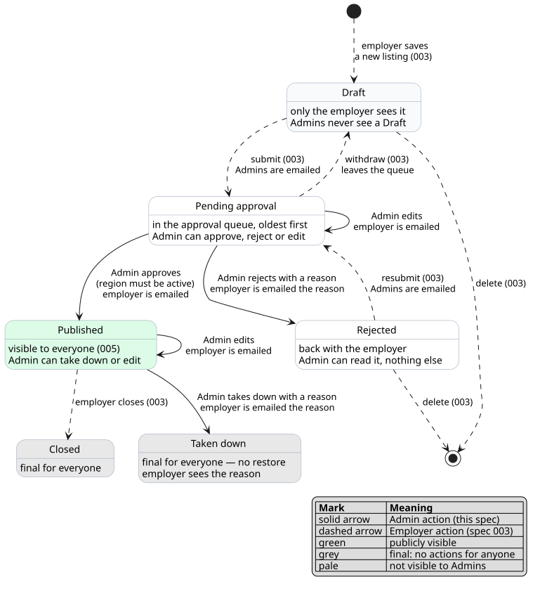
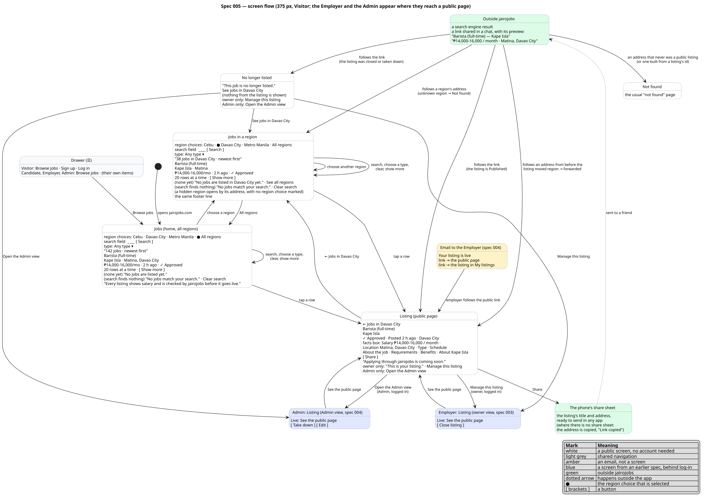
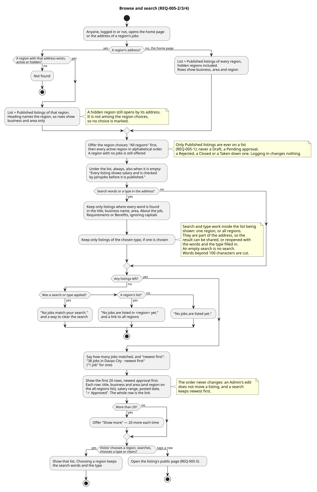
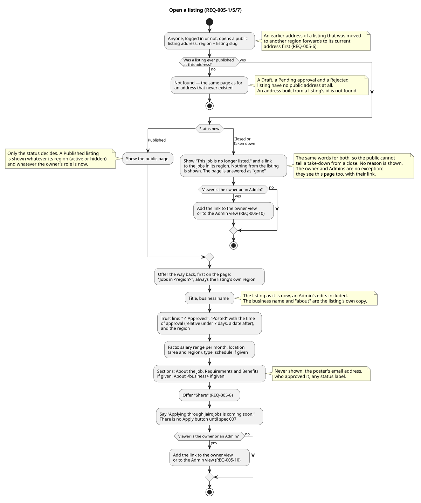
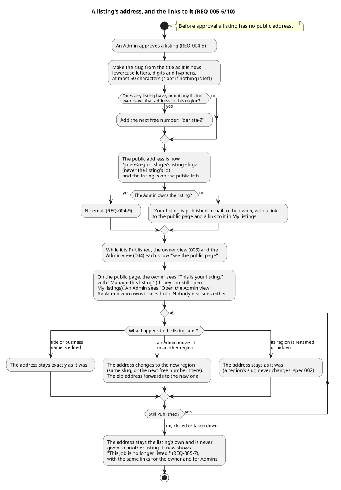
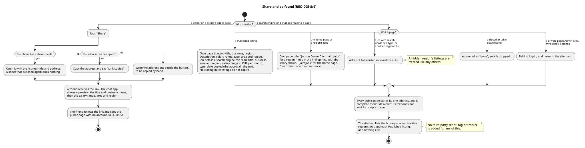

# 005 — Public browse and search

**Status:** In Progress
**Created:** 2026-11-20
**Approved:** 2026-11-23
**Owner:** Jairo
**Related ADRs:** 0004 (UUID v7 keys; slugs for public listing addresses)
**Depends on:** 000 (product overview), 001 (public pages need no account, navigation), 002 (regions and their slugs), 003 (what a listing contains, how it is displayed), 004 (approval, the "posted" time, hand-offs)

## Problem / Why

An Employer can post a listing and an Admin can approve it, and then nobody can see it. The
home page still says "Listings are coming soon", and a Published listing is visible only to its
owner and to Admins. The board has no public side, so it is not yet a job board.

This spec builds the public side: a list of jobs for all regions and for each region, a
search and a filter by type, a page for each listing, addresses that can be shared and that
keep working, and the basics that let search engines find the listings. It is the first
spec written for the **Visitor**: someone on a phone, with no account, who wants to see
what is open in their city and send a listing to a friend.

It also settles what earlier specs left to it: what the public sees of a listing in a
hidden region, how a listing's public address is made, and what happens to that address
when the listing is closed or taken down.

## Goals

- Anyone can see every Published listing, with its salary, without an account.
- A visitor can narrow the list to one region, to a type of work, and to words they type.
- Each listing has its own page that reads well on a phone and shows who is hiring, where,
  for how much, and when jairojobs approved it.
- Each listing has one readable address that can be shared and that keeps working when the
  title is corrected.
- A listing that is not Published is never shown to the public, whatever address is used.
- Search engines and chat apps get what they need to show a listing properly.
- The Employer and the Admin can get from a listing they manage to its public page, and
  back.
- Specs 006, 007 and 010 get a clear contract: where the apply action will sit, and what a
  public address is.

## Non-goals / Out of scope

- Applying to a listing, and the "Apply for this job" button — spec 007. Until then the
  listing page says applying is coming soon (REQ-005-5).
- Candidate profiles and CVs — spec 006.
- Email alerts for new jobs in a region — spec 010.
- A filter by salary, sorting other than newest first, and search that forgives typing
  mistakes or knows synonyms. Decision 8 records the salary filter as an option not taken.
- Remembering a visitor's region between visits, and guessing it from their location.
- Saved jobs, "report this listing", and a public page for each business — later ideas in
  spec 000. The business name on a listing is text, not a link.
- The lists updating by themselves while someone is looking at them. A list shows what was
  true when it was opened.
- Counting how often a listing is viewed, and any analytics (constitution §5).
- A picture in link previews. Previews are text; the site has no images.
- Changing the Listing lifecycle. No status and no transition is added or changed.
- Changing what an Employer or an Admin can do to a listing. They gain links only
  (REQ-005-10).

## Personas involved

- **Visitor** — the main persona; every public screen is written for them.
- **Candidate** — browses exactly as a Visitor does. Logging in changes the menu, not the
  lists.
- **Employer** — gains the public address of each Published listing, in the email and on the
  owner view.
- **Admin** — gains a link from a public listing page to its Admin view, and back.

## User stories

**US-005-1**
- As a Visitor,
- I want to see the jobs that are open, newest first, without creating an account,
- so that I can tell at a glance whether the site is worth my time.

**US-005-2**
- As a Visitor,
- I want to see only the jobs in my city,
- so that I am not shown work I cannot travel to.

**US-005-3**
- As a Visitor,
- I want to search by a word such as "barista" or the name of a business,
- so that I find the kind of work I am looking for.

**US-005-4**
- As a Visitor,
- I want to narrow the list to a type of work such as part-time,
- so that I only see jobs that fit my week.

**US-005-5**
- As a Visitor,
- I want to read a listing in full, with its salary, who is hiring, where, and when it was
  checked,
- so that I can decide whether it is worth applying for.

**US-005-6**
- As a Visitor,
- I want to send a listing to a friend or a relative,
- so that they can read it on their own phone without an account.

**US-005-7**
- As a Visitor following an old link,
- I want to be told plainly that the job is no longer listed,
- so that I do not waste time on it and can look at other jobs instead.

**US-005-8**
- As an Employer,
- I want the public address of my published listing,
- so that I can post it on my own page and send it to people I know.

**US-005-9**
- As an Employer,
- I want my listing to be found through a search engine,
- so that people who have never heard of jairojobs see it too.

**US-005-10**
- As an Admin,
- I want to get from a public listing page to its Admin view in one step,
- so that I can take down or fix something where I notice it.

**US-005-11**
- As the Operator,
- I want nothing that is unapproved, closed or taken down to be shown to the public,
- so that the approval rule holds on the pages everyone can see.

## Listing lifecycle

Unchanged. This spec adds no status and no transition, so it has no state diagram of its
own. The lifecycle is `state-listing` in spec 004:



*Source: `../004-listings-admin-moderation/diagrams/state-listing.puml`.*

What this spec adds is what the public sees in each status. REQ-005-1, REQ-005-6 and
REQ-005-7 must agree with this table and with that diagram.

| Status | On the public lists | At its public address |
|---|---|---|
| Draft | no | it has none |
| Pending approval | no | it has none |
| Rejected | no | it has none |
| Published | yes | the listing's public page |
| Closed | no | "This job is no longer listed." |
| Taken down | no | "This job is no longer listed." |

A listing gets its public address when it is approved, and approval happens at most once in
a listing's life (Closed and Taken down are final), so the first three rows never have one.

## Screen flow



| Story | Path through the screen flow |
|---|---|
| US-005-1 see what is open | start → Jobs (home, all regions) |
| US-005-2 only my city | Jobs (home) → choose a region → Jobs in a region |
| US-005-3 search by a word | Jobs (home) or Jobs in a region → type words → Search → the same screen, narrowed |
| US-005-4 narrow by type | Jobs (home) or Jobs in a region → choose a type → the same screen, narrowed |
| US-005-5 read a listing | Jobs → tap a row → Listing (public page) |
| US-005-6 send it to a friend | Listing (public page) → Share → the phone's share sheet → Outside jairojobs → the friend follows the link → Listing (public page) |
| US-005-7 an old link | Outside jairojobs → follows the link → No longer listed → See jobs in Davao City → Jobs in a region |
| US-005-8 my public address | Email to the Employer → public link → Listing (public page); or Employer: Listing (owner view) → See the public page |
| US-005-9 found by a search engine | Outside jairojobs (a search engine result) → Listing (public page) |
| US-005-10 Admin, one step | Listing (public page) → Open the Admin view → Admin: Listing (Admin view) |
| US-005-11 nothing else is public | Outside jairojobs → No longer listed, or Not found; the lists show Published listings only |

*Source: `diagrams/screenflow-browse.puml`.*

No wireframe is included. The two main screens are already drawn at 375 px in the design
guide's reference mock (`docs/design/mock-listing-375.html`): the jobs list and the listing
page. Where this spec differs from the mock, decisions 10 and 14 say so. The "No
longer listed" page is one sentence and one link.

## Flows (activity diagrams)

| Flow | Covers | Diagram |
|---|---|---|
| Browse and search | REQ-005-2, -3, -4 | [activity-browse-and-search](diagrams/activity-browse-and-search.svg) |
| Open a listing | REQ-005-1, -5, -7 | [activity-open-a-listing](diagrams/activity-open-a-listing.svg) |
| A listing's address, and the links to it | REQ-005-6, -10 | [activity-address-and-links](diagrams/activity-address-and-links.svg) |
| Share and be found | REQ-005-8, -9 | [activity-share-and-be-found](diagrams/activity-share-and-be-found.svg) |

### Browse and search


### Open a listing


### A listing's address, and the links to it


### Share and be found


*Sources: `diagrams/activity-*.puml`.*

## Requirements

### REQ-005-1: Only a Published listing is public

**Serves:** US-005-1, US-005-11

The public lists and the public listing page show Published listings and nothing else.
Only the status decides.

```gherkin
Scenario: A Published listing is public without an account
  Given a listing is Published
  And I am not logged in
  When I open the home page
  Then the listing is on the list
  And I can open its public page

Scenario: Other statuses are on no public list
  Given listings that are Draft, Pending approval, Rejected, Closed and Taken down
  When I open the home page, their region's jobs, or search for their titles
  Then none of them is listed

Scenario: A taken down listing leaves the lists
  Given a Published listing is on the home page
  When an Admin takes it down
  And I open the home page again
  Then it is not listed

Scenario: A hidden region does not hide a listing
  Given a listing is Published in region "Baguio"
  And "Baguio" is hidden
  When I open the home page
  Then the listing is on the list
  And I can open its public page

Scenario: The owner's role does not matter
  Given a listing is Published
  And its owner has since been demoted to Candidate
  When I open the home page
  Then the listing is on the list

Scenario: Logging in does not change the lists
  Given I am an Employer with one Published listing and one Draft
  When I open the home page
  Then I see my Published listing
  And I do not see my Draft
```

**Rules**
- The rule is applied where the listings are fetched, not only by the screens
  (constitution §2.7): there is one way to ask for "public listings", and it returns
  Published listings only.
- Public pages need no account (REQ-001-1). Visitors, Candidates, Employers and Admins see
  the same lists.
- Hiding a region changes what is *offered* (REQ-005-3), not what is public. An Admin who
  wants a listing in a hidden region gone takes it down or moves it (REQ-004-7,
  REQ-004-8); the Admin view already marks the region "hidden" (REQ-004-4).
- This is the test spec 004 asked for: a Taken down listing is not shown (REQ-004-7).

### REQ-005-2: The home page lists the jobs of every region

**Serves:** US-005-1

The home page is the list of all Published listings. It replaces the text "Listings are
coming soon".

```gherkin
Scenario: Newest first
  Given "Cashier" was approved 3 hours ago and "Barista" 20 minutes ago
  When I open the home page
  Then "Barista" is listed above "Cashier"

Scenario: What a row shows
  Given the listing "Barista (full-time)" by "Kape Isla" in area "Matina", region "Davao City", with a salary of 14000 to 16000, was approved 2 hours ago
  When I open the home page
  Then its row shows "Barista (full-time)", "Kape Isla", "Matina, Davao City", "₱14,000–16,000/mo", "2 h ago" and "✓ Approved"
  And the whole row opens the listing's public page

Scenario: How many jobs
  Given 3 listings are Published
  When I open the home page
  Then I see "3 jobs · newest first"

Scenario: Nothing listed yet
  Given no listing is Published
  When I open the home page
  Then I see "No jobs are listed yet."

Scenario: A long list is shown in parts
  Given 25 listings are Published
  When I open the home page
  Then I see the first 20
  And I can ask for more

Scenario: An edit does not move a listing
  Given "Cashier" was approved before "Barista"
  When an Admin edits "Cashier"
  And I open the home page
  Then "Barista" is still listed above "Cashier"

Scenario: The trust line is shown
  Given no listing is Published
  When I open the home page
  Then I see "Every listing shows salary and is checked by jairojobs before it is published."
```

**Rules**
- Order: time of approval, newest first. There is no other order.
- A row follows the design guide's "Listing row": title, then business and area, then
  salary, posted date and "✓ Approved". On this list the row also names the region, after
  the area: "Kape Isla · Matina, Davao City".
- The posted date is the time of approval (REQ-004-5), shown in `Asia/Manila`: relative
  under 7 days ("20 min ago", "2 h ago", "3 d ago"), a date after that. This is what the
  site's one time helper already gives on the Admin lists (constitution §4.6); the mock's
  "Yesterday" is not used.
- Salary in a row reads "₱14,000–16,000/mo", or "₱15,000/mo" when minimum and maximum are
  the same (REQ-003-4).
- The count reads "1 job" for one.
- The trust line sits under every public list, also when the list is empty (design guide,
  trust signals: "Footer line on public lists").
- "Browse jobs" in the menu leads here, as it does today.
- The region choices, the search field and the type choice of REQ-005-3 and REQ-005-4 are
  on this page too.

### REQ-005-3: Jobs in one region

**Serves:** US-005-2

Each region has its own list at its own address, `/jobs/<region slug>`.

```gherkin
Scenario: Choose a region
  Given 2 listings are Published in "Davao City" and 1 in "Cebu"
  When I choose "Davao City" on the home page
  Then I see only the 2 listings in Davao City
  And I see "2 jobs in Davao City · newest first"

Scenario: Rows do not repeat the region
  Given a listing by "Kape Isla" in area "Matina" is Published in "Davao City"
  When I open the jobs in Davao City
  Then its row shows "Kape Isla · Matina"

Scenario: The choices are the active regions
  Given regions "Cebu" and "Davao City" are active and "Baguio" is hidden
  When I look at the region choices
  Then they are "All regions", "Cebu" and "Davao City"
  And "Baguio" is not offered

Scenario: A region with no jobs
  Given the active region "Cebu" has no Published listing
  When I open the jobs in Cebu
  Then I see "No jobs are listed in Cebu yet."
  And I can go to all regions

Scenario: A hidden region still opens by its address
  Given a listing is Published in the hidden region "Baguio"
  When I open the address of the jobs in Baguio
  Then I see that listing under the heading for Baguio
  And no region choice is marked as chosen

Scenario: Unknown region
  Given no region has the slug "atlantis"
  When I open the address of the jobs in "atlantis"
  Then I get "not found"

Scenario: Back to all regions
  Given I am looking at the jobs in Davao City
  When I choose "All regions"
  Then I am on the home page
```

**Rules**
- The choices are "All regions" first, then the active regions in alphabetical order
  (REQ-002-6). "All regions" is first because it is the choice marked on the home page,
  and a row of choices wider than a phone would otherwise start with it off the screen.
  A region with no jobs is still offered.
- The region is named once, in the heading, so the rows do not repeat it (design guide,
  trust signals).
- A region's address uses its slug, which never changes (REQ-002-3), so a renamed region
  keeps its address.
- Everything else is as on the home page: order, rows, count, parts of 20, the trust line.
- `/jobs` with nothing after it is no page of its own: it forwards to the home page, which
  is the list of every region.

### REQ-005-4: Search and filter by type

**Serves:** US-005-3, US-005-4

Both lists can be narrowed by words and by type of work.

```gherkin
Scenario: Search by a word in the title
  Given "Barista (full-time)" and "Cashier" are Published
  When I search for "barista"
  Then I see "Barista (full-time)"
  And I do not see "Cashier"

Scenario: Search finds the business and the area
  Given a Published listing by "Kape Isla" in area "Matina"
  When I search for "kape", and then for "matina"
  Then I see that listing both times

Scenario: Search finds words in the listing's text
  Given a Published listing whose "About the job" says "experience with espresso machines"
  When I search for "espresso"
  Then I see that listing

Scenario: Every word must be found
  Given "Barista" in area "Matina" and "Barista" in area "Lanang" are Published
  When I search for "barista matina"
  Then I see only the one in Matina

Scenario: Capitals do not matter
  Given "Barista (full-time)" is Published
  When I search for "BARISTA"
  Then I see "Barista (full-time)"

Scenario: Filter by type
  Given a Full-time listing and a Part-time listing are Published
  When I choose the type "Part-time"
  Then I see only the Part-time listing

Scenario: Search and type together, inside a region
  Given I am looking at the jobs in Davao City
  When I search for "barista" and choose "Part-time"
  Then I see only Part-time listings in Davao City that match "barista"

Scenario: Nothing matches
  Given no Published listing contains "astronaut"
  When I search for "astronaut"
  Then I see "No jobs match your search."
  And I can clear the search

Scenario: Clear the search
  Given I searched for "barista" and chose "Part-time"
  When I clear the search
  Then I see the whole list again

Scenario: A search can be opened again by its address
  Given I searched the jobs in Davao City for "barista" and chose "Part-time"
  When I open that page's address again
  Then I see the same search, with the same words and type filled in

Scenario: Choosing a region keeps the search
  Given I searched all regions for "barista"
  When I choose "Cebu"
  Then I see the jobs in Cebu that match "barista"

Scenario: An empty search is no search
  Given 3 listings are Published
  When I search with nothing typed, or only spaces
  Then I see all 3
```

**Rules**
- A search looks in the title, the business name, the area, "About the job", Requirements
  and Benefits. A listing matches when every word typed is found in at least one of them.
- The types are those of REQ-003-4: Full-time, Part-time, Contract, Temporary, Internship,
  plus "Any type".
- Results keep the order of the list: newest first. There is no ordering by how well a
  listing matches.
- The count follows the search: "2 jobs in Davao City · newest first" counts what matched.
- Search words are at most 100 characters; anything longer is cut.
- Not promised: finding part of a word, forgiving a typing mistake, or knowing that two
  words mean the same.
- The search words and the type are part of the page's address. What was searched is not
  stored.
- How far a list is opened with "Show more" is part of the page's address too, up to 200
  rows, so the browser's back button returns to the list as it was. Past 200 rows "Show
  more" still works and the address stays. A new search, type or region starts again at
  the first 20.

### REQ-005-5: The listing's public page

**Serves:** US-005-5

A Published listing has a public page that shows everything a job seeker needs, laid out as
the design guide's "Listing detail".

```gherkin
Scenario: Read a listing without an account
  Given the Published listing "Barista (full-time)" by "Kape Isla" in area "Matina", region "Davao City", with a salary of 14000 to 16000
  And I am not logged in
  When I open its public page
  Then I see "Barista (full-time)" and "Kape Isla"
  And I see the salary "₱14,000–16,000 / month", the location "Matina, Davao City", the type and the schedule
  And I see "About the job", "Requirements", "Benefits" and "About Kape Isla"

Scenario: The trust line
  Given a listing was approved 2 hours ago in "Davao City"
  When I open its public page
  Then I see "✓ Approved", "Posted 2 h ago" and "Davao City"

Scenario: An older listing shows the date
  Given a listing was approved 10 days ago
  When I open its public page
  Then "Posted" is followed by the date it was approved

Scenario: Optional parts are left out
  Given a Published listing with no schedule, no requirements, no benefits and no "about the business"
  When I open its public page
  Then none of those parts is shown, not even as an empty heading

Scenario: The public sees the listing as it is now
  Given an Admin changed a Published listing's business name to "Kape Isla Café"
  When I open its public page
  Then I see "Kape Isla Café"

Scenario: What is never shown
  Given a Published listing
  When I open its public page as a Visitor
  Then I do not see the email address of the account that posted it
  And I do not see who approved it
  And I do not see a status label

Scenario: Applying is not possible yet
  Given a Published listing
  When I open its public page
  Then I see "Applying through jairojobs is coming soon."
  And there is no button to apply

Scenario: Back to the region's jobs
  Given a Published listing in "Davao City"
  When I open its public page
  Then I can go to the jobs in Davao City
```

**Rules**
- The fields, their labels and their display are those of REQ-003-4 and the owner view
  (REQ-003-10): salary as "₱14,000–16,000 / month", text with its line breaks kept, no
  formatting, links or HTML.
- The trust line is the part the owner view leaves out: "✓ Approved", "Posted" with the
  time of approval, and the region. The date follows the rule in REQ-005-2.
- The business name and "about" are the listing's own copy (REQ-003-2, REQ-004-8).
- The page has no accent action until spec 007 adds "Apply for this job" in the place of
  the "coming soon" line. "Share" (REQ-005-8) is not an accent button.
- The way back goes to the listing's region, whatever list the visitor came from.

### REQ-005-6: A listing's public address

**Serves:** US-005-6, US-005-8

A listing gets its public address when it is approved:
`/jobs/<region slug>/<listing slug>`. The listing slug is made from the title once and
does not change.

```gherkin
Scenario: The address is made at approval
  Given the listing "Barista (full-time)" is Pending approval in "Davao City"
  When an Admin approves it
  Then its public address ends in "/jobs/davao-city/barista-full-time"

Scenario: The same title in the same region gets a number
  Given a listing with the address "/jobs/davao-city/barista-full-time" exists
  When an Admin approves another "Barista (full-time)" in "Davao City"
  Then its public address ends in "/jobs/davao-city/barista-full-time-2"

Scenario: The same title in another region needs no number
  Given a listing with the address "/jobs/davao-city/barista-full-time" exists
  When an Admin approves "Barista (full-time)" in "Cebu"
  Then its public address ends in "/jobs/cebu/barista-full-time"

Scenario: A changed title keeps the address
  Given a Published listing at "/jobs/davao-city/barista-full-time"
  When an Admin changes its title to "Barista (full-time, weekends)"
  Then its public address is unchanged
  And the page shows the new title

Scenario: Unusual characters in a title
  Given the listing "Café Staff — ₱500/day!!" is Pending approval in "Cebu"
  When an Admin approves it
  Then its public address ends in "/jobs/cebu/cafe-staff-500-day"

Scenario: An unpublished listing has no public address
  Given a listing is Draft, Pending approval or Rejected
  When I look for its public address
  Then it has none

Scenario: The id is never a public address
  Given a Published listing in "Davao City"
  When I open "/jobs/davao-city/" followed by the listing's id
  Then I get "not found"

Scenario: Moving to another region forwards the old address
  Given a Published listing at "/jobs/davao-city/barista-full-time"
  When an Admin moves it to "Cebu"
  Then its public address ends in "/jobs/cebu/barista-full-time"
  And the old address forwards to the new one

Scenario: An address is never given to another listing
  Given the listing at "/jobs/davao-city/barista-full-time" was closed
  When an Admin approves a new "Barista (full-time)" in "Davao City"
  Then the new listing's address ends in "/jobs/davao-city/barista-full-time-2"

Scenario: An earlier address is not given to another listing either
  Given a Published listing was moved from "/jobs/davao-city/barista-full-time" to "Cebu"
  When an Admin approves a new "Barista (full-time)" in "Davao City"
  Then the new listing's address ends in "/jobs/davao-city/barista-full-time-2"
  And "/jobs/davao-city/barista-full-time" still forwards to the moved listing
```

**Rules**
- Slug: lowercase ASCII letters, digits and hyphens, made from the title as it is at the
  moment of approval, by the same rule as a region's slug (REQ-002-2). At most 60
  characters, cut at a word where possible. A title that leaves nothing usable gives "job".
- The slug is unique within its region. A clash gets the next free number: "-2", "-3".
  An address counts as taken if any listing has it or ever had it: a closed or taken down
  listing keeps its address, and so does the earlier address of a listing that was moved.
  A listing that is moved back to a region it was in before returns to the address it had
  there.
- The shape `/jobs/<region>/<listing>` is the one ADR-0004 gives as its example, and
  `/jobs/<region>` is the address the Admin's Regions screens have shown since spec 002.
- Set once. Neither an edit of the title or the business name nor a change to the region's
  name changes it.
- The address never contains the listing's id (constitution §4.8).
- When an Admin moves a Published listing to another region (REQ-004-8), the address
  follows the listing: same slug in the new region, or the next free number there. Every
  earlier address of the listing forwards to its current one.
- A listing keeps its address for good, also after it is closed or taken down
  (REQ-005-7).

### REQ-005-7: A listing that is no longer listed

**Serves:** US-005-7, US-005-11

The address of a listing that was Published and is now Closed or Taken down says so,
plainly, and shows nothing of the listing.

```gherkin
Scenario: A closed listing's address says so
  Given a listing was Published and its Employer closed it
  When I open its public address
  Then I see "This job is no longer listed."
  And I can go to the jobs in its region

Scenario: A taken down listing's address says the same
  Given a listing was Published and an Admin took it down with a reason
  When I open its public address
  Then I see "This job is no longer listed."
  And I do not see the reason

Scenario: Nothing of the listing is shown
  Given a listing was Published and is now Closed or Taken down
  When I open its public address
  Then I do not see its title, business name, salary or text

Scenario: The page is answered as gone
  Given a listing was Published and is now Closed or Taken down
  When a browser or a search engine asks for its public address
  Then the answer says the page is gone, not that it was never there

Scenario: The owner and Admins see the same page
  Given a listing was Published and is now Taken down
  When its owner or an Admin opens its public address
  Then they see "This job is no longer listed." and nothing of the listing

Scenario: An address that never was a listing
  Given no listing was ever published at "/jobs/davao-city/no-such-job"
  When I open it
  Then I get "not found"
```

**Rules**
- The words are the same for Closed and Taken down, so the public cannot tell which it
  was. No reason is ever shown here.
- The owner and Admins still read the listing on the owner view and the Admin view, which
  this page links to for them (REQ-005-10).
- "Gone" tells search engines to drop the page; "not found" is for an address that never
  was a listing.
- This holds whatever address is used, including an earlier address that forwards
  (REQ-005-6).

### REQ-005-8: Share a listing

**Serves:** US-005-6

A listing's page can be sent to someone else, and looks right when it arrives.

```gherkin
Scenario: The page offers Share
  Given a Published listing "Barista (full-time)"
  When I open its public page
  Then I see a "Share" button
  And it carries the listing's title and its full public address

Scenario: A shared link has a preview
  Given the Published listing "Barista (full-time)" by "Kape Isla" in area "Matina", region "Davao City", with a salary of 14000 to 16000
  When a chat app reads its public page to build a preview
  Then the preview's title is "Barista (full-time) — Kape Isla"
  And its text is "₱14,000–16,000 / month · Matina, Davao City"

Scenario: A shared link opens without an account
  Given a friend sent me the public address of a Published listing
  And I am not logged in
  When I open it
  Then I see the listing's public page
```

**Rules**
- "Share" opens the phone's own share sheet with the title and the address. Where there is
  no share sheet, it copies the address and says "Link copied". Where the address cannot
  be copied either (an old browser), it is written out beside the button, to be copied by
  hand. A share sheet that is closed again does nothing.
- There are no buttons for particular networks, and nothing is added to the address to
  track who shared it.
- The preview is text only. The salary is in it, because it is the first thing a job
  seeker asks.
- What "Share" does when tapped cannot be reached by the test suite, which has no browser
  tests (constitution §3.1). The scenario above tests what the button carries; the tap is
  checked by hand on a phone at close, and the result is written in `tasks.md`.

### REQ-005-9: Listings can be found through a search engine

**Serves:** US-005-9

The public pages tell search engines what they are, and the private ones stay out.

```gherkin
Scenario: A listing page has its own title and description
  Given the Published listing "Barista (full-time)" by "Kape Isla" in area "Matina", region "Davao City", Full-time, with a salary of 14000 to 16000
  When a search engine reads its public page
  Then the page title is "Barista (full-time) — Kape Isla, Davao City | jairojobs"
  And the description names the salary, the type, the area and the region

Scenario: A listing page carries job details a search engine can read
  Given a Published listing
  When a search engine reads its public page
  Then it finds, marked as a job posting, the title, the business name, the area and region, the salary range in PHP per month, the type, the date posted and the text

Scenario: A region's jobs have their own title
  Given the region "Davao City"
  When a search engine reads the jobs in Davao City
  Then the page title is "Jobs in Davao City | jairojobs"

Scenario: Search results ask not to be listed
  Given the jobs in Davao City, searched for "barista"
  When a search engine reads that page
  Then the page asks not to be listed in search results

Scenario: A hidden region's list asks not to be listed
  Given a listing is Published in the hidden region "Baguio"
  When a search engine reads the jobs in Baguio, and then that listing's public page
  Then the list asks not to be listed in search results
  And the listing's page does not

Scenario: The sitemap lists the public pages only
  Given a Published listing, a Closed listing and a Draft, an active region and a hidden region
  When a search engine reads the sitemap
  Then it lists the home page, the active region's jobs and the Published listing
  And it lists nothing else

Scenario: A page is complete as first delivered
  Given a Published listing
  When its public page is fetched without running any script
  Then the listing's title, salary and text are in what was delivered
```

**Rules**
- Every public page states its one address, so the same page reached with extra words in
  the address is not counted twice.
- The home page's title is "Jobs in the Philippines, with the salary shown | jairojobs".
  Descriptions of the lists are one plain sentence.
- The job details follow the format search engines publish for job postings. The date
  posted is the time of approval. No closing date is given, because listings do not expire
  (spec 000).
- A hidden region's list is not in the sitemap and asks not to be listed, for as long as
  the region is hidden. Its Published listings are treated like any others (REQ-005-1).
- Private pages (the Admin area, My listings, Settings) are behind log-in and never in the
  sitemap. A Closed or Taken down listing is answered as gone (REQ-005-7).
- No third-party script, tag or tracker is added for any of this (constitution §5).

### REQ-005-10: Links between a public page and the pages that manage it

**Serves:** US-005-8, US-005-10

The people who manage a listing can get from it to its public page and back. Nobody gains
an action; these are links.

```gherkin
Scenario: The approval email links to the public page
  Given an Employer's listing "Barista (full-time)" is Pending approval
  When an Admin approves it
  Then the Employer receives the "Your listing is published" email
  And it links to the listing's public page
  And it links to the listing in My listings

Scenario: The owner view links to the public page
  Given I am an Employer with a Published listing
  When I open it in My listings
  Then I see a link to its public page

Scenario: The Admin view links to the public page
  Given I am an Admin and a listing is Published
  When I open its Admin view
  Then I see a link to its public page

Scenario: Only a Published listing has the link
  Given listings that are Draft, Pending approval, Rejected, Closed and Taken down
  When their owner or an Admin opens each one
  Then none of them shows a link to a public page

Scenario: An Admin gets to the Admin view from the public page
  Given I am logged in as an Admin
  When I open a Published listing's public page
  Then I see a link to its Admin view

Scenario: The owner gets to their listing from the public page
  Given I am logged in as the Employer who owns a Published listing
  When I open its public page
  Then I see "This is your listing." and a link to it in My listings

Scenario: Nobody else sees those links
  Given a Published listing
  When a Visitor, a Candidate or another Employer opens its public page
  Then they see no link to an Admin view or to My listings

Scenario: The same links on a listing that is no longer listed
  Given a listing was Published and is now Closed or Taken down
  When its owner, or an Admin, opens its public address
  Then the owner sees a link to it in My listings
  And the Admin sees a link to its Admin view
```

**Rules**
- This amends REQ-004-9: the "Your listing is published" email gains the link to the public
  page, placed first, and keeps the link to My listings. The other three emails do not
  change.
- An Admin who owns the listing sees both links on the public page.
- The links to the Admin view and to My listings lead to pages that check who is asking,
  as before (REQ-004-1, REQ-003-14). Showing or hiding a link is a convenience, not the
  guard.
- An owner who can no longer open My listings (an Admin demoted to Candidate) is not shown
  the "This is your listing." link. What happens to such listings is still spec 008's to
  decide (spec 004, hand-offs).

## Non-functional requirements

- **Mobile-first:** every screen is usable at 375 px — one column, rows, buttons, region
  choices and fields ≥ 44 px. The design guide hopes for about six rows to a phone screen
  (principle 5). The lists do not reach that: the region choices, the search field and
  the type choice sit above the list, so about five rows show before scrolling on a large
  phone and under four on a small one. Accepted as built (decision 27).
- **Speed:** a list and a listing page are readable in under 2 seconds on a mid-range phone
  over 4G (spec 000, success criteria; design guide, principle 2). No web fonts, no
  images, no third-party scripts.
- **Design:** follows `docs/design.md` — the "Listing row" and "Listing detail" patterns,
  the trust signals, plain sentences for empty states. No public screen in this spec has an
  accent action; spec 007 brings the first one.
- **Authorization:** the rule "Published only" is applied in the domain layer
  (constitution §2.7). Tests prove that a listing in each other status is on no public
  list and has no public page (constitution §3.4).
- **Privacy:** a public page never shows an account's email address or an Admin's identity.
  Search words are not stored and are not written to logs (constitution §4.12).
- **Time:** times are shown in `Asia/Manila`, relative under 7 days and absolute after
  (design guide, trust signals).
- **Accessibility:** "✓ Approved" is written in words, not shown by colour or an icon
  alone. The region choice that is selected is marked for screen readers as well as by
  colour.

## Open questions

- None.

## Decisions (resolved 2026-11-20)

Questions 1–3 are the ones the hand-offs of specs 003 and 004 left to this spec; 4–14 came
up while drafting; 15–24 are smaller choices made while drafting or while checking the
draft, confirmed afterwards; 25 was found unanswered in that check. Question 2 was answered
by the owner before drafting. The owner went through all the others one at a time and chose
the proposed answer for each.

| # | Question | Decision |
|---|---|---|
| 1 | Does the public see a Published listing whose region is hidden? | Yes. Only the status decides. Hiding a region stops it being offered as a choice; its listings stay on the all-regions list, in search and at their own addresses, and the region's own address still opens. The same holds when the owner's role changes. An Admin who wants such a listing gone takes it down or moves it (REQ-005-1, REQ-005-3) |
| 2 | How is a listing's slug made, and what happens when the title changes? | Made from the title at approval and never changed, as a region's slug is; unique within its region; a clash gets a number (REQ-005-6) |
| 3 | On the all-regions list, does a row show the area as well as the region? | Both: "Kape Isla · Matina, Davao City". On a region's list the row shows the area only (REQ-005-2, REQ-005-3) |
| 4 | What is the shape of the addresses? | `/jobs/<region>` for a region and `/jobs/<region>/<listing>` for a listing; the home page is the all-regions list. Not `/<region>/<listing>`, which was named when question 2 was answered: a region called "Admin", "Users" or "My" would collide with addresses the site already uses. Found afterwards, on checking: this is also the shape ADR-0004 gives as its example, and the address the Admin's Regions screens already show (REQ-005-3, REQ-005-6) |
| 5 | What happens to the address when an Admin moves a Published listing to another region? | The address follows the listing to the new region, and every earlier address forwards to the current one. Known cost: the site must remember a listing's earlier addresses (REQ-005-6) |
| 6 | What does someone see at the address of a listing that is Closed or Taken down? | One page for both: "This job is no longer listed.", a link to the region's jobs, nothing of the listing, answered as "gone". The owner and Admins see the same page. An address that never was a listing is "not found" (REQ-005-7) |
| 7 | Is the home page the list of jobs? | Yes. It is the all-regions list and replaces "Listings are coming soon", with no headline above the list. "Browse jobs" keeps leading there (REQ-005-2) |
| 8 | Which filters are there? | Words, looked for in the title, business name, area and the three texts, and type of work. Both work inside the chosen region or across all. No salary filter for now (REQ-005-4) |
| 9 | In what order, and how many at a time? | Newest approval first, always, with no ordering by how well a listing matches. 20 rows, then "Show more" for 20 more. Whether the list remembers how far it was opened is left to the plan (REQ-005-2, REQ-005-4) |
| 10 | What does the listing page offer for applying, before spec 007 exists? | One plain line, "Applying through jairojobs is coming soon.", and no button. The page has no accent action until spec 007 adds "Apply for this job" there (REQ-005-5) |
| 11 | What does "SEO basics" cover? | Own title and description per page; job details in the format search engines read; a sitemap of public pages; narrowed lists ask not to be listed; a removed listing is answered as gone; pages are complete without scripts. Search engines are not told directly of each change (REQ-005-9) |
| 12 | Is there a Share button, or is a clean address enough? | A "Share" button on the listing page, using the phone's share sheet or copying the address, plus a text preview for chat apps. No buttons for particular apps. The tap is checked by hand at close (REQ-005-8) |
| 13 | Which links join a public page to the pages that manage it? | The two spec 004 asked for (the approval email, and an Admin's link to the Admin view), plus: the owner view and the Admin view of a Published listing link to the public page; the owner on their public page gets a link back; the same owner and Admin links on the "no longer listed" page (REQ-005-10) |
| 14 | The mock's listing page says "Member since Oct 2026" under the business. Is that shown? | No. The section shows the listing's "about the business" text only (REQ-005-5) |
| 15 | How long can a listing's slug be, and what does a title with nothing usable become? | At most 60 characters, cut at a word; an empty result becomes "job". Approval is never refused because of the address (REQ-005-6) |
| 16 | What is the limit on search words, and what does search not promise? | Cut at 100 characters. Whole words are promised; finding part of a word, forgiving a typing mistake and knowing synonyms are not (REQ-005-4) |
| 17 | Is a region with no jobs still offered as a choice? | Yes. The choices are the active regions, with or without jobs, and no counts beside them (REQ-005-3) |
| 18 | How are the messages worded? | As written: "No jobs are listed yet.", "No jobs are listed in Cebu yet.", "No jobs match your search.", "This job is no longer listed.", "Applying through jairojobs is coming soon.", "This is your listing.", "Link copied". The empty lists carry no invitation to post (REQ-005-2 to REQ-005-5, REQ-005-7, REQ-005-8, REQ-005-10) |
| 19 | How do the page titles and the link preview read? | As written in REQ-005-9 and REQ-005-8. The salary is in the description and the preview's second line, not in the title; "\| jairojobs" stays on every title |
| 20 | Where does the way back from a listing lead? | Always to the listing's region, "← Jobs in Davao City", not to the list the visitor came from. The browser's own back button returns to that list (REQ-005-5) |
| 21 | What do the owner and Admins see at the address of a listing that is no longer listed? | The same page as everyone, "This job is no longer listed.", plus their one link. They read the listing on the owner view or the Admin view (REQ-005-7, REQ-005-10) |
| 22 | Is the trust line shown under an empty list? | Yes, always: under every public list, with or without rows (REQ-005-2) |
| 23 | How do posted dates read? | As the site's one time helper writes them: "20 min ago", "2 h ago", "1 d ago", then a date after 7 days. Not the mock's "Yesterday" (REQ-005-2) |
| 24 | Can an address a listing once had be given to another listing? | Never. That covers a closed or taken down listing's address and every earlier address of a moved listing. A listing moved back to a region returns to the address it had there. Known cost: numbers only go up (REQ-005-6) |
| 25 | Does a hidden region's list ask search engines not to list it? | Yes. Its listings stay findable, each at its own address and in the sitemap; only the region's list asks not to be listed, until the region is shown again (REQ-005-9) |
| 26 | Where does "All regions" sit among the region choices? | First, before the regions (resolved 2026-11-26, after the lists were built). It was last, as the mock draws it. With four regions the row is wider than a phone, and on the home page the chosen choice started off the screen (REQ-005-3) |
| 27 | The spec asked for "about six rows to a phone screen". The lists as built show about five on a large phone and under four on a small one. What is done? | Left as built (resolved 2026-11-27, at the close). The number came from the mock, which has no search field or type choice; both must be 44 px tall to be tapped. The non-functional requirement says what is built. Ways to show more rows are kept as a product idea in `TODO.md`, for a later spec |

## Notes for the plan

Not requirements; reminders for whoever writes `plan.md`.

- **ADRs.** ADR-0006 says the shape of public addresses is an architecture choice that
  gets an ADR. ADR-0004 already gives `/jobs/davao-city/barista-cafe-x` as the shape, and
  this spec keeps it, so no new ADR is needed (confirmed by the owner, 2026-11-20). ADR-0004 expected "redirects on rename";
  with a slug that never changes, the only forwarding is after a move between regions.
- **Sequence diagram.** This spec adds no flow with three parties of its own. The approval
  email already has one, `sequence-decision-email` in spec 004, which changes with
  REQ-005-10.
- **The browser's back button.** The way back on a listing page goes to the region
  (decision 20), so a visitor who wants the list they came from uses the browser's back
  button. The plan should say what that restores: the search words, the type, and how far
  the list was opened with "Show more" (decision 9 left the last of these to the plan).
- **Listings that are already Published.** A listing approved before this spec is built has
  no slug. Each one needs an address when the spec ships (in the dev database: "Software
  Engineer").
- **Earlier documents this spec changes.** To be updated in the same commits as the
  behaviour, each with a changelog row (README, Feature lifecycle step 5), and walked again
  at close:

  | Document | Change |
  |---|---|
  | 000 feature map | the 005 row is linked and its status follows this spec |
  | 001 REQ-001-1 and `screenflow-auth` | the "Home / Browse jobs" and "Listing detail" boxes show what is built: region choices, search, rows; the detail has "Share" and the "coming soon" line, not "Apply for this job" |
  | 001 `activity-request-access` | check its list of public pages against the addresses here |
  | 002 REQ-002-4 | the rule "what happens to a hidden region's published listings on public pages is decided in spec 005" states the decision (decision 1) |
  | 002 `state-region` | "Hidden : not offered in pickers or public index" becomes: not offered as a choice; its Published listings stay public |
  | 002 `activity-seed-and-consume` | check the step for the consuming feature against REQ-005-3 |
  | 003 lifecycle table, `state-listing` | "everyone", "visible to everyone (005)" and "no longer public" on Closed and Taken down stay true; check the wording against REQ-005-1 and REQ-005-7 |
  | 003 REQ-003-9 and `activity-after-submitting` | "no longer visible to the public" / "No longer public (005)" now means the page in REQ-005-7 |
  | 003 REQ-003-10, `activity-my-listings`, `screenflow-posting`, `wireframe-posting` | the owner view of a Published listing gains "See the public page" |
  | 004 REQ-004-9, `activity-emails`, `sequence-decision-email`, `screenflow-moderation` | the "Your listing is published" email also links to the public page |
  | 004 REQ-004-4, `activity-find-and-review`, `screenflow-moderation` | the Admin view of a Published listing gains "See the public page" |
  | 004 REQ-004-3 and REQ-004-7 | "Until the public pages exist…" and "Until spec 005 there are no public pages" are no longer true and point here |
  | 004 REQ-004-5 and `activity-approve-or-reject` | approving also gives the listing its public address (REQ-005-6); the note "the approval time is the 'posted' date (005)" stays true |
  | 004 REQ-004-8 and `activity-take-down-and-edit` | moving a Published listing to another region changes its public address, and the old one forwards (REQ-005-6); the public address joins what an Admin edit cannot set directly; "No longer public (005)" after a take-down now means the page in REQ-005-7 |
  | 004 `state-listing` | check "Published" against REQ-005-1 and REQ-005-6: it gets its public address on approval |
  | `architecture/overview.md` | the `:current_user` row of the `live_session` table gains the two lists, and the listing's page and the sitemap are named as public pages outside it (plan, decision 1); the Listings row says the public pages are implemented |
  | `architecture/data-model.md`, ERD | the listing's slug, and whatever remembers earlier addresses; the Conventions line "a unique slug only" becomes: the region's slug plus a listing slug unique within the region; the ERD's planning comment for 005 goes |
  | `c4-context-system`, `c4-container-system` | a search engine and a chat app reading the public pages and the sitemap are new outside parties; the Visitor's "Browses, searches" becomes true |
  | `docs/design.md` and its mock | decisions 10 and 14 leave the mock showing two things the site does not have: the "Apply for this job" button until spec 007, and "Member since". A third difference came out of the check: the mock's rows say "Yesterday" where the site says "1 d ago". To be proposed to the owner at the plan stage as one note beside the mock, in its own commit with a changelog row |
  | the home page | the text "Listings are coming soon" goes; the page becomes the list (REQ-005-2) |
  | the Admin's Regions screens (spec 002) | no change needed: they already show `/jobs/<slug>`, which is now a real address. Whether it becomes a link is for the plan |

  Not in the table on purpose: `plan.md` and `tasks.md` of earlier specs. They record how
  each spec was built at the time (for example spec 004's plan describes the approval email
  with one link) and were not updated by spec 004 either.

## Review before approval

**Reviewed:** 2026-11-27 at commit `e38bab9`

The whole spec was reviewed on 2026-11-20 at commit `4f3a9f8`; the table below is that
review. Three things changed after approval (see the Changelog), and each time only the
changed part was read again:

- 2026-11-26, at commit `5a8dfbc`: one row of "Notes for the plan", against the approved
  plan and the requirements;
- 2026-11-26, at commit `ca32216`: the order of the region choices (decision 26):
  REQ-005-3's rule and its scenario "The choices are the active regions", against
  `screenflow-browse`, `activity-browse-and-search`, the other scenarios of REQ-005-3 and
  the built screen. They agree. No other scenario names an order for the choices;
- 2026-11-27, at commit `e38bab9`, at the close: three rules added (REQ-005-3, REQ-005-4,
  REQ-005-8) for what plan decisions 9, 15 and 19 built, and four diagrams brought in
  line with the built screens. All five diagrams were read against the screens, the
  phone check's pages and the requirements, scenario by scenario for the parts that
  changed. They agree. No scenario changed.

| Checked against | Result |
|---|---|
| This spec's diagrams, scenario by scenario | Agrees. All 74 scenarios and the rules were read against the five diagram sources, twice: once after drafting, once after the decisions and the change of wording. The first pass found one gap in a requirement (an earlier address could be reused; REQ-005-6), two places where the draft differed from what is built ("Yesterday"; the trust line under an empty list) and steps missing from every diagram. All fixed. The second pass found one missing detail (the order of the email's links), fixed |
| `architecture/overview.md` (contexts, boundaries, who gets in) | Agrees. No new context; Listings already depends on Regions and Accounts. The public pages join the `:current_user` session. The overview does not show them yet: listed in "Notes for the plan". *(Added 2026-11-26: the plan, decision 1, puts only the two lists in that session; the listing's page and the sitemap are plain pages beside it. No requirement depends on which.)* |
| `architecture/data-model.md` and the ERD | Agrees. Every field the search reads is a column; only Published, Closed and Taken down listings have `published_at`, which matches which statuses have an address; a Published listing always has a region. The slug and the record of earlier addresses are not in the ERD yet, by design. The line "a unique slug only" needs rewording: listed |
| C4 and use case diagrams | Agrees. A search engine and a chat app are new outside parties: listed. The use case diagram lacked the arrow from Admin to "Browse & search listings"; fixed in spec 000 on 2026-11-20 |
| ADRs and the constitution | Agrees. ADR-0004 gives the address shape; the owner confirmed no new ADR is needed. §4.8 (no id in public addresses), §2.3 (the Share script), §3.1 (no browser tests: the tap is checked by hand), §4.6 (one time helper), §5 (no analytics, no background jobs) are each met by a rule in this spec |
| Earlier specs this one changes ("Notes for the plan") | Every row was opened and checked against the document it names. Five rows were missing and were added (REQ-004-5, REQ-004-8 and their two diagrams, spec 003's `activity-my-listings`, the data-model line, the Admin's Regions screens) |
| Not checked | Specs 001 and 002 were read only where they concern public pages, navigation, hiding a region and slugs. Earlier specs' rendered images were not looked at, only their sources. The search of earlier documents was by word ("005", "public", "visitor", "browse"); a document that depends on this spec without those words would have been missed |

## Hand-offs to later specs

| Spec | Inherits |
|---|---|
| 006 | A Candidate browses exactly as a Visitor does. Nothing on the public pages depends on a profile. |
| 007 | "Apply for this job" takes the place of the "coming soon" line on the listing's public page, and is that page's one accent action. Only a Published listing can be applied to; the "no longer listed" page offers nothing to apply to. |
| 007 | A listing's public address is `/jobs/<region>/<listing>` and stays the listing's own for good, so an application or an email can point to it. |
| 008 | Views of public pages and searches are not counted or stored. If the dashboard needs them, spec 008 decides. |
| 008 | A Published listing stays public when its owner's role changes. Spec 008 still decides what happens to the listings of an Admin demoted to Candidate (spec 004, hand-offs). |
| 010 | A region's jobs are at `/jobs/<region>`, newest approval first; an alert for "new jobs in my region" can link there. |
| Later | "Report this listing" and a public page per business would both start from the listing's public page; the business name there is plain text today. |

## Traceability

| Story | Requirements |
|---|---|
| US-005-1 | REQ-005-1, REQ-005-2 |
| US-005-2 | REQ-005-3 |
| US-005-3 | REQ-005-4 |
| US-005-4 | REQ-005-4 |
| US-005-5 | REQ-005-5 |
| US-005-6 | REQ-005-6, REQ-005-8 |
| US-005-7 | REQ-005-7 |
| US-005-8 | REQ-005-6, REQ-005-10 |
| US-005-9 | REQ-005-9 |
| US-005-10 | REQ-005-10 |
| US-005-11 | REQ-005-1, REQ-005-7 |

## Changelog

| Date | Change |
|---|---|
| 2026-11-20 | Created (Draft) with a screen flow and four activity diagrams; the lifecycle is spec 004's, by reference. Fourteen open questions, each with a proposed answer written into the requirements; question 2 was answered by the owner before drafting |
| 2026-11-20 | Open questions resolved: the owner went through the thirteen still open, one at a time, and chose the proposed answer for each; no requirement or diagram changed. Still Draft |
| 2026-11-20 | Checked scenario by scenario against the five diagrams, and the table of earlier documents against each document. Requirements: REQ-005-6 says an address a listing ever had is never reused, with a scenario for a moved listing, and names ADR-0004; REQ-005-2 shows the trust line under an empty list too, and its dates follow the built time helper, not the mock's "Yesterday". Diagrams: all five brought in line (who is never on a list, the fixed order, the forwarding of earlier addresses, the links on a listing no longer listed, the email's second link, page titles). Table: rows added for REQ-004-5, REQ-004-8 and their two diagrams, spec 003's `activity-my-listings`, the data-model convention line and the Admin's Regions screens |
| 2026-11-20 | Wording (owner's decision, docs/design.md changelog): one word per status. "Published" is the only word for that status, on screens too, so the note explaining "Published" and "Live" is gone and "Live" is no longer used; the email is "Your listing is published". This spec also writes "Pending approval" and "Rejected" for those statuses, not the screen labels "Waiting for approval" and "Needs changes". Two scenarios in REQ-005-10 renamed ("The approval email links to the public page", "Only a Published listing has the link"); four diagrams changed to match. No requirement changed meaning |
| 2026-11-20 | Smaller choices settled: the owner went through all eleven one at a time and chose the proposed answer for each; they are decisions 15–25 and the "Smaller choices" section is gone. Three additions came with them: REQ-005-9 says a hidden region's list asks search engines not to list it, with a scenario (decision 25); REQ-005-6 says a listing moved back to a region returns to the address it had there (decision 24); a note for the plan on what the browser's back button restores (decision 20). `activity-share-and-be-found` and `activity-address-and-links` updated. Still Draft |
| 2026-11-20 | Checked again against its five diagrams, and against the architecture overview, the data model, the ERD, the C4 diagrams and the use case diagram. No contradiction found. The owner confirmed that no new ADR is needed (ADR-0004 has the address shape). The table of earlier documents names what the use case diagram and the C4 diagrams need; `activity-address-and-links` says the public link comes first in the email |
| 2026-11-20 | The use case diagram's missing arrow (Admin to "Browse & search listings") was fixed in spec 000 at the owner's request, so its row left the table of earlier documents |
| 2026-11-20 | "Review before approval" section added, under the new rule (constitution §6, README): what was checked, what was found, what was not, and the commit reviewed. `mix jairojobs.spec_review 005` passes |
| 2026-11-23 | Approved by the owner, after a summary of every change since the first draft. `mix jairojobs.spec_review 005` passed on the approved text |
| 2026-11-26 | "Notes for the plan" brought in line with the approved plan (its decision 1): in the table of earlier documents, the row for `architecture/overview.md` says the two lists join the `:current_user` session and the listing's page and the sitemap are public pages outside it. It said "the public pages" join it. A sentence in "Review before approval" notes the same. No requirement, scenario or diagram changed |
| 2026-11-26 | Amended after approval, on the owner's decision (decision 26): "All regions" is the first of the region choices, not the last. Seen once the lists were built: with four regions the row of choices is wider than a phone, and on the home page the chosen choice was off the screen. REQ-005-3's rule and its scenario "The choices are the active regions" changed; `screenflow-browse` and `activity-browse-and-search` changed with them. The design guide's mock still draws "All regions" last |
| 2026-11-27 | At the close, after every diagram was read again against the built screens. Three things the plan decided and the app does are now written in the requirements, each as a rule, with no scenario changed: how far a list is opened is part of its address, up to 200 rows (REQ-005-4; plan decision 9); `/jobs` alone forwards to the home page (REQ-005-3; plan decision 15); where "Share" can neither open a share sheet nor copy, it writes the address out (REQ-005-8; plan decision 19). Diagrams brought in line with the screens: `activity-share-and-be-found` (the third outcome of Share), `activity-browse-and-search` (the address keeps how far the list is opened), `activity-open-a-listing` (the way back is first on the page, as built), `screenflow-browse` (a region's heading, "Clear search" whenever words or a type are set, the third outcome of Share, `/jobs`). `activity-address-and-links` agreed and did not change |
| 2026-11-27 | Amended at the close, on the owner's decision (decision 27): the non-functional requirement "Mobile-first" no longer asks for about six rows to a phone screen on the lists. It says what is built (about five on a large phone, under four on a small one) and why. No requirement, scenario or diagram changed. The idea of showing more rows is in `TODO.md` |
